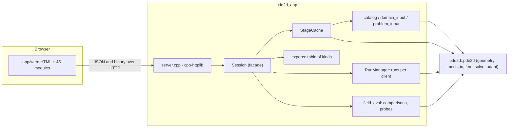

# The app

How the graphical interface in `app/` is built, as it is now. How to use
it is in [app/README.md](../app/README.md); why it is like this, decision
by decision, is in [app-decisions.md](app-decisions.md).

**The app's design is delegated** (the owner, 2026-11-14). Agents make
the app's decisions themselves and record them in
[app-decisions.md](app-decisions.md). The library's rules still hold: the
app must not change the library's design, and anything the app needs from
the library is a library change, raised with the owner
([library-requests.md](library-requests.md)).

## At a glance

- **One program**, `pde2d_app`: a local HTTP server (cpp-httplib) that
  serves the page (`app/web`, plain ES modules, no build step) and a JSON
  API, and a command line that runs a saved case (`--run`, `--set`,
  `--sweep`).
- **A case** is one JSON object (geometry, mesh, problem, assembly,
  solve, view, notes), read strictly, versioned with migrations, described
  by a generated JSON Schema (`GET /api/case-schema`).
- **The library decides everything**: the page and the app forward its
  messages with the path of the field; components and their options come
  from the catalog (`GET /api/catalog`).
- **Stages are cached** by the text of the sections they read; **runs**
  belong to a page (client), go in chunks sized by their measured cost,
  and are kept within a byte budget.
- **Two locks**: the session mutex for library work (SymEngine is one
  thread), a short run lock for bookkeeping, so progress, Stop, values,
  probes and `GET /api/status` never wait for a chunk or a mesh.
- **A geometry editor on the picture**: a drawing source (loops of exact
  curves the page edits at pointer speed), and a split tool that splits
  any region where it is clicked, the fraction computed on the server
  from the exact curves (exact at corners).
- **Results in double on the server** (comparisons, probes, per-snapshot
  min and max); float32 only for pictures. Exports carry their provenance
  (versions, git commit, the case's SHA-256).

## Contents

[Shape](#shape) · [Files](#files) · [The case](#the-case) ·
[Clients](#clients) · [The API](#the-api) ·
[Binary answers](#binary-answers) · [Comparisons](#comparisons) ·
[Probes](#probes) · [Exports](#exports) · [The catalog](#the-catalog) ·
[Adding a component](#adding-a-component) · [The drawing](#the-drawing) ·
[The geometry editor](#the-geometry-editor) ·
[The stage cache](#the-stage-cache) · [Runs](#runs) · [Locks](#locks) ·
[Memory](#memory) · [The page](#the-page) · [Presets](#presets) ·
[Security](#security) · [The command line](#the-command-line)

## Shape



- **One program, `pde2d_app`**, serves the page and an API (on 127.0.0.1
  by default), and runs a saved case without the browser (`--run`).
- **The page holds no physics.** It edits a *case* (JSON), sends it to the
  server and draws what comes back. Every check is the library's own: the
  app forwards the library's messages with the path of the field they
  concern. Numbers the user reads as results (errors against an exact
  solution, u(t) at probes) are computed on the server in double.
- **The page is generated from a catalog.** The server describes every
  component and its options (`GET /api/catalog`); the forms are built from
  that, so a new library component needs one catalog entry in C++ and no
  change to the page.
- **The library stays as it is.** The app uses only public headers,
  through the umbrella target `pde2d::pde2d`, which links every module.

## Files

| Path | Contents |
| --- | --- |
| `app/src/options.*` | `OptionSpec` (an option as the page sees it), `OptionReader` (reads a JSON object strictly against the specs), small JSON readers, `named_option` (the option a library message names), `request_job` / `request_count`, `error_json` |
| `app/src/app_error.hpp` | `PathError` (input refused at a path), `StageError` (a stage failed: stage, kind, message, path), `staged`, `at_path` |
| `app/src/catalog.hpp`, `mesh_catalog.cpp`, `solve_catalog.cpp`, `catalog_parts.hpp` | the mesh and solve catalogs (the solve catalog also holds the adaptive modes' estimators and markings, and the assembler's settings; their refiners are the mesh catalog's): every component, its options with the library's defaults, a function that builds it; `build_mesh_setup`, `build_solve_setup` (the inactive mode's part checked, not built: `check_component`); the sections' key lists |
| `app/src/case_format.*` | the case's format, version and keys, `case_migrations` (`migrate_vN_to_vN+1`, none yet), `migrate_case`, `check_case`, `CaseInput` (a checked, migrated case) |
| `app/src/case_schema.*` | `case_schema()`: the JSON Schema generated from the catalogs and the readers' key lists |
| `app/src/domain_input.*` | the `geometry` section: shapes, SVG, mesh files, drawings (`drawing.*`), region edits (`split_mesh_region_at_node` for a mesh file); the geometry view; `DomainFacts` |
| `app/src/drawing.*` | the drawing source: `build_drawing` (errors at `geometry.loops[i].edges[j]`), `drawing_error_path` (the library's loop and curve indices as a path), `drawing_section` (a `CurveGeometry` as a drawing, curve for curve) |
| `app/src/locate.*` | `locate_boundary`: the boundary point nearest to a point, snapped to corners, with `split_region`'s fraction (or a mesh file's node) and whether the library splits there |
| `app/src/problem_input.*` | the `problem` section: `build_problem`, `check_problem` (every error at once, with paths), the problem catalog and templates |
| `app/src/presets.*` | problem presets: a complete problem and its solve settings for any geometry, scaled by `DomainFacts` |
| `app/src/stage_cache.*` | `StageCache`: the last domain, mesh (with its id), `MeshedProblem` and assembly, keyed by the case sections; `assembly_settings`, `solve_key` |
| `app/src/runs.*` | `SessionOptions`, `RunState`, `Run` (a solve: static, adaptive, or a time run in chunks; its `published` part under the run lock), `RunSnapshots`, `ChunkCost`, `fit_chunk_cost`, `plan_chunk`, `MetricRule` and `combine_report`, `run_bytes`, `adaptive_run_bytes`, `adaptive_time_run_bytes`, `make_run`, `start_run` (an adaptive run: `solve_adaptive`, `publish_adaptive`; in time `solve_adaptive_time`, `publish_adaptive_time`), `advance`, `progress_json`, `RunManager` (each client's run and reference run, bounded by count and bytes; runs that are gone and why) |
| `app/src/field_eval.*` | expressions at the nodes, `lumped_weights`, `difference_stats`, `Comparison` (against an exact solution or the reference run), `PointLocator` (a grid over the mesh), `probe_series` |
| `app/src/exports.*` | `ExportedFile` (content, a stream, or an archive's members), `ExportKind`, `ExportNeeds`, the table of export kinds with their writers, provenance, `case_hash` |
| `app/src/zip.*`, `sha256.*`, `build_info.hpp` | a stored zip writer with CRC-32 (Zip64 past 4 GiB), SHA-256, the build's git commit (written at build time by `app/cmake/build_info.cmake`) |
| `app/src/case_set.*`, `sweep.*` | `--set PATH=VALUE`: `set_case_value`, `set_value`, `apply_set_argument`; `--sweep`: `parse_sweep_argument`, `run_sweep`, `sweep_table`, `sweep_csv` |
| `app/src/views.*` | reports, mesh stats, sparsity as JSON; the mesh summary and its binary arrays |
| `app/src/binary.hpp` | little-endian float32, float64 and uint32 |
| `app/src/session.*` | `Session`: the facade the server and `--run` use (stages, runs, comparisons, probes, status, exports, `run`), the two locks and `Work` (a call under the session mutex, with what it does), the table of field kinds, the default case |
| `app/src/server.*`, `app/src/main.cpp` | HTTP (the only file that includes `httplib.h`: routes, client ids, token, Origin, the queue bound for calls that wait for the session) and the command line |
| `app/web/` | `index.html`, `css/` (one dark theme, every colour a token: `tokens.css` tokens and base, `panels.css` controls, step heads, forms, results, toast, settings, `picture.css` viewer, time bar, legend, overlays, charts, `layout.css` top bar, columns, tabs, narrow screens; loaded in that order), `js/`: `pure/` (no DOM, tested in Node: `format.js` numbers, decimal parsing, chart, colour-bar and log ticks, CSV, byte sizes; `color.js` OKLab ramps, field scales, the locked range, the colour maps; `display.js` what the picture shows (`resolveDisplay`); `requests.js` retries, backoff, plain error texts, the server's busy text; `study.js` refinement levels and observed orders; `mesh_math.js` angles, point location, interpolation, isolines, \|∇u\| per triangle, line sampling, the binary mesh; `case_model.js` normalization, region edits, the conditions that follow a drawing's region changes, visible coefficients, `isLine`; `playback.js` the playback clock and the run's pace; `drawing.js` the drawing's curves, hit testing, snapping, the split point, the drawing edits; `stages.js` the stage registry, keys, error paths; `run_values.js` the snapshot window; `prefs.js` settings, folds, probe slots, the picture's height; `tickets.js` request tickets; `history.js` undo steps), `api.js` (every call, the client id kept per tab and its claim, the token header, requests that wait), `state.js` (the store, `editCase`, tickets, undo, invalid entries, the picture's state per tab), `actions.js` (stages, the coalesced requests of the problem check and the geometry, runs and their progress with retries, reattaching after a reload, presets, exports), `display.js` (the store gathered for `resolveDisplay`), `snapshots.js`, `settings.js`, `case_menu.js`, `server_status.js`, `refinement.js` (the refinement study), `geometry_editor.js` (the tools bar, the split tool, the drawing editor: the viewer's overlay), `region_popover.js` (a region's actions on the picture), `dom.js` (forms from specs, `numberInput`, error marks, warning chips, info toggles, foldable sections), `view/` (`viewer.js` the picture's state and layer order, the overlay drawn over the kept frame, `layers.js` the drawing, `legend.js` the legend, its range lock and the saved picture, `interaction.js` pointer, pinch, wheel, keys, the readout, `tokens.js`), `timebar.js`, `probes.js` (probes, u(t), the line profile), `charts.js` (the SVG line chart: keyboard readout, CSV, log–log), `compare.js` (comparisons with an exact solution and the reference run), `panels/*.js` (one per step), `main.js` |
| `app/examples/` | example cases (each runs as `app_run_*`) and an example SVG |
| `app/tests/` | `browser/` (the page in headless Chrome: `run.sh`, `harness.html`, `scenarios/*.js`), `session.cpp`, `drawing.cpp` (drawings, their errors' paths, the exact conversion of every shape and example, the locator, a mesh file's split at a node), `solve.cpp` (the Solve step, with exact solutions), `runs.cpp` (runs in chunks, every preset), `compare.cpp` (comparisons in double, reference runs, probes, clients, the binary mesh), `exports.cpp` (exports never compute, provenance, VTK, the series zip, CRC-32 and SHA-256, error paths, `--set`, `--sweep`), `server.cpp` (HTTP, token, Origin, 429, status, clients), `example_checks.json` and `example_check.cpp` (each example's expected figures, `app_check_*`), `app_support.hpp` (the mesh decoded as the page decodes it), `web.test.mjs`, `web_actions.test.mjs` |
| `app/third_party/cpp-httplib/` | `httplib.h` 0.18.3 and its MIT license |

## The case

A case is the whole setup in one JSON object. Every section is read
strictly: a key the reader does not know is an error (a misspelt option
must not be ignored silently), and a missing value means its default.

```json
{
  "format": "pde2d-app-case",
  "version": 1,
  "notes": "free text",
  "geometry": {"source": "shape", "shape": "rectangle",
               "options": {"width": 2, "height": 1}, "region_edits": []},
  "mesh": {
    "spec": {"max_edge_length": {"absolute": null, "relative": 0.05}},
    "discretizer": {"type": "chord_length", "options": {}},
    "triangulator": {"type": "cdt", "options": {}},
    "refiner": {"type": "ruppert", "options": {"min_angle_degrees": 25}},
    "improvers": [{"type": "delaunay_flips", "options": {"use": "final_only"}}]
  },
  "problem": {
    "equation": {"text": "u_t - div(k*grad(u)) = 1"},
    "parameters": {"k": 0.1},
    "boundary_conditions": {"left": {"text": "u = 0", "priority": 0},
                            "right": {"alpha": "1", "beta_n": "1", "g": "0"}},
    "initial": {"u": "0"}
  },
  "assembly": {"t": 0, "max_time_order": 2},
  "solve": {
    "mode": "time",
    "linear_solver": {"type": "sparse_lu", "options": {}},
    "assembler": {"threads": 1},
    "static": {"t": 0},
    "time": {"t0": 0, "t1": 1, "snapshots": 50,
             "method": {"type": "implicit_euler", "options": {}},
             "step": {"type": "fixed_step", "options": {"dt": 0.01}}},
    "adaptive": {"t": 0, "tolerance": {"absolute": null, "relative": 0.1},
                 "max_cycles": 10, "max_nodes": 50000,
                 "estimator": {"type": "residual_estimator", "options": {}},
                 "marking": {"type": "dorfler", "options": {"theta": 0.5}},
                 "refiner": {"type": "newest_vertex_bisection", "options": {}}},
    "adaptive_time": {"every": {"interval": null, "steps": 10},
                      "tolerance": {"absolute": null, "relative": null},
                      "max_nodes": 20000, "max_refinements": 20,
                      "damping_steps": 0,
                      "estimator": {"type": "residual_estimator", "options": {}},
                      "marking": {"type": "dorfler", "options": {"theta": 0.5}},
                      "refiner": {"type": "newest_vertex_bisection", "options": {}},
                      "damping_method": {"type": "implicit_euler", "options": {}}}
  },
  "view": {"exact_solution": "x"}
}
```

- `geometry.source` is `shape` (`shape`, `options`), `svg` (`svg`: the
  document's text, `name`), `mesh_file` (`format`: `gmsh` or `pde2d`,
  `text`, `name`) or `drawing` (`loops`; see "The drawing"). SVG's y axis
  points down; the library flips it, so the SVG point (x, y) is (x, −y) in
  the case. Shapes and SVGs take `region_edits`: `{"op": "rename",
  "from", "to"}`, `{"op": "merge", "source", "target"}`, `{"op":
  "split", "region", "fraction", "first", "second"}`, applied in order
  with `CurveGeometry`'s methods. A mesh file takes `rename`, `merge` and
  `{"op": "split_at_node", "region", "node", "first", "second"}` (not
  `split`: it has no curves); the app applies them to the imported
  `mesh::Mesh` (a renamed region keeps its tag; a merge moves the
  source's boundary edges to the target's tag and drops the source's
  name, renumbering the tags above it; a split at a node: the region's
  boundary edges must form one chain, domain on the left, which starts
  at the edge no other edge of the region leads into, or for a whole
  closed loop at its first edge in the mesh's order; the edges from the
  start to the node keep the tag, named `first`, the rest get a new last
  tag named `second`; each new name is the old one or a new one) and
  checks the result with `mesh::validate`. A drawing has no region
  edits: its edges carry their regions.
- A mesh file is not meshed again: the `Remesher` runs the refiner and
  the improvers on it (the discretizer and triangulator are not used).
- `mesh.refiner` may be `null` (no refiner). A length bound is
  `{"absolute": number or null, "relative": number or null}`.
- The equation and each condition are either one line, `{"text": ...}`
  (read by the library's `fem::parse_equation` and `fem::parse_condition`:
  `u_t - div(k*grad(u)) = 1`, `-∇·(k∇u) + (1, 0)·∇u = f`, `k*u_n + h*u =
  h*u_out`), or their coefficients (expression texts; an empty or missing
  one is not set). A line and a coefficient together are an error at the
  object; an empty line is an error at its `text`. New cases, the
  examples, the templates and the presets use lines; cases with
  coefficients are read as they are (no version change). `priority` is a
  whole number, beside a line or the coefficients.
- `assembly.max_time_order` (0, 1 or 2) is `Assembler::assemble`'s: which
  time terms are built.
- `solve.mode` is `static` (`StaticSolver` at `static.t`), `time`
  (`Integrator` from `t0` to `t1` with `method` and `step`) or `adaptive`
  (`AdaptiveStaticSolver` at `adaptive.t` with one `MeshRefinement` of
  `estimator`, `marking` and a `Remesher` of `refiner`, toward the target
  `tolerance`, `max_cycles`, `max_nodes`; see "Adaptive runs"). The
  linear solver serves all three. `tolerance` is the option kind
  `tolerance`: `{"absolute", "relative"}` like a length bound, the
  relative part times the first cycle's estimate (`ErrorTolerance`); both
  null is no tolerance. The adaptive refiners are the mesh catalog's; a
  missing `estimator`, `marking` or `refiner` is the catalog's default
  (residual, Dörfler, newest vertex bisection), and a case without an
  `adaptive` part gets the default one (the page adds it without a
  notice). `adaptive_time` (`AdaptiveIntegrator` from `time.t0` to
  `time.t1` with the `time` part's method, step and snapshots, and one
  `MeshRefinement` of the `adaptive_time` part's `estimator`, `marking`
  and `refiner`) reads both parts; its target is `every` (the option kind
  `schedule`: `{"interval": number or null, "steps": integer or null}`,
  at least one), `tolerance` (relative to the estimate at the first
  adaptation time; both null: refine every time), `max_nodes` and
  `max_refinements` (both required in the case, though the library
  allows leaving them out: they bound the run's memory), and
  `damping_steps` with `damping_method` (built only when the steps are
  above 0); see "Adaptive runs". `assembler` (may be missing: one
  thread) holds `fem::AssemblerOptions`: `threads`, passed to the static
  solver, the integrator and both adaptive loops (the Assemble step
  assembles in one thread); every linear solver with a `threads` option
  offers it. Only the chosen mode's part is read into the
  library's objects; the other is kept as written, but checked for
  unknown keys and value types with their paths (`solve.time.snapshots:
  expected a whole number`, an unknown method type); a value only the
  library would refuse (dt = 0) is allowed there. A time run keeps the
  solution at `snapshots` + 1 equal times from t0 to t1 (at most 1000
  snapshots). A case written before the solvers has `"solve": null`, which
  means the default section (a static solve).
- `view` and `notes` are free for the page and for people. The page keeps
  `view.exact_solution` (the comparison's expression; `--run` compares
  with it too), `view.region_edit_undo` (one undo record per region edit)
  and `view.condition_archive` (conditions of regions that are gone)
  there.
- `version` is checked: a whole number from 1 to the app's version
  (`case_version`, 1); a case without one is taken as current. A case
  from a newer app is refused with a message naming both versions, not
  misread. An older case is migrated when it is read (`CaseInput`): the
  chain `case_migrations()` holds one `migrate_vN_to_vN+1` per version
  (none yet); each step sets `version` to N + 1, and the keys are checked
  after the migration. A current case is not copied.
- **The schema.** `GET /api/case-schema` is a JSON Schema (draft 2020-12)
  generated from the catalogs (every component with its options, their
  kinds, choices, labels and defaults; options carry `x-pde2d-kind`), the
  shape catalog, the problem catalog's coefficients and each reader's key
  list (`case_keys`, `shape_section_keys`, `mesh_section_keys`,
  `problem_section_keys`, `assembly_section_keys`, `solve_section_keys`,
  ...). A key in a list that the generator does not describe is an error,
  so a reader cannot gain a key the schema lacks. It describes structure
  and types, not ranges (the library's): a case that validates may still
  be refused, with the library's message.

## Clients

Every tab has a random client id (`api.js`, `clientId`), kept in the
tab's `sessionStorage`, and sends it on every request in
`X-PDE2D-Client` (letters, digits, `-`, `_`, at most 64). A reload of the
tab is the same client and finds its run again (`POST
/api/solve/current`). A duplicated tab copies `sessionStorage`: on load,
a page with a kept id asks the other tabs on a `BroadcastChannel`
whether one uses it (150 ms, while the catalog loads) and takes a new id
if so. Runs, reference runs and their progress belong to the client: two
tabs do not replace each other's run, and one tab cannot read or stop
another's. A request without the header is the client `local` (the
command line, tests, `curl`).

The session keeps at most `SessionOptions::max_clients` (8) clients; a
solve by a new client drops the one used least recently, with its runs
(a running one stops). Only a solve makes a client; asking for an unknown
client's run is an error (`expired`), not a new client. Runs are also
bounded in bytes (see "Memory").

The stage cache (domain, mesh, problem, assembly) is shared by all
clients: it is keyed by the case's text, so a client gets the same answer
whoever built it; two clients that alternate between different meshes
rebuild them in turn.

## The API

All on `127.0.0.1:8765` by default. Every POST body is JSON and must be
sent as `application/json`. Stage calls take a case (the page sends only
the sections the stage reads: `requestCase`); run calls take `{"job",
...}`.

| Call | Body | Gives |
| --- | --- | --- |
| `GET /api/catalog` | | the catalog (below) and the default case |
| `GET /api/default-case` | | the case a new session starts with |
| `GET /api/examples`, `GET /api/examples/<name>.json` | | the example cases (name and notes), and each case |
| `GET /api/case-schema` | | the case's JSON Schema (`application/schema+json`; see "The case") |
| `GET /api/status` | | what the session is busy with, never waiting for it: `busy` (`{"task", "client", "yours", "job", "since", "seconds"}` or `null`; tasks: `geometry`, `mesh`, `mesh arrays`, `problem check`, `assembly`, `field`, `solve` (making or starting a run), `run` (a chunk), `comparison`, `reference`, `preset`, `export`), `waiting` (requests being served or waiting for the session), `running` (runs), `clients`, `memory` (`budget`, `used`, `room`: what a new run of this client may keep) |
| `POST /api/geometry` | case | loops (each curve sampled for drawing, with its region and kind), regions and lengths, bounding box, domain size; for a mesh file its boundary edges |
| `POST /api/geometry/locate` | `{"case", "point": [x, y], "snap"}` | the boundary point nearest to `point` and how to split its region there (see "The geometry editor"): curves `{"kind": "curves", "region", "loop", "curve", "t", "point", "corner", "fraction", "splittable", "reason", "distance"}`; a mesh file `{"kind": "mesh_file", "region", "node", "point", "corner", "splittable", "reason", "distance"}` |
| `POST /api/geometry/drawing` | case | `{"geometry": drawing}`: the case's curves after its region edits as a drawing section, curve for curve (refused for a mesh file) |
| `POST /api/mesh` | case | `mesh`: the mesh's summary (`id`, counts `nodes`, `triangles`, `boundary_edges`, `region_names`, `has_links`, and `arrays`: where its arrays are, see "Binary answers"); `stats`, `target_met`, `longest_edge`, `max_edge_length`, `domain_size`, every stage's `reports`, `memory` (`snapshot_bytes`: what a run on this mesh keeps per snapshot, about `snapshot_bytes` × (snapshots + 1) in all; `budget`) |
| `POST /api/mesh/arrays` | `{"mesh": id}` | the mesh's arrays in binary. The session keeps the last 16 meshes it built and the meshes of every kept run (all of an adaptive run in time's) |
| `POST /api/problem` | case | the check: `ok`, `errors` (`path`, `message`), `facts` per coefficient path (also for a line; none for a text that did not parse), each condition's kind, `forms` (per equation and condition that was read without an error in any of its fields: `line` whether it was given as a line, `text` the line as written or printed from the coefficients by `fem::equation_text`/`condition_text` (null, with `reason`, when the library cannot print it), `coefficients` the non-zero ones as written or read from the line), time order, needed initial conditions |
| `POST /api/assemble` | case | the `MeshedProblem` report and Dirichlet nodes; the assembled operators' facts and sizes, a sparsity picture, the assembly report |
| `POST /api/field` | `{"case", "field"}` | values at the nodes (`null` where there is none) of `{"kind": "expression", "text"}`, `initial_u`, `initial_u_t`, `dirichlet` or `right_hand_side`, at `t` (default: `assembly.t`) |
| `POST /api/solve` | case | starts the client's solve of the case, or finds its current one with the same inputs (see "Runs"), and answers its progress (below) |
| `POST /api/solve/progress` | `{"job"}` | the same progress, now (never waits for a chunk) |
| `POST /api/solve/current` | case | `{"run": progress}`: the client's current run when its inputs (geometry, mesh, problem and solve sections) are the case's, else `{"run": null}`; never starts or continues a run, never makes a client, the run lock only (a reloaded page finds its run with it) |
| `POST /api/solve/stop` | `{"job"}` | stops the run after the chunk that is running (at once: it does not wait for it); its progress. A solve of the same inputs continues it |
| `POST /api/solve/values` | `{"job", "first", "count"}` | snapshots `first` to `first + count` (ready ones only) in binary (never waits for a chunk); a run on several meshes sends each with its own node count (`values.snapshot_nodes`) |
| `POST /api/solve/indicators` | `{"job"}` | a done adaptive run's error indicators of its last cycle, float32, one per triangle of its mesh (the run lock only); another run: 409 `not_ready` |
| `POST /api/solve/reference` | `{"job"}` | keeps the client's run (it must be done) as its reference run: `{"reference": {"job", "mode", "times", "mesh_id"}}`. It stays when the run is replaced |
| `POST /api/solve/reference/clear` | `{}` | forgets the reference: `{"reference": null}` |
| `POST /api/solve/compare` | `{"job", "exact": text}` or `{"job", "reference": true}` | the comparison in double (see "Comparisons") |
| `POST /api/solve/compare/difference` | the same and `"snapshot": k` | u − other at snapshot k in binary (float32) |
| `POST /api/solve/probes` | `{"job", "points": [[x, y], ...]}` | u(t) at each point (at most 64) over the run's ready snapshots (see "Probes"; never waits for a chunk) |
| `POST /api/preset` | `{"case", "preset"}` | the case with its `problem` and `solve` sections replaced by the preset for the case's geometry (see "Presets") |
| `POST /api/export/<kind>` | case | a file (see "Exports"); `X-PDE2D-Case-Name` (URL-encoded) names the case in its provenance |

**The progress of a run** (`/api/solve`, `/progress`, `/stop`): `job`
(the run's id), `state` (`running`, `done`, `failed`, `stopped`), `mode`
(`static`, `time`, `adaptive` or `adaptive_time`), `mesh_id`, `times` of the snapshots ready, `min` and
`max` over their values (exact doubles, `null` before any value),
`snapshot_min` and `snapshot_max` (per ready snapshot, its smallest and
largest finite value in double, `null` for a snapshot without one),
`time_order` (assembly's, `Assembler::time_order`), `problem_time_order`
(as written), `free_unknowns`, `reports` (`static_solver`'s, or one
`integrator` report combining the chunks', with `chunks`), `values`:
`{"path": "/api/solve/values", "format": "float32le", "snapshots"
(ready), "nodes", "bytes"}`, and `memory`: `{"bytes"` (what the run keeps
when done, its share of the budget), `"budget"}`. A time run adds `t0`,
`t1`, `t` (reached) and `snapshots_total`; a failed one `error`. A static
solve is `done` at once, and so is an adaptive one, which adds
`start_mesh_id` (the Mesh step's mesh it started from; `mesh_id` is its
last mesh) and `adaptive`: `stop_reason` (`tolerance_met`, `max_cycles`,
`node_budget`, `nothing_changed`), `tolerance` (resolved, or `null`),
`cycles` (`{"cycle", "nodes", "triangles", "estimate", "max_indicator",
"marked"` (`null` on the last), `"residual", "seconds"}`), `mesh_stats`
of the last mesh, `mesh` (its summary, as `/api/mesh` gives it: the
arrays come from `/api/mesh/arrays`) and `indicators` (their count, or
`null`). Its `reports` are the `adaptive_static_solver` report, then the
last cycle's. An adaptive run in time is also `done` at once (one library
call) and has the time run's `t0`, `t1`, `t` and `snapshots_total`,
`start_mesh_id`, and `adaptive_time`: `adaptations` (`{"time", "steps",
"estimate", "outcome"` (`refined`, `tolerance_met`, `nothing_changed`,
`node_budget`), `"nodes"` (of the mesh the solution was on), `"marked",
"nodes_after", "mesh"` (the index of the mesh it goes on with)`}`),
`snapshot_mesh` (per snapshot, the index of its mesh in `meshes`),
`meshes` (each mesh's summary, as `/api/mesh` gives it, with its id; the
first is the starting mesh, the last the run's `mesh_id`),
`refinements`, `pieces`, `steps`, `damping_steps`, `tolerance`,
`messages` (the adaptive integrator's: why it stopped adapting) and
`mesh_stats` of the last mesh. Its `reports` are the
`adaptive_integrator` report, then the last piece's `integrator` report.
Its snapshots are on different meshes, so `values` adds `snapshot_nodes`
(each snapshot's node count; `nodes` is then the largest, `bytes` the
sum).

**Errors** are `{"error": {"stage", "kind", "message", "path"}}`.
`message` is readable on its own; when the error concerns a field it
starts with that field's path (`mesh.refiner.options.min_angle_degrees:
...`), and `path` holds the same path as a field (`null` when the error
names none, as most of the library's own algorithm messages). The page
marks the field `path` names (or its nearest ancestor that has a form
element); only an error without `path` falls back to the path at the
start of its text. Where the paths come from:

- The JSON readers (`require_*`, `OptionReader`) throw `PathError` at the
  value they read.
- A component's constructor (mesh and solve components) and a shape's
  function refuse their options with the library's message; when it names
  one of the options as a word (`RuppertOptions::min_angle_degrees must
  be ...`, `fixed_step: dt must be ...`, `Rectangle width must be ...`),
  the path is that option's (`named_option`), else the options object's.
- An SVG or mesh text the library refuses is at `geometry.svg` or
  `geometry.text`; a region edit at `geometry.region_edits[i]` (or its
  `.op`); a drawing's JSON at its place (`geometry.loops[1].vertices[2]`,
  `geometry.loops[0].edges[3].kind`), the library's refusal of its curves
  at the loop and edge the message names (`Loop 1, curve 3: ...` is
  `geometry.loops[1].edges[3]`; for two loops that cross, the curve of
  the later loop it names; `geometry.loops[i]` when it names only a
  loop); a coefficient at `problem.equation.a_xx` and so on, a line at
  `problem.equation.text` (also when compiling one of the coefficients
  it means fails, an unknown name); the mesh
  spec at `mesh.spec.max_edge_length...`; `--set` at the path it was
  given; a comparison's expression at `exact`; a probe point at
  `points[i]`; the adaptive loop in time's refusal of a setting at
  `solve.adaptive_time.every.steps` and so on (a schedule with nothing
  set at `solve.adaptive_time.every`, a damping method that does not fit
  at `solve.adaptive_time.damping_method`); a thread count the
  assembler refuses at `solve.assembler.threads`; the adaptive loop's refusal of a target setting
  (`adaptive_static_solver: max_cycles must be at least 1`, a starting
  mesh above `max_nodes`) at `solve.adaptive.max_cycles` and so on.

| Status | When | `kind` |
| --- | --- | --- |
| 400 | the body is not JSON | `input` |
| 403 | the Host is not this machine (loopback server), the token is missing or wrong, or the Origin is another site | `input` |
| 409 | a result that is not ready: a solution export before the client's run of the case is done, a reference that is not done | `not_ready` |
| 409 | a run a newer solve of the same client replaced ("the run 3 was replaced by a newer solve of this page") | `replaced` |
| 410 | a run that is gone: dropped for the memory budget or the client limit (the message says which), a reference run dropped for the budget, or a run this server never had (it was restarted: "this server has no run 3 (it was restarted, or the run was dropped long ago); solve again"), also for an unknown client | `expired` |
| 413 | a body over 64 MiB | |
| 415 | a POST that is not `application/json` | `input` |
| 422 | the library refused the input (`std::invalid_argument`) or an algorithm could not finish (`std::runtime_error`) | `input`, `algorithm` |
| 422 | a run that does not fit the memory budget even after dropping other clients' finished runs; the message gives its size, the room and what to change; `path` is `solve.time.snapshots` for a run in time | `memory` |
| 429 | more than `ServerOptions::max_waiting` (6) API requests are already being served or waiting for the session (progress, stop, values, probes, status and current never count and are never refused) | `busy` |
| 500 | anything else | `internal` |

## Binary answers

All little-endian, as `application/octet-stream`.

- **Solution values** (`/api/solve/values`): float32, snapshot after
  snapshot, one value per mesh node (in node order); for a run on
  several meshes each snapshot has its own mesh's count
  (`values.snapshot_nodes`, split by `splitCounted`).
- **Differences** (`/api/solve/compare/difference`): float32, one per
  node.
- **Mesh arrays** (`/api/mesh/arrays`): the parts listed in the summary's
  `arrays.parts` (`name`, `type`, `count`, `offset` in bytes), one after
  the other: `nodes` (float64 x0, y0, x1, y1, ...), `triangles` (uint32
  a0, b0, c0, ...; counterclockwise), `boundary_edges` (uint32 a0, b0, a1,
  b1, ...; the domain on the left) and `boundary_regions` (uint32, the
  region tag of each boundary edge, an index into `region_names`).
  `arrays.bytes` is the total. The page decodes them into a
  `Float64Array` of nodes, a `Uint32Array` of triangles and a
  `Uint32Array` of boundary edges as `[a, b, region, ...]` (`pure/mesh_math.js`,
  `decodeMesh`).

## Comparisons

`POST /api/solve/compare` compares the run `job` with an exact solution
(`"exact"`: an expression in x, y, t and the run's parameters, compiled
by the library's `CompiledExpression` under the session mutex and
evaluated at every node at each snapshot's time) or with the client's
reference run (`"reference": true`). The answer, all in double:

```json
{"job": 3, "against": {"exact": "x + t"}, "nodes": 564,
 "snapshots": [{"t": 0, "max_abs": 1e-16, "rms": 4e-17, "l2": 3e-17}, ...],
 "max_abs": 2e-15, "max_rms": 9e-16, "max_l2": 6e-16}
```

- `max_abs` is max over nodes of |u − other|; `rms` is the nodal root
  mean square sqrt(Σ d²/N); `l2` is the lumped L2 norm sqrt(Σ w_i d_i²)
  with w_i a third of the area of the triangles around node i (the L2
  norm of the P1 function d with nodal quadrature). A node where a value
  is not finite makes the snapshot's figures `null`. `max_*` are the
  largest over the snapshots (`null` when none could be compared).
- **A reference run** must be on the same mesh object as the run (node i
  is the same point in both): solving after a change of the geometry or
  mesh sections gives another mesh, and the comparison is refused with a
  message saying so. Each run snapshot is compared with the reference's
  snapshot at the same time (up to rounding); a static reference (one
  snapshot) stands for every time; a snapshot without a match is `null`.
- The figures cover the snapshots ready when the call is made.
- **An adaptive run** against an exact solution also gives `cycles`:
  `{"cycle", "nodes", "max_abs", "rms", "l2"}` for every cycle's solution
  on its own mesh (the last is the snapshot). A reference comparison of
  two adaptive runs is refused like any other on two meshes.
- **An adaptive run in time** compares each snapshot on its own mesh
  (the exact values at its nodes, its own lumped weights); `nodes` is the
  last mesh's. A reference comparison with or of such a run is refused
  (its snapshots are on several meshes).

## Probes

`POST /api/solve/probes` gives, for each point, `x`, `y`, `inside`,
`triangle` and `values` (u at the point at every ready snapshot, in
double, `null` where not finite; empty outside the mesh), and `times`.
The point's triangle is found with a uniform grid over the mesh's
bounding box (about one triangle per cell, at most 1024 cells a side;
each cell lists the triangles whose boxes overlap it) and barycentric
coordinates in double; on an edge the triangle with the largest smallest
weight wins, and a point outside every triangle by more than 1e−10 in
barycentric terms is outside. u is the P1 interpolant there. For an
adaptive run in time each snapshot is interpolated on its own mesh (a
grid per mesh); `inside` says whether any snapshot's mesh holds the
point, `triangle` is the last mesh's (or `null`), and a snapshot whose
mesh misses the point (near a curved boundary that was refined) is
`null`.

## Exports

`POST /api/export/<kind>` with the case. One table (`exports.cpp`,
`export_kinds`) lists each kind with its file name, content type, what it
needs and its writer:

| Kind | Needs | Contents |
| --- | --- | --- |
| `mesh.pde2d` | the mesh | the old `.pde2d` format, exactly (no provenance: the format has no place for it) |
| `mesh.svg` | the mesh | an SVG picture of the mesh |
| `geometry.svg` | the domain | the curve geometry as SVG (refused for an imported mesh) |
| `stiffness.mtx`, `damping.mtx`, `mass.mtx` | the assembly at `assembly.t` | the free part of A, B or M2 in Matrix Market `coordinate real general`, 1-based; a zero operator has no entries |
| `rhs.mtx` | the assembly | b in Matrix Market `array` form |
| `solution.csv` | a done run on one mesh | x, y and u at every kept time (`u(t=...)` columns), one row per node, full doubles; refused (409) for a run on several meshes (adaptive in time) |
| `solution.vtk` | a done run on one mesh | VTK legacy ASCII `UNSTRUCTURED_GRID`: the nodes (z = 0), the triangles (`VTK_TRIANGLE`), and one `POINT_DATA` scalar array per kept snapshot, named `u(t=...)`; ParaView and VisIt open it; refused like the CSV for a run on several meshes |
| `solution-mesh.pde2d` | a done run | the mesh the run's solution is on in `.pde2d` (an adaptive run's last mesh, in time too; the Mesh step's for the others), so it opens as a mesh file; `--output` writes it for both adaptive modes |
| `solution-vtk.zip` | a done run | a time series for ParaView, as a stored (uncompressed) zip: `solution_0000.vtk`, `solution_0001.vtk`, ... (each its snapshot's mesh and one array `u`; ParaView follows a mesh that changes), `solution.vtk.series` (ParaView's JSON manifest: `{"file-series-version": "1.0", "files": [{"name", "time"}, ...]}`; ParaView opens it and plays the snapshots at their times) and `solution-vtk.provenance.json` (as `provenance.json`). `--output` writes these files into the directory instead of the zip |
| `provenance.json` | the case | `{"format": "pde2d-app-provenance", "version": 1, "app" (`name`, `version`, `commit`, `dirty`), "library", "case_name", "case_sha256", "exported", "file", "case" (the full case as sent), "run"}`: the run is the client's done run of the case with its progress (reports included, without the values layout) and `started`, or `null` |

- **Solution exports never compute.** They take the client's current run
  when its inputs (the geometry, mesh, problem and solve sections, as
  text) are the case's and it is done; with no such run, or one that is
  running, stopped or failed, they answer 409 with a message. Mesh and
  system exports use the stage cache (built when missing).
- **Large files stream.** `solution.csv` and `solution.vtk` are written
  piece by piece as they are sent (`ExportedFile::stream`, an httplib
  chunked content provider). The stream holds only the mesh and the
  values (no expressions), so it runs after the session mutex is
  released; a done run's values do not change.
- **Provenance.** Every file but `.pde2d` says what produced it: the app
  and library versions (both the CMake project version, `PDE2D_VERSION`),
  the app's build (`commit`: the git commit of the tree it was built
  from, and `dirty`: whether that tree had uncommitted changes to tracked
  files; recorded at every build by `app/cmake/build_info.cmake`, rewritten
  only when it changes, `"unknown"`/`null` outside git, never failing the
  build), the case's content hash (`case_sha256`: SHA-256 of the case's
  canonical JSON, keys sorted and no spaces, so the order of keys does not
  change it), the case's file name when known, the export time (UTC), the
  run (id, state, start time) for solution exports, and `settings`: the case
  sections the kind is built from (geometry with an SVG or mesh text
  replaced by its length; plus mesh; plus problem and assembly for the
  system; plus solve for a solution) as one line of JSON. As comments:
  `%` lines after the `%%MatrixMarket` banner, `#` lines at the top of the
  CSV (read it with `pandas.read_csv(path, comment="#")`, `numpy.loadtxt`
  (`#` is its default comment), R's `read.csv(comment.char = "#")`;
  spreadsheets show them as rows), an XML comment after the SVG's
  declaration. VTK legacy has no comments: its title line (the second,
  at most 255 characters) names the app with its commit, the library, the
  run, the first 16 digits of the case's hash, the time and the case (in
  the series, also the snapshot's t); `provenance.json` has everything.

## The catalog

`GET /api/catalog` returns:

- `sections`: one per pipeline the page builds forms for. The mesh
  section has `settings` (the `MeshSpec` fields) and `slots`; a slot has
  an `id` (its key in the case), a `cardinality` (`one`, `optional` or
  `list`) and its `components`, each with `type`, `label`, `description`
  and `options`. An option has `name`, `label`, `description`, `kind`
  (`number`, `integer`, `choice`, `length_bound`, `tolerance`,
  `schedule`), `default`, and
  `choices` or `unit` where they apply. The solve section has the
  step controllers `fixed_step` and `adaptive_step` (the library's
  `AdaptiveStep`: initial_dt, atol, rtol, the change limits and the
  keep-dt band, min_dt, and `max_dt`, an optional number: empty is no
  bound; an option may be `optional`, read with
  `OptionReader::optional_number`), the
  `linear_solver` slot (sparse LU, simplicial LDLᵀ, conjugate gradient,
  BiCGSTAB, supernodal Cholesky, multifrontal LU; every `threads` option
  is the library's), `assembler` (settings: `threads`) and `modes`
  (`static`, `time`, `adaptive`, `adaptive_time`), each
  with its `settings` and `slots` (`method` and `step` for `time`;
  `estimator`, `marking` and `refiner` for `adaptive`, the refiners being
  the mesh section's; the same and `damping_method` for
  `adaptive_time`, whose `with: ["time"]` says that the `time` mode's
  settings and slots apply too and are shown first). Components of
  the solve section carry `traits`, read from the library's declarations
  of a default-built instance: a linear solver's `symmetric_matrix`
  requirement, a time method's supported `time_orders`.
- `shapes`: the ready-made shapes with their options.
- `problem`: the coefficients of the equation, of a condition and of the
  initial conditions in order, with the term each multiplies; help text
  (`line_help`, `condition_line_note`, `expression_help`); templates of
  common equations and conditions (as lines); `presets` (`id`, `label`,
  `description`).
- `format`, `version`, `library_version`, `default_case`.

## Adding a component

1. Add one entry to `make_mesh_catalog()` in `app/src/mesh_catalog.cpp`
   or `make_solve_catalog()` in `app/src/solve_catalog.cpp`: its `type`
   (the component's `name()`), label, description, its options with
   defaults read from the library's options struct, and `make`, which
   builds the component from an `OptionReader`.
2. That is all for the page and the case schema. `tests/session.cpp` and
   `tests/solve.cpp` check that every type equals `name()` and that the
   schema's options are the catalog's; add its defaults to the defaults
   test.

Ranges are never checked in the app: the component's constructor
validates its options, and its message is shown at the field.

## The drawing

`geometry.source` `drawing` is a geometry the page edits (`drawing.hpp`,
`pure/drawing.js`):

```json
{"source": "drawing",
 "loops": [{"vertices": [[0, 0], [3, 0], [3, 1], [0, 1]],
            "edges": [{"kind": "line", "region": "base"},
                      {"kind": "arc", "region": "tip", "center": [3, 0.5],
                       "radius_x": 0.5, "radius_y": 0.5, "rotation": 0,
                       "start_angle": -1.5707963267948966,
                       "sweep_angle": 3.141592653589793},
                      {"kind": "cubic", "region": "top",
                       "control1": [2, 1.4], "control2": [1, 0.6]},
                      {"kind": "line", "region": "root"}]},
           {"vertices": [[1.7, 0.5]],
            "edges": [{"kind": "arc", "region": "hole", "center": [1.5, 0.5],
                       "radius_x": 0.2, "radius_y": 0.2, "rotation": 0,
                       "start_angle": 0, "sweep_angle": 6.283185307179586}]}]}
```

- **Shared vertices.** Edge i of a loop runs from vertex i to vertex
  i + 1 (the last to vertex 0): a loop has one edge per vertex, and
  moving a vertex moves both of its edges. Kinds: `line`, `quadratic`
  (`control`), `cubic` (`control1`, `control2`), which take their ends
  from the vertices, and `arc`, kept exactly in the library's centre form
  (`geometry::EllipticalArc`: `center`, `radius_x`, `radius_y`,
  `rotation` (0 when missing), `start_angle`, `sweep_angle`, radians). An
  arc's ends must lie on its vertices, within 1e-9 of the drawing's size
  (the library's closure tolerance): the app checks it, since nothing
  else would notice a vertex between two arcs that is not where they
  meet (`geometry.loops[1].edges[0]: the arc starts at (1.8, 0.5), not
  at its vertex 0 (1.7, 0.5)`). A full circle or ellipse is a loop of one
  vertex and one arc of sweep 2π.
- **The library decides the rest**: `CurveGeometry` validates the loops,
  decides holes by containment and normalizes the direction (a loop may
  be drawn either way). Its errors are mapped to the drawing's paths
  (see "Errors"); the page draws the edge or loop they name red and
  dashed and keeps the edit.
- **Regions** are the edges' `region`; a drawing has no `region_edits`.
  Renames, merges and splits change the edges (and the conditions follow,
  as for region edits: `applyDrawingChange`).
- **Exact conversion.** `POST /api/geometry/drawing` (`drawing_section`)
  writes a curve geometry (a shape or an SVG, after its region edits) as
  a drawing of its normalized loops, curve for curve: vertex i is the
  exact end point of the line or Bézier next to it, or an arc's own start
  between two arcs. Read back, every curve is bit for bit the same
  (`app_drawing` checks every shape of the catalog, an edited shape,
  every example and the example SVG): numbers are written in the
  shortest form that reads back as the same double. (Two lines or
  Béziers that meet at slightly different points, as an SVG's paths may
  within its join tolerance, would share one vertex: the drawing moves
  one end by at most that tolerance. None of the examples does.)
- `--set` and `--sweep` reach every number of a drawing
  (`--set "geometry.loops[0].vertices[3][1]=1.2"`). A circle's radius is
  `radius_x`, `radius_y` and its vertex together: a sweep of one of them
  makes an ellipse, or an arc whose end is no longer at its vertex
  (refused with the path).
- `app/examples/cooling_fin.json` is a drawn domain.

## The geometry editor

The editor is on the picture while the Geometry step is open
(`geometry_editor.js`). A tools bar at the picture's top left: **Select**
(V), **Split** (S) and, for a drawing, **Rectangle** (R), **Circle** (C),
**Polygon** (P) and the grid (G). It is the viewer's *overlay*: the
viewer draws the mesh, fields and layers once and keeps the frame; the
overlay is drawn over that frame (`redrawOverlay`, at most once per
animation frame, a timer standing in where frames do not run), so a
pointer move redraws only the drawing, its handles or the split marker,
never the mesh or a field, and no panel DOM is rebuilt.

**Splitting a region** (every source with a boundary). With the split
tool, a marker follows the pointer along the boundary, computed in the
page: on the drawing's exact curves (nearest point, refined like the
server's), or on the server's sampled curves of a shape or an SVG, or on
a mesh file's boundary edges (its nearest node). It snaps to a curve's
end (a corner, also every region's end) within 12 px. A click splits
the region there and names the parts `region` and `region_2` (the next
free name), offered at once in a card on the picture for renaming (the
second name selected; Enter applies).

- **Shapes, SVGs, mesh files**: the page sends the marker's point to
  `POST /api/geometry/locate` (snap: 12 px in world units). The server
  finds the nearest point of the exact curves (64 samples per curve,
  golden-section search, then Newton's method on (c(t) − p)·c′(t)), snaps
  to a corner within `snap`, and computes `split_region`'s fraction as
  the library will measure it: the region's run of curves in the
  normalized loop (from the curve whose predecessor is another region,
  or the loop's first curve for a whole loop), lengths summed curve by
  curve in the library's order, the partial length `curve_length(curve,
  t)`. At a corner the fraction is the sum of whole curves, which the
  library's junction tolerance (1e-9 of the region's length) takes as
  exactly that corner: no curve is cut (`app_drawing`: a hexagon's
  vertex, a corner of two merged sides). Whether the split works is
  asked of the library by splitting a copy; its message is `reason`
  (a region end, a region in several pieces). The page then adds the
  region edit `split` (or `split_at_node` with the node for a mesh file)
  through `applyRegionEdit`, so the conditions follow and undo works as
  for every region edit. Renaming a part right after its split replaces
  the split's name in that edit instead of adding a rename
  (`renameRegionByEdit`); both parts keep the conditions they have then
  (one may have been edited since the split), and undoing the split still
  restores the conditions from before it.
- **Typed splits** (no pointer needed): a shape's or an SVG's region at
  a fraction of its length (the region table's Edit), a mesh file's at a
  node number, a drawing's selected edge at a fraction of the edge's
  length (the inspector: a vertex is inserted there and the part after
  it gets the region typed; a new name takes the old region's
  condition). "Split at a typed place…" in a drawing's region table
  selects the region's first edge and focuses that field.
- **Drawings** are split in the page (the drawing is the case): at a
  vertex the edges are retagged; inside an edge the edge is split there
  exactly (`splitCurve`: a line at its point, de Casteljau for Béziers,
  an arc at its angle) and the new vertex inserted. The run of edges of
  the region around the point (in the loop's order; a whole loop from
  vertex 0) is cut there: the edges before keep `first`, the rest get
  `second`.

**A region on the picture.** With the Geometry step open, a click on a
region (Select tool, not a drawing) opens a card at the click: its name
(Enter renames), **Merge into** another, **Split…** (the split tool).
The legend and the region table still select it.

**The drawing editor** (a drawing, Select tool). Hit testing in screen
pixels (8 px, 16 for a finger): the selected edges' handles (a Bézier's
controls, a round bend handle in the middle of a line or an arc), then
vertices, the selected loop's move handle (✥ at its box's middle), then
edges.

- Dragging a vertex moves both of its edges: a line or a Bézier follows
  its vertices, a cubic's handle next to the vertex moves with it, an
  arc is moved by the similarity that takes its old chord to the new one
  (it keeps its shape; a closed arc turns and scales about its centre).
  The bend handle makes the circular arc through the two ends and the
  pointer (`arcThrough`; a closed arc changes its radius). Dragging an
  outline or the move handle moves the loop. With the grid on, points
  (and a loop's offset) snap to a grid of 1, 2 or 5 × 10ⁿ, about a
  fortieth of the domain size.
- During a drag the editor keeps its own copy of the drawing (built from
  the drawing at the start of the drag, so nothing accumulates) and
  draws it; the case changes once, when the pointer is released
  (`editCase`, "edit": one undo step), and the server reads the geometry
  right after (`scheduleGeometry`, one request at a time, see "Stages the
  page runs by itself"). A gesture belongs to the geometry's
  revision it started on: an undo, a redo or any other change of the
  geometry meanwhile ends it, and so do Escape and a cancelled pointer;
  an ended gesture changes nothing, and the inspector shows the case's
  values again. The view holds still while a
  drawing is edited (a new bounding box does not refit it).
- A click selects a vertex or an edge (Shift+click adds edges); a click
  beside the drawing clears the selection. A double-click on an edge adds
  a vertex there. Keys on the picture: the arrows nudge the selected
  vertex (a grid step, or a pixel; Shift: ten; the nudges of one vertex
  are one undo step until the picture loses the focus), Delete removes
  it (or the loop of the selected edges), Escape cancels a drag, a
  polygon, a tool, then the selection. **Without a pointer**: `]` and
  `[` select the next and previous element of the selected loop (vertex
  0, edge 0, vertex 1, ...; from nothing, loop 0), L and Shift+L the
  next and previous loop's vertex 0 (loops without one are passed over).
  A live region (`#editor-status`) says the selection: "Loop 0, vertex 2:
  x 1, y 0.5", "Loop 0, edge 1: arc, region right".
- **An incomplete drawing** (read from a file or storage: a loop without
  vertices, a Bézier without its controls, a vertex that is not a point)
  is kept as it is: normalization does not replace it, the editor draws,
  hits and selects only the complete parts (`edgeCurve` is null for an
  incomplete edge; edits on one say it is incomplete), and the server's
  error says what is missing, at its path.
- The tools: a rectangle (drag corner to corner), a circle (drag from
  the centre; one vertex and a full arc), a polygon (click the corners,
  close on the first or with Enter; Backspace removes the last). A new
  loop is one region, `hole` when its first point is inside an odd
  number of loops, else `boundary` (or the next free name), selected
  afterwards; the tool goes back to Select.
- **The inspector** (the Geometry step): a selected vertex's x and y
  (`numberInput`; a change moves the vertex as a drag does), **Delete
  vertex**; a selected edge's kind (line, arc, quadratic, cubic: a line
  bulges outward by 0.15 of its length, a quadratic becomes the same
  cubic, an arc or Bézier becomes the arc through its middle or a Bézier
  with its end tangents; a closed arc stays an arc), its region (an
  existing name or a new one, for every selected edge: a new name for
  part of one region is a split of it, both parts keep its condition; for
  the whole region a rename), **Add vertex** (at the edge's middle),
  **Delete loop**. Loops, vertices and edges are numbered from 0, as in
  the case file and the library's messages. Deleting a vertex joins its
  edges with a line (three vertices stay at least); the last loop stays.
- What is drawn: the drawing's fill (holes empty), each edge in its
  region's colour (the legend's order), selected edges and the selected
  region wider on a halo, vertices as small squares (the selected one
  filled), handles with their lines, the error's edge red and dashed,
  the grid's points, the tool's outline while it is drawn.

## The stage cache

`StageCache` keeps the last result of each stage with the key it was
built from: the domain (the `geometry` section's text), the mesh (plus
`mesh`), the `MeshedProblem` (plus `problem`) and the assembly (plus
`assembly.t` and `max_time_order`). Changing the problem does not remesh;
an assembly at another t of the same `MeshedProblem` passes the previous
one so the library reuses its constant parts. Each mesh it builds gets an
id (`MeshOutcome::id`); the last 16 stay findable by id for
`/api/mesh/arrays`.

## Runs

`Session::solve` makes a **run** (`Run`) for the client, keyed by
`solve_key` (the geometry, mesh, problem and solve sections' text): a
static solve is done when it is made; a time integration runs in chunks
that end on snapshot times. Each chunk is one `Integrator::integrate(meshed,
ta, tb, output, &last, nullopt, &anchor)` from the state the previous
chunk ended with (`IntegrationResult::final`, with its velocities for
time order 2 and Newmark's accelerations) and where its steps stood
(`IntegrationResult::anchor`: an error-controlled step goes on with its
proposed dt and the method's earlier steps); so a chunked run equals one
call bit for bit, also with `adaptive_step`.

- `solve` runs the first chunk (one snapshot interval) before it answers,
  so the library's refusals (a time order the method does not support, a
  solver's requirement) are thrown as before and land on their field.
  With `SessionOptions::background_runs` (the server) one thread then
  runs the next chunks of every running run, taking the clients in turn;
  without (the command line, tests) `solve` runs them all before it
  returns. Both use `advance`.
- Each chunk holds the session mutex only while it integrates; between
  chunks the runner releases it for a moment, so other library calls are
  answered after at most one chunk (and the calls that read only runs do
  not wait at all, see "Locks").
- **Chunk sizes** (`plan_chunk`). Each `integrate` call prepares
  (factorizes) the linear solver at least once and assembles at its start,
  so a chunk has a fixed cost F besides a cost c per step. The run records
  each chunk's intervals, steps and wall seconds (`ChunkCost`) and fits
  seconds = F + c · steps by least squares (`fit_chunk_cost`: the last 8
  chunks, or all of them when those 8 took the same steps; a fit needs two
  step counts at least 10% apart). With a fit, the next chunk takes the
  fewest steps that keep F at most `max_fixed_share` (20%) of it and make
  it last at least `chunk_seconds` (0.4 s), but at most
  max(`max_chunk_seconds` (3 s), 2F) seconds: the cap wins, so a fixed
  cost above 0.6 s gives a larger share (at most half), and Stop and
  progress still come every few seconds. Steps become intervals by the
  steps per interval so far; a chunk grows by at most 8 times. Without a
  fit (one chunk so far, or equal step counts) the next chunk doubles,
  within max(`max_chunk_seconds`, twice the last chunk's time), so a chunk
  that is all fixed cost still grows. The first chunk is `first_chunk` (1)
  interval; `chunk_seconds` 0 keeps every chunk one interval (tests).
  Measured on a 110,768-unknown heat run with a snapshot at every step
  (Sparse LU, about 1.7 s a factorization): 30 steps took 30 chunks and
  30 prepares (51.9 s) before, 4 chunks and 4 prepares (8.0 s) now.
- The combined `integrator` report combines each metric by its declared
  rule (`integrator_metric_rules`): `steps`, `rejected_steps`,
  `linear_iterations`, `assemblies`, `prepares`, `snapshots` add up;
  `max_linear_iterations`, `max_residual`, `linear_threads`,
  `max_backward_error` take the largest (a NaN of any chunk stays, as in
  the integrator's own maximum); `min_pivot_ratio` the smallest
  above 0 (`Combine::min_measured`: 0 means "not measured", so it stays 0
  only when no chunk measured one); `min_dt` and
  `max_dt` the smallest and largest over the chunks that took steps; `t0`
  is the first's, `t1`, `t_end`, `time_order` and `assembly_threads` the
last's;
  `chunks` is added. A
  metric without a rule is an error (a test checks that the rules are
  exactly the integrator's metrics). `prepares` counts one per chunk at
  least.
- A solve of the same inputs reuses the client's run: a running or done
  one is answered as it is, a stopped one continues, a failed one starts
  again. Other inputs replace it (the old one is dropped under the
  session mutex: it holds expressions); asking for the old one then
  answers `replaced`. The reference run is a second pointer that keeps a
  done run alive.
- Kept snapshots do not keep their velocities (only the state a chunk
  ends with needs them), so a run of time order 2 holds the same bytes
  per snapshot as one of order 1.
- **Exactness.** The state is U (and U' for time order 2, and Newmark's
  U''), which `final` carries, and the steps' anchor, so the snapshots of
  a chunked run are bit for bit those of one call, for every method and
  for error-controlled steps (`tests/runs.cpp`). An error-controlled run
  reserves two more states of the nodes for the method's earlier steps
  in the anchor, which a done run drops.
- What a chunk cannot do: show progress or stop inside one snapshot
  interval (library-requests.md, item 2).

### Adaptive runs

`start_run` of an adaptive run calls `AdaptiveStaticSolver::solve` once,
under the session mutex (the library has no progress or cancellation
for the loop: library-requests.md, item 2), and publishes under the run
lock: the last cycle's solution as the run's one snapshot, the run's
`meshed`, `mesh` and `mesh_id` replaced by the last problem, its mesh and
`adapted_mesh_id` (an id the stage cache reserved when the run was made,
`StageCache::new_mesh_id`, so `RunManager::mesh_of` serves its arrays
while the run is kept), every cycle's solution (`Published::cycles`, in
`RunSnapshots::cycles`: comparisons give each cycle's error), the last
estimate's indicators and the summary. The library's loop is not
reimplemented: the app passes the catalog's components and the target
and reads the result.

- **Memory**: an adaptive run reserves `adaptive_run_bytes(max(nodes,
  max_nodes), max_cycles)` = cycles × (nodes × 96 + 512): every cycle's
  values, mesh and indicators at the node budget (the real use is
  smaller: the meshes grow geometrically).
- Probes, values, comparisons and exports read the run's `RunSnapshots`,
  so they are on the last mesh without knowing it is adapted.

**An adaptive run in time** (`adaptive_time`) calls
`AdaptiveIntegrator::integrate` once over the run's snapshot times
(`solve_adaptive_time`; one call: no progress or Stop either, the same
library request), with an `Integrator` of the time part's method, step
controller and linear solver and one `MeshRefinement`, and publishes
under the run lock (`publish_adaptive_time`):

- **Each snapshot stays on its piece's mesh** (`Solution::mesh`), so
  every reader takes the mesh from the snapshot, not from the run:
  comparisons (exact values and lumped weights per mesh), probes (a
  locator per mesh) and the VTK series (a file per snapshot on its
  mesh). The CSV and the single VTK file have one mesh and refuse such a
  run; `solution-mesh.pde2d` gives the last mesh.
- **Every mesh has an id**: the starting mesh keeps the stage cache's,
  each new one takes the next of `max_refinements` ids reserved when the
  run was made (`StageCache::new_mesh_ids`); `Published::meshes` holds
  them, so `RunManager::mesh_of` serves each mesh's arrays while the run
  is kept. The run's `meshed`, `mesh` and `mesh_id` become the last
  piece's, as for the static loop.
- **The summary** (`adaptive_time` in the progress) has a row per
  adaptation time and the mesh of each snapshot; the page fetches every
  mesh with the result and draws each snapshot on its own.
- **Memory**: `adaptive_time_run_bytes(max(nodes, max_nodes), snapshots,
  max_refinements + 1, time order)` = meshes × (max_nodes × 88 + 512) +
  `run_bytes(max_nodes, snapshots, time order)`, plus 16 bytes a node per
  snapshot for time order 2 (the library holds each snapshot's u_t and
  u_tt until it returns): the meshes and the snapshots at the node
  budget.

## Locks

Two locks (`session.hpp`, `runs.hpp`):

- **The session mutex** serializes everything that touches the library:
  every stage, making and starting a run, running a chunk, comparisons
  (they construct `CompiledExpression`: symbolic work), presets, exports,
  and dropping a run (a `Run` holds its `MeshedProblem`, which holds
  expressions). A call takes it through `Session::Work`, which also
  records what it is doing for `/api/status`.
- **The run lock** is short. It guards the runs' bookkeeping: the
  `RunManager` (clients, current and reference runs, runs that are gone
  and why, the use clock), every run's `published` part (state, kept
  snapshots, per-snapshot min and max, t reached, the combined report,
  error) and the activity. A chunk computes without it and takes it only
  to publish what it made; Stop sets the state under it.
- **Progress, stop, values, probes, status and current take only the run lock.**
  They read a run's `RunSnapshots` (the mesh and the kept snapshots as
  shared pointers: no expressions, and a kept snapshot never changes),
  copied under the run lock, and work on them after releasing it (probes
  build their point locator then). Calling an already compiled function
  would be thread-safe (`compiled_expression.hpp`), but nothing here
  needs it.
- **Order:** the session mutex first, then the run lock, never the other
  way round. A run is removed from the `RunManager` under both, kept in
  its `dropped` list, and destroyed when `Work` ends, after the run lock
  is released and before the session mutex is (so no reader holding only
  the run lock ever sees a run being destroyed, and no expression is
  dropped outside the session mutex).
- The server's queue bound (429) counts only calls that wait for the
  session mutex.

## Memory

The kept runs of all clients (current and reference runs) together may
reserve at most `SessionOptions::memory_budget` bytes (`--memory-budget`,
default 1 GiB). A run's reservation is fixed when it is made
(`run_bytes`; for an adaptive run `adaptive_run_bytes`, in time
`adaptive_time_run_bytes`, see "Adaptive runs"): its snapshots (times + 1 for a time run, 1 for a static
solve) × (8 bytes a node + 128) plus the state a chunk starts from (8
bytes a node, three times for time order 2: u_t and Newmark's u_tt,
which the state carries so that a chunk continues without Newmark's
start); the mesh and the stage cache are
not counted.

- **Before a run starts** (after its setup is read, before anything is
  solved), the session checks that it fits: the client's own current run
  does not count (the solve replaces it) unless it is also the reference.
  If it does not fit, the finished runs (done, failed or stopped) of other
  clients are dropped, least recently used first (a lookup marks a run
  used), until it does. Running runs, the client's own reference and the
  run being replaced are never dropped for it.
- **When it cannot fit even then**, the solve is refused (422, kind
  `memory`, path `solve.time.snapshots` in time) with the run's size, the
  room and what to change: fewer snapshots, a coarser mesh, forgetting
  the reference run, or a larger `--memory-budget`.
- A dropped run answers `expired` with the reason ("dropped to make room
  for newer runs (the server's memory budget for runs)"); a dropped
  reference does the same for a comparison with it.
- The page can warn before solving: the mesh answer has `snapshot_bytes`
  and the budget, `/api/status` the room for this client, and the
  progress of a run its `bytes`.

## The page

**The top bar**: the case menu (New case, Open case…, Save case, Restore
previous case, Undo, Redo, the examples; the menu button pattern:
Enter, Space or ArrowDown opens it, the arrows, Home and End move,
Escape closes it; the button names the case), an "unsaved" chip, the
server's status, Run all and Settings. It is one row at phone width.

**What the picture shows is resolved in one place** (`pure/display.js`,
`resolveDisplay`, fed by `display.js`): the quantity (u, u − exact, u −
reference, a field of the Assemble step), its source and snapshot, the
comparison asked for and its state (`none`, `busy`, `failed`, `outdated`,
`current`), whether the result is outdated, loading or failed, the
precision note and the scale. The picture, the legend, the Colour menu,
the overlays, the comparison checkboxes and the probe table read that
answer. A difference is drawn only while its comparison is current for
the fresh solution; otherwise u is drawn, labelled u, and the legend says
why ("u − exact is for the previous expression: press Compare"); the
checkbox keeps the choice and says the same beside it.

**An outdated result** (the case changed since) is drawn at 40% opacity
on the mesh it was computed on, with "Outdated: the case changed since
this result" over the picture and "(outdated)" in the legend and the
Colour menu; it never draws a comparison.

**Stages the page runs by itself** (the problem check after every edit,
the geometry after a change of it; `actions.js`, `coalesced`) run at
once, one request at a time: an edit made while one runs is sent when it
answers, the newest text only (no pause in typing is waited for; the
answers take milliseconds). The setting "Check while typing" off checks
the problem only when a field is left.

**The Problem step** (`panels/problem.js`). The equation and each
condition show their line (a text field with buttons that insert ∇ · ² Δ
at the caret, keeping the focus) and under it, in a row of its own
height, what the line means: the coefficients from the check's `forms`
("means a_xx = -k · b_x = …", powers as ^), kept greyed while the line
is being typed or wrong. A line's error waits until typing in it pauses
for 0.7 s and then takes the place of the meaning (a line is wrong after
almost every key). "Coefficients" (beside the equation's heading and in
each condition card's head) switches to the coefficient form and "As a
line" back, both from the fresh check's `forms` (the library reads and
prints them; a form with an error in any of its fields cannot switch,
and neither can coefficients the library cannot print as a line, such as
a parameter named u; a toast says why).
Templates give lines. **Nothing above a field changes while a check
runs**: the summary (time order, chips) and the step's status keep the
last check's words, and only a check slower than 0.4 s says "Checking…"
and greys the old facts.

**Following a run** (`actions.js`, `followRun`): the page polls the
progress every 250 ms and makes room for the new snapshots; the time bar
plays the run from its start as it comes (`store.playRun`, see "The time
bar"; the setting "Play a run as it is computed" turns it off), and the
picture colours with the range so far (the summary's exact `min` and `max`, one scale for every
snapshot). A poll answered `busy` (429) or not at all is tried again
after 250 ms, doubling to 4 s (`pure/requests.js`), and the Solve step's
head says so; a `replaced` or `expired` answer, or another error, ends
the following with its message (an expired run offers "Solve again").
**Stop** keeps what arrived; **Continue** solves again, which continues
the run on the server. A change of the case that changes the solve's
inputs stops the run.

**After a reload** (`reattachRun`): the page asks `POST
/api/solve/current` for this tab's run of the restored case; if the
server still has it, the page fetches the mesh and shows the run (and
follows it while it runs), else it shows no solution.

**The picture's state belongs to the tab**: probes, the profile line,
the locked ranges, the colouring and the comparison asked for are kept in
`sessionStorage` (`pde2d-app-view`), restored after a reload, not saved
in the case. The colour maps are a preference (Settings, localStorage).

**Snapshots on demand** (`snapshots.js`): a solve result's `values` has
one entry per ready snapshot, a `Float32Array` where loaded and `null`
where not. Showing snapshot k fetches the missing ones from k − 2 to
k + 8 in one range request; beyond `keptSnapshots(nodes)` (about 64 MB of
float32, from 8 to 1000 snapshots) the loaded ones farthest from k are
dropped (`pure/run_values.js`, `snapshotPlan`). Until the shown one arrives
the picture keeps the nearest loaded snapshot and says so in its label
("u at t = 0.2 (loading t = 0.3)"); with none loaded, "Loading u at t =
0.3…" is over the picture. A failed fetch is kept and said over the
picture in plain words with Retry (or Solve again when the run is gone),
and no new fetch starts until then. Differences behave the same.

**The time bar** under the picture (play or pause, the playback speed,
a slider, the shown time with that snapshot's min and max of u from the
progress's `snapshot_min` and `snapshot_max`, in double; at phone width
the min and max are the time's tooltip, so the bar keeps one row) is the
one control of the shown snapshot (`store.solveFrame`); during a run it
also shows how far the run got and how the playback keeps up.
**Playback** (`timebar.js`, `pure/playback.js`) moves a clock in
simulated time by real time, about 60 ticks a second (a timer): at 1×
(the default speed, a preference) one simulated second takes one second,
whatever the steps and snapshots; the snapshot shown is the last one at
or before the clock. It never moves onto a snapshot that is not loaded
(it waits, "loading…"; the window from the shown one on is fetched
ahead, `prefetchSnapshots`), and a tick
counts at most 0.25 s (a hidden tab does not jump). A run being computed
plays from t0: it waits until 4 snapshots are there, then plays at the
speed or at 90 % of the run's measured pace (simulated time per second
over the last 4 s of progress), whichever is slower, and waits at the
newest snapshot if it catches up; the bar says "playing at 0.38×: the
run computes slower than 1×". When the run ends, the playback goes on at
the speed to the end. The slider and Pause end playing a run as it comes;
Play at the end starts again from t0.

**Probes.** A click on the picture (or Enter with the picture focused)
pins a probe, up to four; each keeps its colour slot while others come
and go. The list under the picture gives x, y and the shown quantity's
value there: for u, the server's double values (`/api/solve/probes`, at
the shown snapshot, static solutions too); for a difference, interpolated
in the page from the float32 values drawn; for a field of the Assemble
step, from its values; a line under the table says which. For a run in
time a line chart shows u(t) of every probe. A failed request is said at
the chart with Retry.

**Boundary regions.** A click within 7 px of a boundary edge selects its
region instead of pinning a probe: the region is drawn wider on a halo,
its legend entry is pressed, and its condition opens in the Problem step
(in the Geometry step: its row, and its actions in a card at the click;
see "The geometry editor"). The legend's regions are buttons that do the
same (the keyboard path).

**Charts** (`charts.js`): u(t), the line profile, the error per snapshot,
the reference difference and the refinement study. A hairline grid,
round ticks, a crosshair readout under the pointer; a click picks the
snapshot. The plot takes the focus: the arrows (Shift: a tenth of the
points), Home and End move the readout, which a live region announces;
Enter picks the snapshot. "Download data (CSV)" saves the numbers drawn
(full precision, empty cells for gaps).

**Comparisons** (`compare.js`, the Solve result). *With an exact
solution*: an expression (kept in the case as `view.exact_solution`) is
sent to `/api/solve/compare`; the section shows max |u − exact|, the RMS
over the nodes and the lumped L2 error at the shown snapshot, the largest
max over all, and for a run in time a chart of the three per snapshot.
Next to the figures it says that this is the nodal error computed in
double, not the solver's residual, and that only the picture is float32.
"Show u − exact in the picture" (`store.view.difference`) fetches the
shown snapshot's difference from `/api/solve/compare/difference` and draws
it with one diverging scale from −max to max. A comparison belongs to its
solution and its expression: another solution drops it (a new done run is
compared again with the same text), another expression in the case
greys it out with "for the previous expression" until Compare. A failed
comparison that may pass (busy, no answer) offers Retry. *With the
reference run*: "Keep as reference" (a done, fresh run;
`/api/solve/reference`, kept in `store.reference`), "Compare with
reference" (max difference per snapshot, a chart for a run in time, "Show
u − reference in the picture"), "Forget reference"; a refusal (another
mesh, a run not done) shows the server's message in the section.

**An adaptive result** (`panels/solve.js`, `updateCycles`; the result
carries its own mesh, `data.mesh`, and its indicators, fetched with it in
`actions.js`, `solveData`): the picture draws it on its own mesh while
the solution is what is shown (`display.js`, `pictureMesh`; the Dirichlet
layer is the Mesh step's mesh's and is hidden then); an outdated one is
drawn while the Mesh step's mesh is still the one it started from
(`start_mesh_id`). The stats give the cycles, why it stopped, the last
mesh's nodes, estimate and smallest angle. **Adaptive cycles**: a table
(cycle, N, the estimate and its observed rate, and once compared with
an exact solution each cycle's L2 error and rate; `pure/study.js`,
`adaptiveRows`: rate = log(e₁/e₂) / log(N₂/N₁)) and a log–log chart
against N (estimate, L2 and max errors, N^(−1/2) through the first
estimate, N^(−1) through the first L2 error). The Colour menu's **error
indicator η** (enabled for an adaptive solution) colours each triangle
by log₁₀ η_T of the last cycle (a zero indicator takes the lowest
colour), with the range lock as for |∇| (`locked.indicator`) and η_T in
the readout. **Export adapted mesh** (`solution-mesh.pde2d`). The
reference section and the refinement study are not offered for an
adaptive solve (another mesh each time; it refines itself). When it met
its tolerance, the stop message is not counted as a warning.

**An adaptive result in time** (`adaptive_time`): the settings show the
`time` mode's part, then its own (the mode's `with`; `modePart`), with
the schedule as two fields (time, or steps). `solveData` fetches every
mesh of the result (`data.meshes`; `data.mesh` is the last), and
`pictureMesh` draws the shown snapshot on its own mesh
(`adaptive_time.snapshot_mesh[frame]`), so the picture, the readout,
the probes and the line profile follow the time bar from mesh to mesh. A
snapshot not loaded yet is stood in for only by a loaded one on the same
mesh (`nearestLoaded` with a predicate). It is a run in time for the
time bar, the comparisons' charts and the order hint (`isTimeRun`). The
stats give the snapshots, steps, refinements and the last mesh's nodes
and smallest angle; **Adaptation times** (`adaptationsSection`): a row
per time (t, N, the estimate, the outcome: `refined → N'`), a chart of
the nodes against t and the integrator's messages. Exports: the VTK
series, provenance and the adapted (last) mesh; no CSV or single VTK
file. No reference section or refinement study.

**Threads** are case options in the Solve step: the linear solver's
`threads` (its card) and **Assembly** (`solve.assembler.threads`, folded
under the linear solver; `assemblerPart`). The Settings dialog has no
computation group.

**Refinement study** (`refinement.js`, the Solve result, with an exact
solution in the case): 3 to 5 levels of the mesh's max edge length (the
relative bound, else the absolute one), halved level by level; each level
is solved and compared with the existing actions, one after another. A
table gives h (the longest edge), nodes, the largest nodal and lumped L2
errors over the snapshots and the observed orders log(e₁/e₂) /
log(h₁/h₂) between levels (`pure/study.js`); a log–log chart draws them
with h¹ and h² reference slopes through the first L2 point. The mesh bound
is set by automatic edits and put back at the end, also when stopped or
failed; after a whole study the case's own level is solved again. An
edit by the user meanwhile stops the study. Stop ends it after stopping
the running solve.

**Before solving**, the Solve step says what the run will keep on the
server (`memory.snapshot_bytes` of the mesh answer × the snapshots)
against the server's budget once it is a quarter of it or more, and the
page's float32 share above 50 MB. A `memory` refusal is marked at
`solve.time.snapshots`.

**Server status** (`server_status.js`): while a request of this page
that waits for the session has waited 0.6 s, the top bar says what the
server is busy with from `GET /api/status` (polled each second then):
"server busy: meshing for another tab (12 s)". It stays hidden when the
server is busy with the stage this page shows as running.

**Request tickets** (`state.js`, `requestTicket`; `pure/tickets.js`).
Every asynchronous answer is applied by one rule: a request takes a ticket
of its kind with the case it was made in (`store.caseId`) and the key of
its input; `live()` is true while no newer request of the kind was made in
the same case (the answer may be kept, as outdated), `holds()` while the
input key is also the same. Kinds and keys: each stage (its stage key;
the problem check needs `holds`), `open` (New, Open, an example, a file,
a domain file read: any newer replacement wins; a domain file also needs
the geometry's revision unchanged), `preset` (the revisions of the
geometry, problem and solve sections: an edit made meanwhile refuses the
answer with a toast), `compare-exact` and `compare-reference` (the
solution), `locate` (a split on the picture) and `drawing` (Edit as
drawing): the geometry's revision, `difference-*` (not exclusive: several snapshots side by
side, for the same comparison), `probes` (the run, snapshot count and
points), `reference`, and `solve` for a reattached run.

**Invalid entries.** Number fields are `numberInput` (`dom.js`): text
inputs with `inputmode="decimal"` and the page's own parsing
(`pure/format.js`, `parseNumberText`: a decimal point and an exponent,
whatever the locale; a decimal comma gets its own message), shown with
`numberText` (the shortest text that reads back as the same double).
Text that is not a number changes nothing in the case: the field says
"… The case still has 0.05.", and a field with a case path is recorded in
`store.invalid` (path → label, reason). While any is recorded, every step
head says "1 field is not a number: <label>" with a link that opens the
step and focuses the field, Mesh, Assemble, Solve, Show (a field) and Run
all are disabled with the reason (`guarded` buttons), `runWithPrerequisites`
and `runAll` refuse with a toast, and Save warns. Building the forms again
(a new case, an undo, a structural edit) clears the record, since the
fields then show the case's values.

**Undo and redo** (`state.js`, `pure/history.js`). `editCase` records, per
case section it changed, the section's JSON text before and after; a
step merges the following edits from the same input element (the element
whose `input` event is being handled, `setInputGroup`) until a field
loses the focus, so typing in a field is one step. At most 100 steps; a
new case clears them. Undo and redo put the sections back, rebuild the
forms and read the geometry again when it changed. Keys: Ctrl+Z, and
Ctrl+Shift+Z or Ctrl+Y, except in a text field typed in since it got the
focus, where the browser's own undo of the field wins. **Edits the page
makes by itself** (`editCase(..., {automatic: true})`: the conditions
that follow a new geometry, the refinement study's mesh levels) are not
undo steps and leave the case saved or not as it was; reading a case
(normalization) does not mark it unsaved either. **Restore previous
case** (case menu, `store.previousCase`) brings back the case the last
New, Open, example or file replaced, until the next replacement.

**The picture** (`view/`). The legend names the field shown (`u at t =
…`, `u − exact at t = …`, `Dirichlet values at t = …`, `|∇u| at t = …`),
the Colour menu's options name it too (`field: u`, `|∇| of u`), a field
with one value says "constant: <value>". The colour bar has round ticks
under it (`colorbarTicks`: 1, 2 or 5 × 10ⁿ inside the range, zero always
on a range that spans it, as few digits as keep them apart; the exact
ends are its tooltip and accessible name). Colour maps (Settings):
sequential blue (default), orange or green, one hue from dark to light;
diverging blue–red (default) or blue–orange with a grey middle
(`COLOR_MAPS`). **Lock range** fixes the colour range per quantity (field
or |∇|) in `store.view.locked` (`lockedScale`), kept until **Unlock** and
editable at its ends. **|∇|** colours each triangle by the gradient of the
shown P1 field (`gradientMagnitudes`, display only). **Line profile**:
with the tool on, a drag draws a line; the shown field along it
(`sampleLine`, 200 intervals, gaps outside the mesh) is charted under the
probes and follows the shown snapshot. Interaction: one pointer pans (a
press that does not move selects a boundary region or pins a probe), two
pinch and pan, the wheel zooms, +/−/fit buttons on the picture; at phone
width a handle under the picture sets its height and ▴ folds the picture
away (both kept in this browser). Edges are drawn fainter over a field's
colours. Results whose reports hold messages show a warning chip with the
count and the first message; it opens the reports. Solution exports are
CSV, VTK, the VTK series (zip) and provenance; a 409 or 429 answer is
said in plain words (`exportErrorText`). Toasts sit at the foot of the
sidebar (at the bottom at phone width): never over the picture, its time
bar or its charts. Expert terms are in plain words with the formula as
the tooltip ("Damping (u_t terms)": B = M1 − D; time orders "0 ·
stationary", "1 · first order", "2 · second order").

**Errors** carry `path` (`ApiError.path`) and `kind` (the server's, or
`network` when the server does not answer); `markError` uses the path,
and the text only for an error without one (`pure/stages.js`,
`errorPathOf`).

## Presets

`POST /api/preset` fills a whole problem for the case's geometry:
equation, parameters, a condition for every region (the heated preset
gives the first region its own), initial conditions and the solve section
(mode, linear solver, method, dt, t1, snapshots). Lengths and times are
scaled to the domain (`DomainFacts`, the same for a shape, an SVG or a
drawing): its size, and a point well inside it
with its distance to the boundary, found on a grid over the bounding box
(inside an odd number of loops, farthest from the sampled boundary) or
among the triangle centroids of a mesh file. Bumps are centred there with
a width of half that distance. The page names presets only by the ids the
catalog gives; every physical choice is in `presets.cpp`, written as lines
(heat is `u_t - div(k*grad(u)) = 0`; cooling through the boundary,
−k u_n = h (u − u_out) with k = 1, is `u_n + h*u = h*u_out`). Each preset runs on the default
rectangle and on an annulus in `tests/runs.cpp`, and on the drawn
cooling fin in `tests/drawing.cpp`.

## Security

- **Loopback by default.** On 127.0.0.1 (or `localhost`, `::1`) API
  requests must name a loopback host in their Host header (against DNS
  rebinding).
- **A token beyond this machine.** With `--host` anything else, the
  server prints a warning and requires a token on every `/api/` request:
  `--token TOKEN`, or 32 random hex digits made at start. It prints the
  address with `?token=...`, which opens the page (the page's files need
  no token). The page (`api.js`) reads the token from its address once,
  keeps it in this tab's `sessionStorage` (a reload of the tab finds it
  there), removes it from the address bar with `history.replaceState`
  (so it is not in a copied link, a bookmark or the history from then
  on), and sends it in `X-PDE2D-Token`. The API takes the token only in
  that header, never in the address. `--token` on loopback requires it
  too.
- **No referrer.** Every answer carries `Referrer-Policy: no-referrer`, so
  a link followed from the page never sends its address (with the token
  of the first load) to another site.
- **Origin.** A POST that carries an `Origin` header must name the same
  host and port as its Host header (the page's own); a POST must be
  `application/json`, which a cross-site form cannot send without a
  preflight this server never answers.
- **Bounded waiting.** At most `max_waiting` + 1 API requests are served
  or wait for the session at a time; one more is answered 429 at once
  instead of queueing behind a long mesh.
- **Bounded memory.** Bodies up to 64 MiB, at most 8 clients, kept runs
  within `--memory-budget` (see "Memory"), 1000 snapshots per run, 64
  probe points per request.

## The command line

```sh
pde2d_app [--host HOST] [--port PORT] [--web DIR] [--token TOKEN] [--memory-budget BYTES]
pde2d_app --run CASE.json [--set PATH=VALUE]... [--output DIR]
pde2d_app --run CASE.json --sweep PATH=V1,V2,... [--sweep ...] [--set ...] [--output DIR]
```

- `--memory-budget` (the server): a number of bytes, or with `K`, `M`,
  `G` (powers of 1024; `iB` or `B` may follow); default `1G`.

- Runs geometry, mesh, problem check, assembly and solve (to the end, in
  the same chunks as the page's runs) and prints a JSON summary; the exit
  code is 0 when every stage ran. With `view.exact_solution` in the case,
  the summary has `comparison`: `max_abs`, `max_rms`, `max_l2` over the
  snapshots against it, with `nodes` and `longest_edge` (for convergence
  studies).
- `--set PATH=VALUE` (repeatable, applied in order before running)
  replaces one value: PATH is dotted keys with `[i]` indices
  (`mesh.improvers[0].options.use`); VALUE is read as JSON, or else taken
  as a string (`--set solve.mode=time`). Every step before the last must
  exist; the last may be a new key of an object (the case reader refuses
  one it does not know). A step that does not exist is an error naming
  the path.
- `--output DIR` writes `summary.json` (the printed summary, also for a
  run that failed), and when every stage ran `mesh.pde2d`, `mesh.svg`,
  `solution.csv`, `solution.vtk`, the members of `solution-vtk.zip` as
  files (`solution_NNNN.vtk`, `solution.vtk.series`,
  `solution-vtk.provenance.json`), `provenance.json` and the system
  (`stiffness.mtx`, `damping.mtx`, `mass.mtx`, `rhs.mtx`), with the case
  file's name in their provenance; for an adaptive solve also
  `solution-mesh.pde2d`. With an exact solution, an adaptive run's
  `comparison` keeps its own `nodes` (the last mesh's) and adds `cycles`
  (each cycle's error), without `longest_edge`.
- `--sweep PATH=V1,V2,...` (repeatable) runs the case once per
  combination of the values (each read like a `--set` VALUE; values are
  separated by commas, so a JSON value with a comma cannot be swept), the
  first `--sweep` varying slowest, after the `--set`s, in one `Session`
  so the stages a combination does not change are reused from the stage
  cache. It prints a table, one row per run: the swept values, `ok`,
  `nodes`, `longest_edge`, `solve_seconds` (the solve stage's reports),
  and with `view.exact_solution` `max_abs`, `max_l2` and the observed
  orders `rate_max`, `rate_l2` = log(e_prev / e) / log(h_prev / h)
  against the row before (h the longest edge; `-` where the mesh did not
  change); a failed run is a row with `ok` false and its message below the
  table. With `--output DIR` it writes `sweep.json` (`{"axes", "rows"}`,
  each row with `values`, the figures above, `max_rms` and `error`) and
  `sweep.csv`. The exit code is 0 when every run finished.
- **A convergence study** (`app/README.md` shows its output):
  `pde2d_app --run app/examples/l_shape_corner.json --sweep
  mesh.spec.max_edge_length.relative=0.08,0.04,0.02` gives an L2 order
  near 4/3, the corner singularity's.
- `app_check_<example>` compares each example's `summary.json` with the
  bounds in `app/tests/example_checks.json` (dotted paths into the
  summary with `min`, `max` or `equals`: the L-shape's error against its
  exact solution, the range of u of the others); every example needs an
  entry.
- `--default-case` prints the case a new session starts with.
