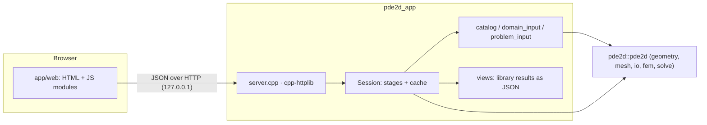

# The app

How the graphical interface in `app/` is built. How to use it is in
[app/README.md](../app/README.md).

**The app's design is delegated** (the owner, 2026-11-14). Agents make
the app's decisions themselves and record them in the decision list
below. The library's rules still hold: the app must not change the
library's design, and anything the app needs from the library is a
library change, raised with the owner as usual (see
[decisions.md](decisions.md)).

## Shape



- **One program, `pde2d_app`**, serves the page and a JSON API on
  127.0.0.1, and runs a saved case without the browser (`--run`).
- **The page holds no physics.** It edits a *case* (JSON), sends it to the
  server and draws what comes back. Every check is the library's own:
  the app forwards the library's messages with the path of the field
  they concern.
- **The page is generated from a catalog.** The server describes every
  component and its options (`GET /api/catalog`); the forms are built from
  that, so a new library component needs one catalog entry in C++ and no
  change to the page.
- **The library stays as it is.** The app uses only public headers,
  through the umbrella target `pde2d::pde2d`, which links every module.

## Files

| Path | Contents |
| --- | --- |
| `app/src/options.*` | `OptionSpec` (an option as the page sees it), `OptionReader` (reads a JSON object strictly against the specs), small JSON readers |
| `app/src/catalog.*` | the mesh and solve catalogs: every component, its options with the library's defaults, a function that builds it; `build_mesh_setup`, `build_solve_setup` |
| `app/src/domain_input.*` | the `geometry` section: shapes, SVG, mesh files, region edits; the geometry view |
| `app/src/problem_input.*` | the `problem` section: `build_problem`, `check_problem` (every error at once, with paths), the problem catalog and templates |
| `app/src/presets.*` | problem presets: a complete problem and its solve settings for any geometry, scaled by `DomainFacts` (`domain_input.*`: regions, domain size, a point well inside) |
| `app/src/views.*` | meshes, reports and sparsity as JSON |
| `app/src/session.*` | `Session`: the stages with their cache, solves as runs in chunks (`SessionOptions`, the background runner), `StageError`, the default case, presets, exports, `run` for the command line |
| `app/src/server.*`, `app/src/main.cpp` | HTTP (the only file that includes `httplib.h`) and the command line |
| `app/web/` | `index.html`, `style.css` (one dark theme, every colour a token), `js/`: `core.js` (pure helpers, tested in Node), `api.js`, `state.js`, `actions.js`, `settings.js` (preferences and their dialog), `dom.js` (forms from specs, info toggles, foldable sections), `view.js` (the picture: layers, isolines, probes, keyboard, PNG export), `timebar.js` (the time bar under the picture), `probes.js` (the probe list and u(t)), `charts.js` (the SVG line chart), `compare.js` (comparison with an exact solution), `panels/*.js` (one per step, `head.js`: the head of every step, `components.js`: the cards of component slots), `main.js` |
| `app/examples/` | example cases and an example SVG |
| `app/tests/` | `browser/` (the page in headless Chrome: `run.sh`, `harness.html`, `scenarios/*.js`), `session.cpp`, `solve.cpp` (the Solve step, with exact solutions), `runs.cpp` (runs in chunks against one call, stop and continue, every preset on a rectangle and an annulus), `server.cpp`, `web.test.mjs` (pure helpers, the stage registry), `web_actions.test.mjs` (overlapping requests, prerequisites, errors per input, the binary solve, following a run, Stop, presets, settings, debounced storage, with a mocked fetch) |
| `app/third_party/cpp-httplib/` | `httplib.h` 0.18.3 and its MIT license |

## The case

A case is the whole setup in one JSON object. Every section is read
strictly: a key the reader does not know is an error (a misspelt option
must not be ignored silently), and a missing value means its default.

```json
{
  "format": "pde2d-app-case",
  "version": 1,
  "notes": "free text",
  "geometry": {"source": "shape", "shape": "rectangle",
               "options": {"width": 2, "height": 1}, "region_edits": []},
  "mesh": {
    "spec": {"max_edge_length": {"absolute": null, "relative": 0.05}},
    "discretizer": {"type": "chord_length", "options": {}},
    "triangulator": {"type": "cdt", "options": {}},
    "refiner": {"type": "ruppert", "options": {"min_angle_degrees": 25}},
    "improvers": [{"type": "delaunay_flips", "options": {"use": "final_only"}}]
  },
  "problem": {
    "equation": {"a_xx": "-1", "a_yy": "-1", "f": "1"},
    "parameters": {"k": 0.1},
    "boundary_conditions": {"left": {"alpha": "1", "g": "0", "priority": 0}},
    "initial": {"u": "0"}
  },
  "assembly": {"t": 0, "max_time_order": 2},
  "solve": {
    "mode": "time",
    "linear_solver": {"type": "sparse_lu", "options": {}},
    "static": {"t": 0},
    "time": {"t0": 0, "t1": 1, "snapshots": 50,
             "method": {"type": "implicit_euler", "options": {}},
             "step": {"type": "fixed_step", "options": {"dt": 0.01}}}
  }
}
```

- `geometry.source` is `shape` (`shape`, `options`), `svg` (`svg`: the
  document's text, `name`) or `mesh_file` (`format`: `gmsh` or `pde2d`,
  `text`, `name`). Shapes and SVGs take `region_edits`: `{"op": "rename",
  "from", "to"}`, `{"op": "merge", "source", "target"}`, `{"op": "split",
  "region", "fraction", "first", "second"}`, applied in order with
  `CurveGeometry`'s methods. A mesh file takes `rename` and `merge` (not
  `split`: it has no curves); the app applies them to the imported
  `mesh::Mesh` (a renamed region keeps its tag; a merge moves the
  source's boundary edges to the target's tag and drops the source's
  name, renumbering the tags above it) and checks the result with
  `mesh::validate`. Errors name the edit (`geometry.region_edits[1]:
  ...`).
- A mesh file is not meshed again: the `Remesher` runs the refiner and
  the improvers on it (the discretizer and triangulator are not used).
- `mesh.refiner` may be `null` (no refiner). A length bound is
  `{"absolute": number or null, "relative": number or null}`.
- Problem coefficients are expression texts; an empty or missing one is
  not set. `priority` is a whole number.
- `assembly.max_time_order` (0, 1 or 2) is `Assembler::assemble`'s: which
  time terms are built.
- `solve.mode` is `static` (`StaticSolver` at `static.t`) or `time`
  (`Integrator` from `t0` to `t1` with `method` and `step`). The linear
  solver serves both. Only the chosen mode's part is read into the
  library's objects; the other is kept as written. A time run keeps the
  solution at `snapshots` + 1 equal times from t0 to t1. A case written
  before the solvers has `"solve": null`, which means the default
  section (a static solve).
- `view` and
  `notes` are free for the page and for people. The page keeps
  `view.region_edit_undo` (one undo record per region edit) and
  `view.condition_archive` (conditions of regions that are gone) there.
- `version` is checked: a whole number from 1 to the app's version; a
  case from a newer app is refused, not misread.

## The API

All on `127.0.0.1:8765` by default. Every POST body is a case (or, for
`/api/field`, `{"case", "field"}`, for `/api/preset` `{"case", "preset"}`,
and for a run's calls `{"job", ...}`) and must be sent as
`application/json`. A stage reads only the sections it needs (the page
sends only those: `requestCase`).

| Call | Gives |
| --- | --- |
| `GET /api/catalog` | the catalog (below) and the default case |
| `GET /api/default-case` | the case a new session starts with |
| `GET /api/examples`, `GET /api/examples/<name>.json` | the example cases |
| `POST /api/geometry` | loops (each curve sampled for drawing, with its region and kind), regions and lengths, bounding box, domain size; for a mesh file its boundary edges |
| `POST /api/mesh` | the mesh (flat arrays), stats, `target_met`, the resolved bound, every stage report |
| `POST /api/problem` | the check: `ok`, `errors` (`path`, `message`), facts per path, each condition's kind, time order, needed initial conditions |
| `POST /api/assemble` | the `MeshedProblem` report and Dirichlet nodes; the assembled operators' facts and sizes, a sparsity picture, the assembly report |
| `POST /api/solve` | starts the solve of the case, or finds the current one with the same inputs (see "Runs in chunks"), and answers its progress: `job` (the run's id), `state` (`running`, `done`, `failed`, `stopped`), `mode`, `times` of the snapshots ready, `min` and `max` over their values (exact doubles), `time_order` (assembly's, `Assembler::time_order`) and `problem_time_order` (as written), `free_unknowns`, the reports (`static_solver`, or one `integrator` report combining the chunks', with `chunks`), and `values`: `{"path": "/api/solve/values", "format": "float32le", "snapshots" (ready), "nodes", "bytes"}`. A time run adds `t0`, `t1`, `t` (reached) and `snapshots_total`; a failed one `error` (`stage`, `kind`, `message`). A static solve is `done` at once |
| `POST /api/solve/progress` | `{"job"}`: the same progress, now |
| `POST /api/solve/stop` | `{"job"}`: stops the run after the chunk that is running; its progress. A solve of the same inputs continues it |
| `POST /api/solve/values` | `{"job", "first", "count"}`: snapshots `first` to `first + count` (ready ones only) as `application/octet-stream`: float32, little-endian, snapshot after snapshot, each one value per mesh node (NaN for a value that is not finite) |
| `POST /api/preset` | `{"case", "preset"}`: the case with its `problem` and `solve` sections replaced by the preset for the case's geometry (see "Presets") |
| `POST /api/field` | values at the nodes (`null` where there is none) of `{"kind": "expression", "text"}`, `initial_u`, `initial_u_t`, `dirichlet` or `right_hand_side`, at `t` (default: `assembly.t`; the right-hand side is assembled at that t). The request has only `case` and `field`, and `field` only `kind`, `text` and `t`: another key is an error |
| `POST /api/export/<kind>` | a file: `mesh.pde2d`, `mesh.svg`, `geometry.svg`, `solution.csv` (x, y and u at every kept time, one row per node, full doubles), or the system assembled at `assembly.t` in Matrix Market form: `stiffness.mtx`, `damping.mtx`, `mass.mtx` (the free part, `coordinate real general`, 1-based; a zero operator has no entries) and `rhs.mtx` (`array`) |

A failure is `{"error": {"stage", "kind", "message"}}`. The HTTP status
is 400 for a body that is not JSON, 422 when the library refused the input
(`kind: "input"`, from `std::invalid_argument`) or an algorithm could not
finish (`kind: "algorithm"`, from `std::runtime_error`), and 500 for
anything else. A message that concerns a field starts with its path in the
case (`mesh.refiner.options.min_angle_degrees: ...`); the page marks that
field. When a component's constructor refuses its options and its message
names one of them (`RuppertOptions::min_angle_degrees must be ...`,
`fixed_step: dt must be ...`), the path is that option's, so the mark
lands on the field itself.

## The catalog

`GET /api/catalog` returns:

- `sections`: one per pipeline the page builds forms for. The mesh
  section has `settings` (the `MeshSpec` fields) and `slots`; a slot has
  an `id` (its key in the case), a `cardinality` (`one`, `optional` or
  `list`) and its `components`, each with `type`, `label`, `description`
  and `options`. An option has `name`, `label`, `description`, `kind`
  (`number`, `integer`, `choice`, `length_bound`), `default`, and
  `choices` or `unit` where they apply. The solve section has the
  `linear_solver` slot and `modes` (`static`, `time`), each with its
  `settings` and `slots` (`method` and `step` for `time`). Components of
  the solve section carry `traits`, read from the library's declarations
  of a default-built instance: a linear solver's `symmetric_matrix`
  requirement, a time method's supported `time_orders`.
- `shapes`: the ready-made shapes with their options.
- `problem`: the coefficients of the equation, of a condition and of the
  initial conditions in order, with the term each multiplies; help text;
  templates of common equations and conditions; `presets` (`id`,
  `label`, `description`).
- `default_case`.

## Adding a component

1. Add one entry to `make_mesh_catalog()` or `make_solve_catalog()` in
   `app/src/catalog.cpp`: its
   `type` (the component's `name()`), label, description, its options with
   defaults read from the library's options struct, and `make`, which
   builds the component from an `OptionReader`.
2. That is all for the page. `tests/session.cpp` and `tests/solve.cpp`
   check that every type equals `name()`; add its defaults to the
   defaults test.

Ranges are never checked in the app: the component's constructor
validates its options, and its message is shown at the field.

## The Solve step

`Session::solve` is cached like the other stages, keyed by the mesh,
problem and solve sections (not by `assembly`): the current run (see
"Runs in chunks"). The page shows the
solution in the picture as a field with one colour scale for every
snapshot (from `min` to `max`), so a colour means the same value at
every time. The **time bar** under the picture (play or pause, a slider,
the shown time with that snapshot's min and max) is the one control of
the shown snapshot (`store.solveFrame`); during a run it also shows how
far the run got.

**Probes.** A click on the picture (or Enter with the picture focused)
pins a probe, up to four; each keeps its colour slot while others come
and go. The list under the picture gives x, y and the shown field's
value there; for a run in time a line chart shows u(t) of every probe
over all snapshots with the shown time marked (a click on it shows that
snapshot). Values are interpolated page-side from the snapshot arrays
with the barycentric weights of the probe's triangle (`core.js`:
`meshGrid`, `locatePoint`, `interpolateAt`, `probeSeries`).

**Comparing with an exact solution.** The Solve result takes an
expression (kept in the case as `view.exact_solution`). The page asks
`/api/field` (kind `expression`) for it at every snapshot's time, the
shown one first, and subtracts it from u: max |u − exact| at the shown
snapshot and over all, a chart of the largest error per snapshot for a
run in time, and "Show u − exact in the picture" with one diverging
scale over every snapshot. The expression is checked by the library;
its error lands on the input. A new solution is compared again with the
same text.

## Runs in chunks

A time run is integrated in chunks that end on snapshot times. Each chunk
is one `Integrator::integrate(meshed, ta, tb, output, &last)` from the
state the previous chunk ended with (`IntegrationResult::final`, with its
velocities for time order 2); the library guarantees that a run that
lands on a time and one that starts there take the same steps. The
`Session` keeps one run at a time (`SolveJob`): its inputs' key, the
snapshots so far, the last state, the combined report.

- `Session::solve` runs the first chunk (one snapshot interval) before it
  answers, so the library's refusals (a time order the method does not
  support, a solver's requirement) are thrown as before and land on their
  field. With `SessionOptions::background_runs` (the server) a thread then
  runs the next chunks; without (the command line, tests) `solve` runs
  them all before it returns. Both use `advance`, the same code.
- Each chunk holds the session mutex only while it integrates; between
  chunks the runner releases it for a moment, so a problem check or a
  field is answered after at most one chunk.
- The next chunk's number of snapshot intervals is scaled so that it
  takes about `chunk_seconds` (0.4 s): between half and four times the
  last one, at least one interval.
- The combined `integrator` report adds up `steps`, `rejected_steps`,
  `linear_iterations`, `assemblies`, `prepares`, `snapshots`, takes the
  largest `max_linear_iterations`, `max_residual`, `max_dt`, the smallest
  `min_dt`, the first `t0` and the last `t1`, and adds `chunks`.
  `prepares` counts one more per chunk (each chunk prepares the linear
  solver once).
- A solve of the same inputs reuses the run: a running or done one is
  answered as it is, a stopped one continues, a failed one starts again.
  Other inputs replace it (the old one is dropped under the mutex: it
  holds expressions).
- **Exactness.** For implicit Euler and the implicit midpoint rule the
  state is U (and U' for time order 2), which `final` carries, so the
  snapshots of a chunked run are bit for bit those of one call
  (`tests/runs.cpp`). Newmark's state also has the acceleration, which
  `Solution` does not carry: each chunk's start computes it again from
  the equation (M2 a = b − B v − A u at the chunk's start), so the
  snapshots differ from one call by rounding (below 1e-8 of the largest
  value in the test).
- What a chunk cannot do: show progress or stop inside one snapshot
  interval. A run with few, long intervals still answers late; that needs
  a progress callback in the library (docs/library-requests.md, item 2).

The page (`actions.js`, `followRun`) polls the progress every 250 ms,
fetches only the new snapshots by range and shows the newest unless the
time bar was moved during the run (or the setting is off). The colour scale
is the range so far, so it can change while the run goes on. **Stop**
keeps what arrived; the step's dot says "stopped before the end", and
**Continue** solves again, which continues the run on the server. A change
of the case that changes the solve's inputs stops the run.

## Presets

`POST /api/preset` fills a whole problem for the case's geometry:
equation, parameters, a condition for every region (the heated preset
gives the first region its own), initial conditions and the solve section
(mode, linear solver, method, dt, t1, snapshots). Lengths and times are
scaled to the domain (`DomainFacts`): its size, and a point well inside it
with its distance to the boundary, found on a grid over the bounding box
(inside an odd number of loops, farthest from the sampled boundary) or
among the triangle centroids of a mesh file. Bumps are centred there with
a width of half that distance. The page names presets only by the ids the
catalog gives; every physical choice is in `presets.cpp`, which spells out
the sign conventions (−k Δu is `a_xx = a_yy = -k`; cooling is
`alpha = h, beta_n = 1, g = h u_out`). Each preset runs on the default
rectangle and on an annulus in `tests/runs.cpp` (finite, not zero;
Laplace gives u = x exactly; the bump, cooling and damped wave decay).

## Decisions

Made by agents under the delegation above. Change them freely when there
is a reason; record the new choice here.

- **A local web server with a browser page,** not a desktop toolkit:
  works from WSL with the Windows browser, needs no GUI library, and the
  page can be edited without rebuilding.
- **In this repository, behind `PDE2D_BUILD_APP`** (on by default), so a
  library change that breaks the app fails the same build and tests.
- **`pde2d::pde2d`** bundles the modules into one target; the modules stay
  separate libraries.
- **cpp-httplib, vendored** (one header, MIT, 0.18.3), used only in
  `server.cpp`; **nlohmann/json** from the system. Neither reaches the
  library.
- **No build step for the page**: plain JavaScript modules, no npm.
- **One case object** holds everything, including the SVG or mesh text,
  so a saved case is complete and can run on the command line.
- **Strict reading**: unknown keys are errors; ranges are left to the
  library, so there is one source of truth for every rule.
- **The server keeps the last result of each stage**, keyed by the case
  sections it was built from, so changing the problem does not remesh.
  All work runs under one mutex: SymEngine's reference counts are not
  thread-safe in this build, and the app has one user.
- **Only this machine can drive the server**: it listens on 127.0.0.1;
  API requests must name a loopback host (against DNS rebinding) and send
  JSON (which a cross-site form cannot).
- **Region edits carry their boundary conditions and undo exactly.**
  Adding an edit moves the conditions at once, as the library will apply
  the edit (a renamed region keeps its condition, the halves of a split
  copy it, a merged region takes its target's), and stores the earlier
  condition of every name it touched in `view.region_edit_undo`, one
  record per edit. Edits are undone last first, which restores those
  conditions exactly, whether or not the library accepted the edit. The
  case is consistent at every moment, so saving or reloading never loses
  a move. Any other change of the regions (another SVG or shape) is
  reconciled after the library accepts the geometry: a condition whose
  region disappears is kept in `view.condition_archive` and comes back
  with its region; a region without either gets u = 0 (`core.js`:
  `applyRegionEdit`, `undoRegionEdit`, `reconcileConditions`).
- **Only the latest answer counts.** Every request of a stage carries a
  generation, and every loaded case an id; an answer to an older request,
  or for a case that was replaced, is dropped. Conditions are synced only
  for the geometry that is still in the case.
- **Region names are arbitrary keys**: the page keeps region-keyed
  conditions in prototype-free dictionaries, so names such as
  `constructor` or `__proto__` (valid region names) behave like any other.
- **A case is normalized before it is shown** (`normalizeCase`): a missing
  or malformed section, down to the containers the forms write into
  (shape options, component choices and their options, region edits,
  each boundary condition), is replaced by the default's, with a notice, and
  a case the forms still cannot show is replaced by a new case instead of
  failing on every visit.
- **Request bodies are limited** to 64 MiB (`ServerOptions::
  max_body_bytes`); larger ones get 413.
- **Whole numbers are checked before they are narrowed** (`OptionReader::
  small_integer`, priorities): a value that does not fit is an error.
- **Fields are drawn with exact linear interpolation** per pixel; values
  given at some nodes only (Dirichlet values, b) are drawn as dots.
- **Colours** follow a fixed categorical order for regions (eight, then
  one neutral colour), one hue dark to light for values of one sign, and
  two hues around a neutral zero for values of both signs.
- **One dark theme** (2026-11-16, the owner's request; was: light and
  dark from the system setting). Every colour is a token on `:root` with
  `color-scheme: dark`; the contrasts are listed at the top of
  `style.css` (text at least 5.5:1, control borders and status dots at
  least 3.2:1). The field ramps and the smallest-angle colouring go
  through a middle stop (dark blue, clear blue, pale blue): a two-stop
  ramp from near-surface navy to pale blue had a grey, muddy middle where
  most triangles and values sit.
- **The browser keeps the current case** in local storage as a
  convenience; saving a case file is the reliable way to keep it.
- **One double-click starts it** (`app/Start pde2d app.cmd`, 2026-11-15).
  The `.cmd` only finds its WSL distribution and folder from its own path
  and runs `app/start-app.sh` there; the script holds all the logic
  (incremental build of `pde2d_app`, start, wait until `/api/catalog`
  answers, open the default browser), so it is the same in Linux. The app
  lives as long as the window: closing it stops the app, so no server is
  left behind unseen. A second start finds the running app and only opens
  the page. Pass the distribution name to `wsl.exe -d` unquoted: it takes
  quotes as part of the name.
- **The Solve step offers what pde2d_solve offers** (2026-11-15): a static
  solve or a time integration, every linear solver, time method and step
  controller from the solve catalog. Nothing is pre-checked in the app:
  a method that does not support the problem's time order, or a solver
  whose symmetry requirement a matrix misses, is refused by the library
  and its message is shown. The page only shows the declared traits as
  chips, and a hint when a static solve would drop time terms.
- **A new case's dt is 0.01**, not the library's default: `FixedStepOptions`
  has `dt = 0`, which its constructor refuses. The catalog still shows the
  library's default; only `default_solve_section` sets a usable step.
- **Snapshots are equal intervals of [t0, t1]** (at most 1000, the app's
  own limit, since each is a value per node sent to the page). A dt that
  does not divide the interval shortens steps to land on them, which makes
  the integrator prepare the linear solver again for each changed step:
  pick snapshots and dt so that they fit.
- **Time runs go in chunks that end on snapshot times** (2026-11-15; was:
  a long run blocked the app). The library's continuation
  (`integrate(..., &previous.final)`) gives progress, Stop and the
  snapshots during the run without a library change, at the price of
  granularity (one snapshot interval) and, for Newmark, a recomputed
  acceleration at each chunk start (see "Runs in chunks").
- **Every solve is a run with an id**, even a static one (done at once):
  one way for the page to get values (by run and snapshot range) and one
  progress shape. The values are no longer fetched by sending the case
  again.
- **One run at a time**, replaced by a solve of other inputs; a stopped
  run continues when the same inputs are solved again, since the server
  still has its state.
- **The first chunk runs inside `POST /api/solve`**, so the library's
  refusals keep landing on their fields; it is one snapshot interval, so
  the answer is quick.
- **A case change stops a running run** (the page sends Stop): the run
  would answer a question nobody asks any more and hold the server.
- **Typing stays instant** (2026-11-15). A keystroke used to redraw the
  picture (a per-pixel field raster), stringify the whole case for local
  storage and for every stage key (an SVG or mesh file included, several
  times), and send the whole case to the problem check. Now: stage keys
  are kept per section and recomputed only for the sections an edit
  names (`editCase(..., {sections})`; every edit must go through
  `editCase`); the picture is drawn only when something it shows changed
  (`Viewer.set` returns whether it drew; the legend is rebuilt only then);
  the case is written to storage 600 ms after the last edit and at once
  when the page is hidden or closed; a stage's request carries only its
  sections; the problem check runs after a pause (a setting) and an answer
  for a problem edited since is dropped. Measured in Chrome (heat annulus
  solved, colouring by u, 1280×800 at 2×): 50 input events in f took
  11.5 ms each before, 6.1 ms after on average and 0.38 ms each once the
  first one has updated the panel.
- **Pan and zoom move the last picture** (2026-11-15): during a gesture,
  at most one frame per animation frame shows the last full picture moved
  and scaled (`viewTransform`, `drawImage`); the full picture is drawn
  once the gesture pauses for 120 ms. What does not depend on the view is
  computed once: per mesh the quality buckets (one path per colour), per
  field the colour position of each node (interpolated per pixel instead
  of the value), per theme the colour tokens and tables. Measured: a pan
  frame took 34 ms before (a full redraw per move), now a move costs
  0.01 ms and the frame is a blit (16 ms per frame is the display's
  rate); the full redraw takes 4.2 ms at 1720×1328 pixels.
- **Every section folds** (2026-11-15): the title of each card and
  section is a button with `aria-expanded`; the state is remembered per
  section id in local storage (a per-viewer preference). Rarely changed
  ones start folded: the boundary discretizer and initial triangulator,
  the linear solver, every Reports section, region conditions when there
  are more than four regions. An error marked inside a folded section
  opens it (without changing the stored state).
- **Settings are the viewer's, not the case's** (2026-11-15): kept in
  local storage, read with `normalizeSettings` (a bad value takes its
  default). Problem check while typing (on/off, delay), playback speed,
  following the newest snapshot, significant digits, picture quality (the
  largest pixel ratio). Parallel assembly and solves are shown disabled
  with the note that the library request is recorded: visible and
  honest, not a dead control that pretends.
- **Presets come from the server** (2026-11-15) and are applied there,
  where the geometry is known: the page stays free of physics and
  presets are tested in C++ on two shapes. Applying one is undone from
  its toast.
- **The solution travels in binary** (2026-11-15): `POST /api/solve`
  answers the summary, `POST /api/solve/values` the values as float32
  (snapshots × nodes), decoded into one `Float32Array` per snapshot. JSON
  numbers took about 20 bytes a value and a parse; float32 takes 4, which
  matters at 1000 snapshots. Float32 is plenty for colours and the
  readout; `min` and `max` stay exact doubles in the summary (the colour
  scale), and the CSV export keeps full doubles. The values are asked for by
  run and snapshot range (since 2026-11-15, see "Runs in chunks"), so a
  run's new snapshots travel once. The Solve step estimates the size from the fresh mesh
  before a run and warns above 50 MB (the page keeps every snapshot in
  memory).
- **One stage registry** (`STAGES` in `web/js/core.js`): each stage's id,
  label, the case sections its result depends on, the stages that must be
  fresh first, its API call and its "running" text. `stageKey`, the
  store, the step tabs and panels, `runWithPrerequisites` (the Mesh,
  Assemble, Solve and Show buttons) and Run all all read it, so a new
  stage is one entry. A failure anywhere gives the same toast and opens
  the failing step.
- **Run all ends on the solution**: after a solve (from Run all or the
  Solve button) the picture colours by the solution. The colour choice
  lives in the store (`store.view.colorBy`); the toolbar only shows and
  sets it.
- **A problem check never queues behind a long stage.** The server runs
  everything under one mutex (the library's thread-safety rule), so a
  check sent during a mesh, assembly or solve would wait for it anyway;
  the page holds it and sends one check when the stage ends.
- **Errors belong to their input.** A stage's error keeps the key of the
  case it was produced for. Once the case changes, it is shown greyed out
  "for the previous input", its field mark is cleared, and the step's dot
  says outdated, not failed. Exports are offered only for results that
  are up to date, and the Problem step greys out a check of an earlier
  problem and says "Checking…" until the new one arrives.
- **Option errors land on their field**: `build_component` puts the
  option's name in the path when the library's message names one of the
  component's options as a word. The library's messages are not changed;
  a message that names no option keeps the path of the options object.
- **Number fields never write a guess**: text that is not a number yet
  marks the field "not a number" and leaves the case as it was; an empty
  option field means the default (as before), an empty parameter value
  is refused the same way.
- **Imported meshes take rename and merge.** `mesh::Mesh` keeps region
  names apart from the edges' tags, so both edits are a change of names
  and tags, with no geometry; the library's `validate` confirms the
  result. Split needs curves and stays refused, with a message saying
  so. The page's region editor offers rename and merge for mesh files.
- **The case remembers its file name** (the opened file's or example's,
  `case.json` for a new case) and whether it changed since it was opened
  or saved (an "unsaved changes" chip). New, Open and Examples keep the
  replaced case while their toast offers to restore it (12 s; a toast
  with a button stays longer than a plain one); afterwards it is dropped.
  Sections replaced by defaults when a case is read are listed in a
  notice that stays until dismissed: a toast was too easy to miss.
- **The assembled system exports as Matrix Market**, the format every
  sparse tool reads (SciPy, MATLAB, Julia): the free parts of A, B and M2
  and b, at `assembly.t`, so the system can be checked or solved
  elsewhere.
- **Fields are one column wide in the grid** (`.field` uses
  `minmax(0, 1fr)`): a long option name in a select no longer widens the
  panel on narrow screens.
- **Few words on screen** (2026-11-16, the owner's request). No lead
  paragraphs; descriptions of components, options, shapes and sections
  sit behind a small "i" toggle (a real button with `aria-expanded`, its
  text also the tooltip, `dom.js`: `infoToggle`); what stays printed is
  what the user needs now: errors, warnings, a hint that changes what to
  do. Plain labels: "min u", "max u", "Time order 1" (both orders only
  when assembly's differs from the problem's), "‖b‖₂, right-hand side".
- **Action and result first** (2026-11-16). Every step starts with a
  head that stays at the top while its panel scrolls: the title, the
  primary action (Solve becomes Stop during a run and Continue after a
  stop; Problem's is its preset menu; Geometry is read on its own) and a
  one-line status (running with the seconds, up to date, outdated,
  failed, stopped), with "Next: <step>" once the result is up to date
  (`panels/head.js`). The result follows; the settings come last, under
  a "Settings" rule. A result of an earlier case is shown muted.
- **Tabs always fit** (2026-11-16): five equal grid columns; in a sidebar
  narrower than 410 px (a container query) the dot sits above the label.
  The tabs take the arrow keys, Home and End.
- **The time bar lives under the picture** (2026-11-16; was: a slider
  and player in the Solve panel): what it controls is the picture, and at
  phone width it stays next to it. There is one copy, so they cannot
  disagree.
- **Probes and charts are page-side** (2026-11-16): the snapshots are
  already in the page as float32, so u(t) at a point is an interpolation,
  not a request. Charts are hand-written SVG (`charts.js`, no library):
  2 px lines, a hairline grid, round ticks, a marker at the shown time,
  a crosshair with values, the probe list as the legend, end labels left
  out where two would touch. Probe colours are series slots 1 to 4
  (validated as a set on the dark surface).
- **Dot fields read the nearest dot** (Dirichlet values, b): the readout
  under the pointer gives the value of the nearest node with a value
  within 8 px (`nearestValuedNode`).
- **Isolines** (2026-11-16): marching triangles on the P1 field
  (`core.js`: `isolines`), at levels evenly inside the colour scale
  (count from Settings). Over the field's own colours they are drawn
  light on a dark halo (lines in the field's colours would vanish);
  without the colouring, each line takes its level's colour.
- **The comparison asks the library per snapshot** (2026-11-16): one
  `/api/field` request per snapshot time. The library keeps the
  expression rules and its messages; the page only subtracts. It costs a
  request per snapshot (fast for the usual 50 to 100; a run of 1000
  snapshots takes a few seconds and shows its progress).
- **Save picture** (2026-11-16) saves the canvas as drawn (at the
  picture-quality pixel ratio) with the legend drawn underneath as a
  PNG, named after the case and the shown time (`pictureName`).
- **Keyboard** (2026-11-16): the picture is focusable (arrows pan, Shift
  for larger steps, + and - zoom, 0 fits, Enter pins a probe at the
  centre); file choosers are real buttons that open hidden inputs; every
  control has a visible focus ring.
- **Phone layout** (2026-11-16): below 860 px the tabs come first and
  stay at the top, the picture with its toolbar, time bar and legend
  stays under them (28% of the height), then the probes and the panel
  scroll. On a short screen (a phone held sideways) nothing sticks.
- **A real-browser test** (2026-11-16): `app/tests/browser/run.sh`
  starts `pde2d_app` on a free port with the page and a harness, runs
  each scenario in headless Chrome and fails on a failed check, a page
  error or a scenario that does not finish. CTest runs it as
  `app_browser` when Chrome is found (`PDE2D_CHROME`, Chrome or
  Chromium on PATH, or the Windows Chrome from WSL, which reaches the
  WSL port only after a moment: a page that did not load is tried
  again). `--shots DIR` saves a screenshot per scenario.
