# Architecture

How the code is organized now. The decisions behind it are in
[decisions.md](decisions.md); where it is heading is in
[vision.md](vision.md).

## Pictures first

The sections up to "Modules" are diagrams to look things up in; the rest
of the file is the detailed text.

| Question | Diagram |
| --- | --- |
| What goes into and comes out of each step? | [Data flow](#data-flow) |
| Which library may use which? | [Libraries](#libraries) |
| What is inside `Problem`, `MeshedProblem`, `AssembledProblem`, a matrix? | [What each object contains](#what-each-object-contains) |
| Where do facts and parameter values come in? | [A coefficient, from text to matrix](#a-coefficient-from-text-to-matrix) |
| How do mesh nodes map to matrix rows, and where do Dirichlet nodes go? | [Nodes and unknowns](#nodes-and-unknowns) |
| What happens inside `assemble`? | [Inside assemble](#inside-assemble) |
| What are the stages of meshing? | [Meshing pipeline](#meshing-pipeline) |
| In what order does a time step run? | [One time step](#one-time-step) |
| Which interfaces exist and what implements them? | [Interfaces and their components](#interfaces-and-their-components) |
| How does adaptive refinement go round (estimate, mark, refine)? | [Adaptive refinement](#adaptive-refinement-marking-in-pde2d_adapt-refinement-in-pde2d_mesh) |

## Data flow

Rectangles are steps (an object with one main function, or a function);
rounded nodes are data.

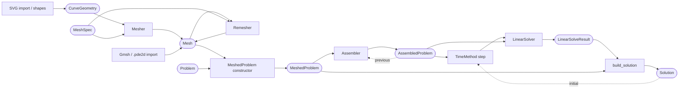

The `StaticSolver` and the `Integrator` are the drivers of
the right-hand part: each takes a `MeshedProblem`, calls the `Assembler`
itself, and returns a `Solution`. The static solver goes once through
Assembler → LinearSolver → build_solution; the integrator repeats
Assembler → TimeMethod step → LinearSolver for every time step and builds a
`Solution` for snapshots and at the end.

### Steps

| Step | Call | Takes | Gives | Library |
| --- | --- | --- | --- | --- |
| SVG import, shapes | `io::import_svg`, `geometry` shape functions, user code | a file or numbers | `CurveGeometry` | `pde2d_io`, `pde2d_geometry` |
| Mesh import | `io::import_gmsh`, `io::import_pde2d` | a file | `Mesh` (no curve links) | `pde2d_io` |
| Mesher | `Mesher::run(geometry, spec)` | `CurveGeometry`, `MeshSpec` | `MeshResult`: the `Mesh`, reports, `properties`, `target_met` | `pde2d_mesh` |
| Remesher | `Remesher::run(mesh, spec)` | `Mesh`, `MeshSpec` | `MeshResult` | `pde2d_mesh` |
| Combining | `MeshedProblem(mesh, problem)` | `Mesh`, `Problem` | `MeshedProblem` | `pde2d_fem` |
| Assembler | `Assembler::assemble(meshed, t, previous, max_time_order)`; `Assembler::time_order(meshed)` | `MeshedProblem`, a time, optionally the previous result, the highest time order to build (default 2) | `AssembledProblem`; the time order alone, from the formula facts | `pde2d_fem` |
| Linear solver | `requirements()` checked by the caller, then `prepare(matrix)`, then `solve(rhs)` | a `CsrMatrix` (for the check: its `always_symmetric` or `symmetric_now` fact, or `is_symmetric` of its values), a right-hand side | `LinearSolveResult` | `pde2d_solve` |
| Time method | `advance(assembled, dt, prepared, state)` | one `AssembledProblem` (at the method's evaluation point), the prepared solver, the state, dt | the next state (through a linear solve) | `pde2d_solve` |
| Building the solution | `build_solution(meshed, free_values, t)` | the short vector, `MeshedProblem` | `Solution` | `pde2d_solve` |
| Marking | `MarkingStrategy::mark(mesh, indicators)` | `Mesh`, one error indicator per triangle (the owner's estimate) | the marked triangles | `pde2d_adapt` |
| Refinement | `Remesher::refine(mesh, marked)` | `Mesh`, marked triangles | `RefinementResult`: the finer `Mesh`, reports, `properties`, optional `Parents` | `pde2d_mesh` |
| Mesh properties | `measure(mesh, warning_angle_degrees)` | `Mesh` | `MeshProperties`: counts, smallest/largest angle, shortest/longest edge, triangles below the warning angle | `pde2d_mesh` |

### Data

| Data | What it holds | Changes after it is built? |
| --- | --- | --- |
| `CurveGeometry` | validated loops of exact curves with region names; computed depth and parent | only region edits |
| `MeshSpec` | the target: length bounds, absolute or relative to the domain size | plain settings |
| `Mesh` | nodes, counterclockwise triangles, boundary edges with region and optional curve link, region names, chains | a plain struct |
| `Problem` | the equation's coefficients, boundary conditions by region name and initial conditions as `Expression`s (each with its facts), and the parameter values | a plain struct |
| `MeshedProblem` | the mesh and the problem; every expression compiled to a function of (x, y, t) with its facts; the Dirichlet nodes and the node ↔ unknown tables; ∇·A and the time derivatives of the Dirichlet data | never |
| `AssembledProblem` | at one time t: the operators mass, damping, stiffness (each a `free` and a `dirichlet` `CsrMatrix`), the load, the Dirichlet values, the right-hand side, its own facts, a report | never |
| `LinearSolveResult` | one value per free unknown, iterations, residual | never |
| `Solution` | one value per mesh node, the mesh, the time (and, for time order 2, one velocity per node) | a plain struct |

Every stage that does work also returns or holds a `StageReport` (time,
metrics, "worked, but…" messages).

## Libraries

An arrow means "may include and link". Dependencies point one way only.
The name on the right of each box is the outside library it uses, only
inside its `.cpp` files.

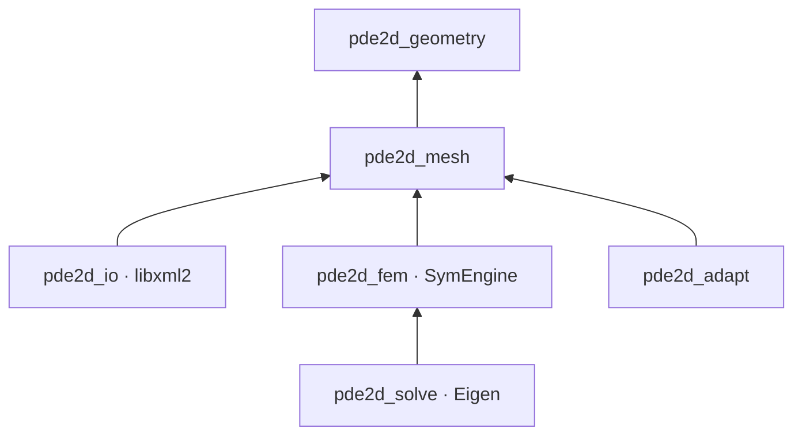

`pde2d_io` and `pde2d_fem` do not use each other. `pde2d_adapt` uses only
`pde2d_mesh` (and `pde2d_geometry` through it); fem and solve do not use
it, nor it them. The interface target `pde2d::pde2d` links all of them
for programs that use the whole library, such as the app (`app/`,
[app.md](app.md)), which sits on top and is never used by the library.

## What each object contains

A line with a diamond means "holds"; the number says how many.

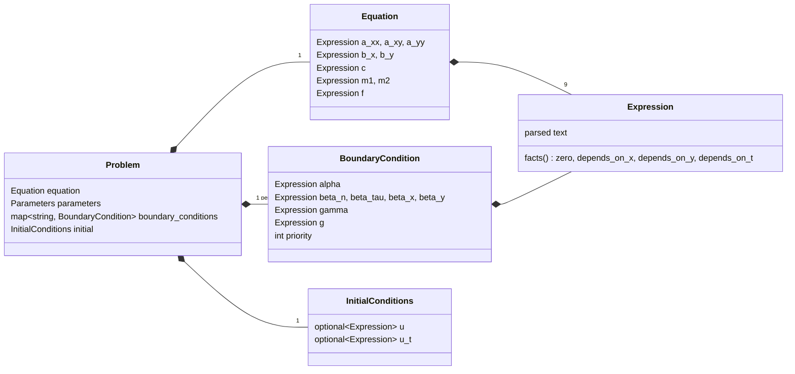

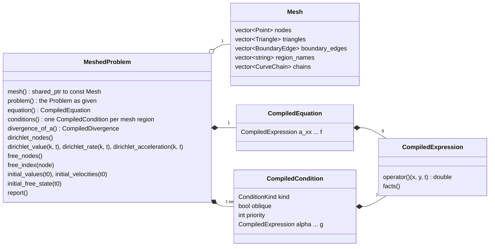

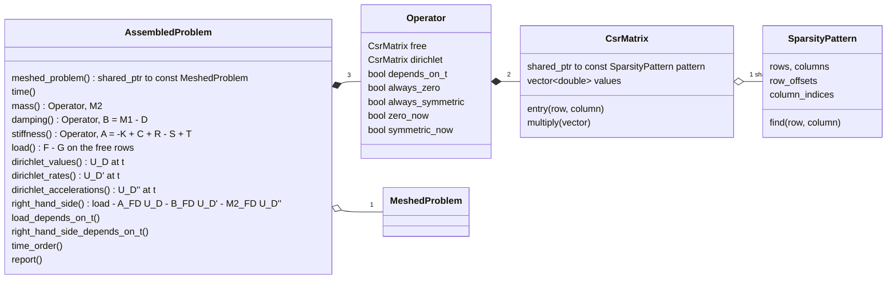

`free` is free rows × free columns (what a solver gets); `dirichlet` is
free rows × Dirichlet columns (it multiplies the known values). All `free`
matrices share one pattern object and all `dirichlet` matrices another.

## A coefficient, from text to matrix

The same coefficient at each stage, for `a_xx = "-k*(1+t)"` with `k = 1000`.

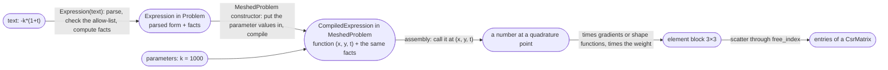

- Facts (`zero`, `depends_on_x`, `depends_on_y`, `depends_on_t`) are
  computed once, when the text is parsed, and travel with the expression.
  Assembly reads them to skip zero terms and to decide what to rebuild at
  a new t.
- Parameter names become numbers in the `MeshedProblem` constructor.
- Coefficient values are never stored: only the matrices are kept.
- Boundary conditions go the same way (`BoundaryCondition` →
  `CompiledCondition`, one per mesh region).

## Nodes and unknowns

The mesh numbers every node; the matrices have one row per node whose
value is unknown. `MeshedProblem` holds the tables. Example: 6 nodes,
nodes 1 and 4 on a Dirichlet region.

| mesh node | 0 | 1 | 2 | 3 | 4 | 5 |
| --- | --- | --- | --- | --- | --- | --- |
| kind | free | Dirichlet | free | free | Dirichlet | free |
| `free_index(node)` (node → row) | 0 | none | 1 | 2 | none | 3 |
| position in `dirichlet_nodes()` | | 0 | | | 1 | |

`free_nodes()` is the other direction (row → node): `[0, 2, 3, 5]`.

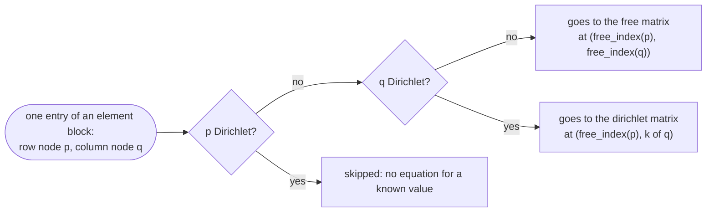

Who uses the tables:

| Use | Table | Where |
| --- | --- | --- |
| placing block entries | `free_index` | assembly (above) |
| moving known values to the right-hand side | `dirichlet_value(k, t)` and its two time derivatives | assembly: `right_hand_side` |
| starting values per node | `dirichlet_value(k, t0)` at Dirichlet nodes | `initial_values(t0)` |
| the solver's short vector back to all nodes | `free_nodes`, `dirichlet_value` | `build_solution` |

## Inside assemble

`Assembler::assemble(meshed_problem, t, previous, max_time_order)`.

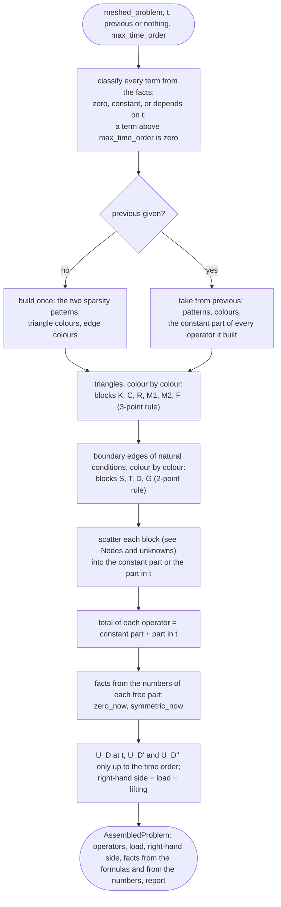

- Without `previous`, constant terms and terms in t are all computed.
  With it, only the terms in t are; the result is bit-for-bit the same.
- A zero term is never computed. An operator with no term in t is copied
  whole from `previous`.
- `max_time_order` 2 builds everything, 1 leaves out M2 (and U_D''), 0
  also M1 and D (and U_D'): A and the load only, the lifting
  load − A_FD·U_D. A left-out operator is a zero operator. An operator
  that `previous` did not build (it had a lower `max_time_order`) is built
  here in full, so the result stays bit for bit that of a fresh assembly
  at the same `max_time_order`.
- Two kinds of facts: the formula facts (`depends_on_t`, `always_zero`,
  `always_symmetric`) come from the plan and hold for every t; they alone
  decide the time order, reuse and what is built. The number facts
  (`zero_now`, `symmetric_now`) are read from each free part's values
  after the totals (`has_only_zero_entries`, `is_symmetric`), hold at
  this t only, and are implied by the formula facts. `Assembler::
  time_order(meshed)` makes the same plan at `max_time_order` 2 without
  assembling, so it equals `assemble(...).time_order()` at every t.
- The code has three pieces: computing a block (`element_blocks.cpp`, no
  shared state), scattering it, and the driver that loops over colours
  (`assembler.cpp`). Only the driver would ever know about threads.

## Meshing pipeline

`Mesher::run(geometry, spec)`; the part in the box is the `Remesher`,
which can also start from any `Mesh`.

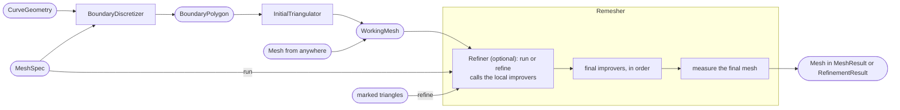

`run` gives a `MeshResult` (with `target_met`), `refine` a
`RefinementResult` (with the optional parents); both carry the
`MeshProperties` of the final mesh.

## One time step

`Integrator::integrate(meshed, t0, t1, output, initial)`; the problem
never changes, the state (`TimeState`: U, and for time order 2 also U' and
U'', one value per free unknown) lives inside the call.

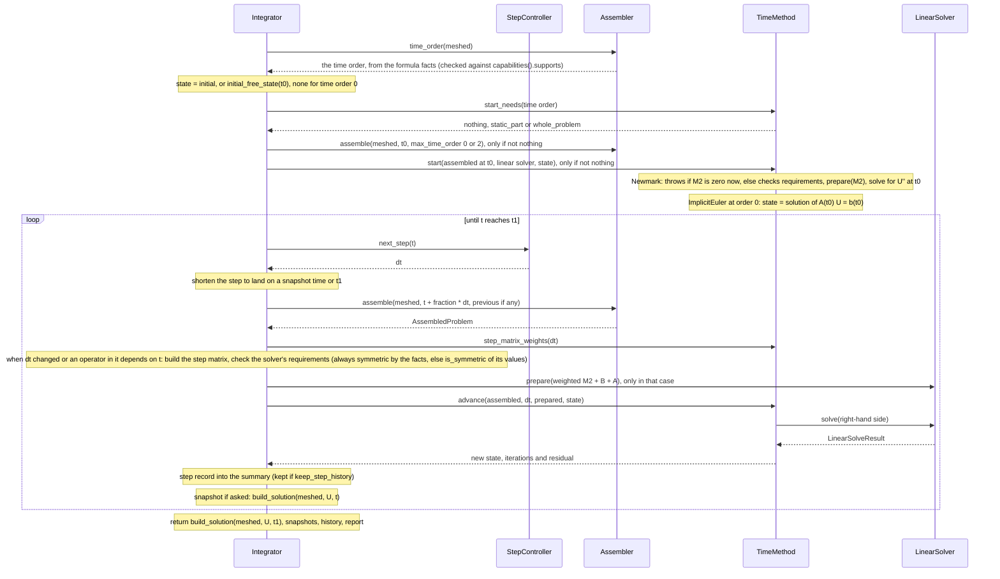

The `StaticSolver` is the same without the loop: assemble once with
`max_time_order` 0, check the solver's requirements against A's
facts (`always_symmetric`, else `symmetric_now`), one linear solve of stiffness·U = `right_hand_side()`
(= load − A_FD·U_D), then `build_solution`.

## Interfaces and their components

A component is passed in when the object that uses it is built
(`Mesher{discretizer, triangulator, refiner, improvers}`,
`Integrator(method, step_controller, linear_solver)`).

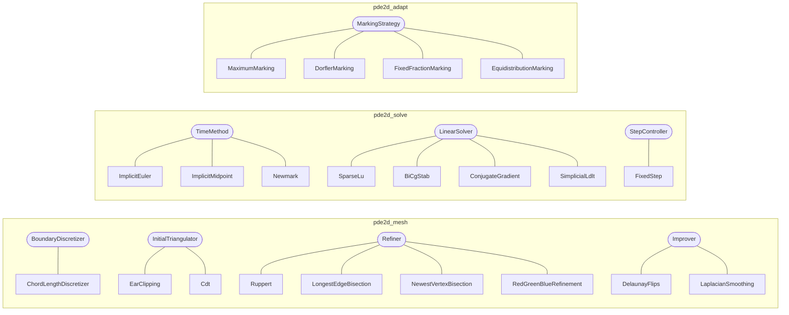

Rounded boxes are interfaces, rectangles implement them. An `Improver`
offers one or both roles, `LocalImprover` (called by a refiner) and
`FinalImprover` (a pass at the end). The curve kinds are not here: they
are a closed set held in a `std::variant` (see Geometry).

## Modules

```
include/pde2d/geometry/   src/geometry/   ->  library pde2d_geometry
include/pde2d/mesh/       src/mesh/       ->  library pde2d_mesh
include/pde2d/io/         src/io/         ->  library pde2d_io
include/pde2d/fem/        src/fem/        ->  library pde2d_fem
include/pde2d/solve/      src/solve/      ->  library pde2d_solve
include/pde2d/adapt/      src/adapt/      ->  library pde2d_adapt
```

`pde2d_mesh` depends on `pde2d_geometry`, and `pde2d_io` and `pde2d_fem`
each on `pde2d_mesh` (so on both), `pde2d_solve` on `pde2d_fem`, and
`pde2d_adapt` on `pde2d_mesh` only, never the reverse. Public headers are in
`include/pde2d/<module>/`; everything in `src/` is private, including the
private headers there (`src/mesh/*.hpp`, `src/io/*.hpp`, `src/fem/*.hpp`,
`src/solve/*.hpp`).
`pde2d_geometry`, `pde2d_mesh` and `pde2d_adapt` have no external
dependencies;
`pde2d_io` links libxml2 privately (only `src/io/svg_import.cpp` includes
it), and `pde2d_fem` links SymEngine 0.14 privately (only through the
private header `src/fem/symengine_expression.hpp`), and `pde2d_solve` uses
Eigen 3 (header-only) privately (only in the private header
`src/solve/eigen_view.hpp`, `sparse_lu.cpp` and `bicgstab.cpp`). The tests use
Boost.Multiprecision (header-only) in one place:
`geometry_predicates_oracle` checks the adaptive predicates against an
arbitrary-precision evaluation. The viewer tests need Node.js and are
skipped without it.

Namespaces: `pde2d::geometry`, `pde2d::mesh`, `pde2d::io`, `pde2d::fem`,
`pde2d::solve` and `pde2d::adapt`.

The graphical interface in `app/` (namespace `pde2d::app`) is not a
module: it is a program over the public headers, described in
[app.md](app.md).

### Files

| Path | Contents |
| --- | --- |
| `include/pde2d/geometry/` | `point.hpp`, `predicates.hpp` (exact `orient`, `incircle`), `bounding_box.hpp` (`BoundingBox`), `curve.hpp` (the curve kinds with their core methods, the `CurveKind` concept, `Curve`, functions built on the core), `polygon.hpp`, `curve_geometry.hpp` (`Loop`, `CurveGeometry`), `shapes.hpp` |
| `src/geometry/` | their implementation; `predicates.cpp` is Shewchuk's adaptive arithmetic, compiled with `-fno-fast-math -ffp-contract=off` |
| `include/pde2d/mesh/` | `mesh.hpp` (output `Mesh`, with optional chains and links; the refinement edge convention and `set_longest_edges_as_refinement_edges`), `mesh_spec.hpp` (`LengthBound`, `MeshSpec`), `domain_size.hpp` (what relative lengths multiply), `mesh_properties.hpp` (`MeshProperties`, `measure`, `default_warning_angle_degrees`), `curve_chain.hpp` (`CurveChain`, `CurveLink`, `default_corner_angle_degrees`), `boundary_polygon.hpp`, `working_mesh.hpp`, `report.hpp` (`StageReport`, `Parents`, `MeshResult`, `RefinementResult`), `components.hpp` (interfaces, improver roles, capabilities, `ImproverUse`, `PipelinePlan`, `plan_pipeline`), `delaunay.hpp` (shared flip routines), one header per component (the refiners `ruppert.hpp`, `longest_edge_bisection.hpp`, `newest_vertex_bisection.hpp`, `red_green_blue_refinement.hpp`), `remesher.hpp` (`RemesherOptions`, `Remesher` with `run` and `refine`), `mesher.hpp` (`MesherOptions`, `Mesher`) |
| `src/mesh/` | implementation; private headers `delaunay_internal.hpp`, `polygon_nodes.hpp`, `stage.hpp`, `local_improvers.hpp`, `edge_recovery.hpp`, `loop_chains.hpp` (joining a loop's curves into chains; shared by the discretizer and the Remesher), `boundary_split_policy.hpp` (the fixed, internal policy for splitting curved boundary edges), `boundary_split_steps.hpp` (its steps, a friend of `WorkingMesh`) and `mesh_validity.hpp` (the geometric validity check run by the `WorkingMesh` constructor) and `domain_size_policy.hpp` (the fixed definition of the domain size) and `edge_bisection.hpp` (the bisection core shared by the three bisection refiners: marked edges, closure, division patterns, parents, the `run` loop; `detail::check_marked`); `bisection_refiners.cpp` holds the three bisection refiners (each a rule for the core) |
| `include/pde2d/io/` | `svg.hpp` (SVG import/export of geometries, SVG pictures of meshes), `pde2d_mesh.hpp` (the old `.pde2d` format), `gmsh.hpp` (Gmsh import) |
| `src/io/` | implementation; libxml2 only in `svg_import.cpp`; private headers `svg_path.hpp` (path data parser), `text.hpp` (files and exact numbers) |
| `include/pde2d/fem/` | `expression.hpp` (`Expression`, `ExpressionFacts`, `Parameters`), `compiled_expression.hpp` (`CompiledExpression`), `problem.hpp` (`Equation`, `BoundaryCondition`, `InitialConditions`, `Problem`, `ConditionKind`, `classify`, the summaries), `meshed_problem.hpp` (`MeshedProblem` and its compiled parts), `csr_matrix.hpp` (`SparsityPattern`, `CsrMatrix`, `has_only_zero_entries`, `is_symmetric`), `assembled_problem.hpp` (`Operator`, `AssembledProblem`), `assembler.hpp` (`Assembler`) |
| `src/fem/` | implementation; private headers `symengine_expression.hpp` (the only file that includes SymEngine; `Expression::Impl`), `derivative.hpp` (`detail::derivative`, the only place derivatives are taken), `fact_summaries.hpp` (the summaries, written once for `Problem` and `MeshedProblem`) and `element_blocks.hpp` (assembly's pure element block functions); `assembler.cpp` holds the driver, patterns, colouring and `detail::AssemblyInternals` |
| `include/pde2d/solve/` | `linear_solver.hpp` (`LinearSolver`, `LinearSolverRequirements`, `PreparedLinearSolver`, `LinearSolveResult`), `sparse_lu.hpp`, `bicgstab.hpp`, `conjugate_gradient.hpp`, `simplicial_ldlt.hpp`, `solution.hpp` (`Solution`, `build_solution`), `static_solver.hpp` (`StaticSolver`, `StaticResult`), `time_method.hpp` (`TimeMethod`, `TimeMethodCapabilities`, `StartNeeds`, `StepMatrixWeights`, `TimeState`, `StepSolveInfo`), `implicit_euler.hpp`, `implicit_midpoint.hpp`, `newmark.hpp`, `step_controller.hpp`, `fixed_step.hpp`, `integrator.hpp` (`Integrator`, `IntegrationOutput`, `StepRecord`, `IntegrationResult`) |
| `src/solve/` | implementation; private headers `eigen_view.hpp` (`Eigen::Map` views of `CsrMatrix` and vectors), `iterative_solve.hpp` (the prepared solver shared by `BiCgStab` and `ConjugateGradient`), `requirements.hpp` (checking a solver's requirements against assembly's facts) and `vectors.hpp` (norms, residual, operator products); Eigen is included only in `eigen_view.hpp`, `iterative_solve.hpp` and the solver `.cpp` files (`sparse_lu.cpp`, `bicgstab.cpp`, `conjugate_gradient.cpp`, `simplicial_ldlt.cpp`); `time_methods.cpp` holds the three time methods |
| `app/` | the graphical interface (`pde2d_app`): `src/` (case format with its migrations and generated schema, the geometry sources with the drawing and the boundary locator, the mesh and solve catalogs, the stage cache, runs in chunks per client under two locks, comparisons and probes, exporters with a stored zip writer, problem presets, `--set` and `--sweep`, local HTTP server), `web/` (the page, plain JS modules, with the geometry editor on the picture), `examples/` (cases), `Start pde2d app.cmd` and `start-app.sh` (double-click launcher), `tests/` (`browser/`: the page in headless Chrome; `example_checks.json`: the examples' expected figures), `third_party/cpp-httplib/`; its own guide is `app/AGENTS.md`, its design `docs/app.md` and its decisions `docs/app-decisions.md` |
| `include/pde2d/adapt/` | `marking.hpp` (`MarkingStrategy`), one header per marking strategy (`maximum_marking.hpp`, `dorfler_marking.hpp`, `fixed_fraction_marking.hpp`, `equidistribution_marking.hpp`); refinement of marked triangles is `mesh::Remesher::refine` |
| `src/adapt/` | `marking.cpp` (the shared checks and the four strategies) |
| `tests/<module>/` | one test program per topic, registered in that directory's `CMakeLists.txt`; `tests/io/data/` holds hand-written `.msh` files; `tests/mesh/refinement_checks.hpp` holds the oracles of a refinement result (also used by `tests/adapt/cycles.cpp`) |
| `tests/support/` | `check.hpp` (test helper), `mesh_checks.hpp` (independent mesh oracles, including a brute-force overlap check in `check_valid_mesh`), `shapes.hpp` (test geometries) |
| `tools/` | `test.sh` (configure, build, ctest), `format.sh`, `mesh_viewer/` (the old browser viewer, unchanged except its README) |
| `examples/` | `mesh_viewer/produce_mesh.cpp` (meshes a plate with a hole, writes `.pde2d`), the viewer's startup example files (from the old code) |
| `docs/` | `decisions.md`, `architecture.md`, `vision.md`, `formats/pde2d-mesh.md` (the `.pde2d` format) |

## Geometry

| Type | Role |
| --- | --- |
| `Point` | a point or vector, with `+ - * dot cross norm distance` |
| `Line`, `QuadraticBezier`, `CubicBezier`, `EllipticalArc` | the kinds of exact curve, parameter `t` in [0, 1]; each owns its mathematics as methods (the core, listed in the `CurveKind` concept) |
| `Curve` | one curve of any kind, held by value (a class around a `std::variant` of the kinds); the same core methods, forwarded; `kind()` gives the variant |
| `BoundaryCurve` | a `Curve` and its region name |
| `Loop` | a closed list of `BoundaryCurve`s; built by the user |
| `CurveGeometry` | a validated set of loops with computed depth and parent |

Curve operations are of three sorts:

- **The core**, methods of every kind and of `Curve`: `validate`,
  `point_at`, `derivative_at`, `second_derivative_at`,
  `derivative_bounds`, `split`, `subcurve`, `reversed`, `transformed`,
  `bounding_box`, `exact_length`, `exact_length_parameter`. A method is in
  the core only if it needs the kind's own data. The `CurveKind` concept
  lists them and a `static_assert` checks every kind, so a kind that
  misses one does not compile.
- **Functions built on the core**, written once for every kind:
  `start_point`, `end_point`, `is_line`, `curve_length`,
  `parameter_at_length_fraction`, `bounding_box` of several curves.
  `curve_length` uses the kind's `exact_length` when it returns a value
  (lines, circular arcs) and integrates numerically otherwise.
- **Code that differs by kind but belongs to another module** (SVG path
  commands, mirroring for SVG): `std::visit` over `curve.kind()` with
  `overloaded{...}`, one handler per kind and no catch-all, so a new kind
  does not compile until it is handled there.

The formulas are ported from the archive. `orient` and `incircle`
are exact predicates: Shewchuk's adaptive-precision `orient2d` and
`incircle` (floating-point filter, then exact expansion arithmetic in
stages), with a slow exact-integer evaluation for the rare undecided case
whose coordinates lie outside [2^-200, 2^200], where the expansion
arithmetic could overflow or underflow. Outside that range the filter's
answer is used only if none of its products underflowed (an underflowed
product, magnified by a later one, can exceed the error bound); the
range check comes before the filter, so no stage runs unprotected. `predicates.cpp` is compiled with
`-fno-fast-math -ffp-contract=off` and refuses to compile under
`__FAST_MATH__` or with `FLT_EVAL_METHOD != 0` (x87 extended precision),
because the error-free transformations need every operation rounded on
its own. `polygon.hpp` has `signed_area` (relative to the first point, so a
small polygon far from the origin does not cancel), `polygon_orientation`
(exact: the turn at the lowest point, decided by `orient`; `CurveGeometry`
and `BoundaryPolygon` decide loop directions with it, because the sign of
an area underflows or overflows at extreme scales),
`locate_in_polygon` and `find_crossing` for polygons.
`bounding_box.hpp`: `BoundingBox{min, max}` with `merged`, `padded`,
`contains`, `width`, `height`, `diagonal`, and `bounding_box` of points.
The box of a curve is its core method `bounding_box()` (end points plus
the exact interior extremes: roots of the Bezier derivatives, axis
extremes of arcs); `CurveGeometry::bounding_box()` is the box of all its
curves. Every axis-aligned box in the library uses it (the
geometry's validation scale, SVG view boxes, the CDT's enclosing
triangle, the validity grid, the polygon sweep, curve linking).

`CurveGeometry` construction:

1. validate each curve and region name, and that every loop is closed
   (within 1e-9 of the geometry's size);
2. flatten every loop to a polyline close to the curves (deviation at most
   1e-6 of the size) and reject any crossing or touching with exact
   predicates;
3. depth of a loop = number of loops containing it; parent = the
   containing loop one level up. Depth and parent live in private vectors
   next to the loops, not in `Loop`;
4. normalize directions: even depth counterclockwise, odd depth clockwise,
   so the domain is always on the left.

Region editing (`rename_region`, `merge_region_into`, `split_region`) is
done by methods, because it must keep the names unique. Shapes (`circle`,
`ellipse`, `rectangle`, `annulus`, `rectangle_with_semicircle`, `polygon`,
`regular_polygon`) are functions returning a `CurveGeometry`.

## Meshing: data flow

```
CurveGeometry ──► BoundaryDiscretizer ──► BoundaryPolygon
                      (MeshSpec)               │ validate()
                                               ▼
                                     InitialTriangulator
                                               │
                                               ▼
                          WorkingMesh ──► Refiner (optional) ──► Improver ... ──► Mesh
                          └──────────────── Remesher ─────────────────────────┘
```

`Mesher{discretizer, triangulator, refiner, improvers}` runs the stages in
this fixed order. The last two run inside a `Remesher{refiner, improvers}`,
which can also start from a `Mesh` that came from anywhere, with or
without the geometry behind it. Improvers are given only to the `Mesher`
(or `Remesher`); the refiner learns which of them to call locally from
the assembled pipeline, never from its own options.

| Type | Role |
| --- | --- |
| `LengthBound{absolute, relative}` | a length limit: optional absolute length, optional multiple of the domain size; the smaller applies, none set means no limit; `resolve(bound, domain_size)`, `validate(bound, name)`; in `mesh_spec.hpp` |
| `MeshSpec{max_edge_length}` | the mesher's only external input besides the geometry; `max_edge_length` is a `LengthBound` with at least one value |
| `CurveChain` | consecutive exact curves treated as one path, measured by arc length `s`; cumulative lengths, `position(s)`, `point_at(s)` |
| `CurveLink{chain, s0, s1}` | which chain (index into the holder's chain list) and arc-length interval an edge approximates, `0 <= s0 < s1 <= length`; in `curve_chain.hpp`, with `default_corner_angle_degrees` (30) |
| `BoundaryPolygon` | loops of straight edges; per edge a region id and an optional `CurveLink`; the chains; region names |
| `WorkingMesh` | the mutable mesh the stages edit |
| `Mesh` | the output: `nodes`, `Triangle{nodes}`, `BoundaryEdge{nodes, region, link}`, `region_names`, `chains` (links and chains empty for an imported mesh); `validate(const Mesh &)` checks it like `WorkingMesh::from_mesh` |
| `ImproverUse` | `local_and_final`, `local_only`, `final_only`: in each improver's options |
| `PipelinePlan` | resolved at construction: indices of the local improvers and of the final passes, and the warnings |
| `StageReport` | `stage`, `time`, `messages`, `metrics` (name → number) |
| `MeshResult` | `mesh`, `reports` (the first is always "pipeline"), `properties` (the final mesh, measured once), `target_met` (`properties.longest_edge <= max_edge_length`), `max_edge_length` and `domain_size` (what the spec resolved to) |
| `RefinementResult` | what `Remesher::refine` returns: `mesh`, `reports`, `properties`, `parents` (`std::optional<Parents>`) |
| `Parents` | `triangles` (input triangle of each output triangle) and `nodes` (`{v, v}` or the input edge `{a, b}` of each output node); see "Parents" below |
| `MeshProperties` | `nodes`, `triangles`, `smallest_angle_degrees`, `largest_angle_degrees`, `shortest_edge`, `longest_edge`, `warning_angle_degrees`, `triangles_below_warning_angle`; from `measure(mesh, warning_angle_degrees)` in `mesh_properties.hpp` |
| `RemesherOptions`, `MesherOptions` | `warning_angle_degrees` (default `default_warning_angle_degrees` = 10, in [0, 60]) |

### Lengths and the domain size

`domain_size(...)` (`domain_size.hpp`) is the length that relative values
multiply. Its definition is a private policy (`domain_size_policy.hpp`,
fixed by the library like the boundary split policy): currently the
diagonal of the axis-aligned bounding box (`geometry::bounding_box`) of
the boundary. It is measured on the geometry's curves, on a mesh's chains
when it has them (the same curves, so exactly the same number), else on
its boundary nodes (an imported mesh: splitting a boundary edge at its
midpoint keeps the box). Settings never know the domain: the discretizer
resolves `max_edge_length` and `max_curve_deviation` against
`domain_size(geometry)`, each refiner resolves `max_edge_length` against
`domain_size(mesh)`, and the `Remesher` does the same for `target_met`.
Each reports `domain_size` and the resolved `max_edge_length` (and
`max_curve_deviation`) as metrics. Nothing is cached (GitHub issue #26).

### Chains

The discretizer joins consecutive curves of a loop into a `CurveChain`
unless the region changes or the boundary turns by more than
`corner_angle_degrees` (default 30°, `default_corner_angle_degrees`) at
the junction. The
turning angle is the angle between the end tangent of one curve and the
start tangent of the next; where a derivative vanishes at that end, the
second derivative's direction is used, then the curve's chord; a junction
without a usable direction is a break. A loop without any break is one
chain from the start of its first curve, so that point (the seam) is
always a node and links never wrap around.

Each chain is sampled as one path: `ceil(length / h)` pieces of equal arc
length, raised while a chord is longer than `h` or a piece may deviate from
its chord by more than `max_curve_deviation` (when set). For a piece across
junctions the bound is the maximum over its curve pieces of
`(1 - u) d0 + u d1 + M u (1 - u) / 2` (`d0, d1` the distances of the curve
piece's ends from the chord, `M` its second-derivative bound), which is
`M / 8` on one curve and does not grow at a smooth junction. Junctions
inside a chain are not forced to be nodes.

A linked boundary edge is split at `s = (s0 + s1) / 2`: binary search over
the chain's cumulative lengths for the curve, then length inversion
(`parameter_at_length_fraction`) inside it. An edge lying on one straight
curve is split at its chord midpoint (the same point without the curve's
rounding); an unlinked edge too. Chains live only on the meshing side.
The chain building is shared private code (`src/mesh/loop_chains.*`), used
by the discretizer and by the `Remesher` when it links a mesh to a
geometry, so both build the same chains.

### WorkingMesh

- Triangles are counterclockwise. Edge `i` of a triangle is opposite its
  vertex `i` (from vertex `i+1` to `i+2`), so the triangle is on its left.
- `neighbour(t, i)` is the triangle across edge `i`, or `no_index`.
- An edge without a neighbour is exactly one boundary edge, oriented with
  the domain on its left, with a region id and an optional curve link.
  Boundary loops never touch, so each boundary node has one outgoing
  boundary edge.
- Edits (`flip`, `insert_in_triangle`, `split_interior_edge`,
  `split_boundary_edge`, `try_move_node`, `set_refinement_edge`) keep all
  of this and return the triangles they touched (`split_interior_edge`:
  the two old indices, then the other half of each).
  `set_refinement_edge(t, edge)` rotates a triangle's vertices (and
  neighbours) so that `edge` becomes edge 0, its refinement edge. An edit that would
  invert a triangle throws and leaves the mesh unchanged.
- **Deletions.** Splitting a curved boundary edge may delete triangles and
  nodes. They stay as tombstones (`is_triangle_deleted`,
  `is_node_deleted`), so indices held by a refiner stay valid and new
  entries are always appended. `compact()` removes them and renumbers in
  index order; the `Remesher` calls it right after the refiner, so final
  passes never see tombstones, and `to_mesh()` never contains them.
  Boundary edges are never deleted.
- A split boundary edge keeps its region, and its link is split into two
  halves of the arc-length interval.
- The constructor validates everything (orientation, conformity, boundary
  edges matching the triangulation, no unused nodes, indices in range,
  links inside their chains), then the geometry (see "Geometric validity"
  below). So does `from_mesh()`, which the importers and the `Remesher`
  use, and `validate(const Mesh &)` runs the same checks on their own.
- `to_mesh()` lists boundary edges loop by loop in walking order, and
  copies the chains and each edge's link into the `Mesh`. `from_mesh()`
  takes them back, so a mesh refined once can be refined again on the
  true curves without the geometry.

### Geometric validity

A mesh can be connected correctly and still overlap itself, for example a
small triangle lying inside a big one with all six sides as boundary
edges. After the connectivity checks the constructor runs a geometric
check (private, `src/mesh/mesh_validity.*`). It rests on one identity:
when every triangle is counterclockwise and every interior edge is used
once in each direction, the number of triangles covering a point equals
the winding number of the boundary edges around it. So the triangles
overlap nowhere exactly when:

1. **no fold**: at every node, the triangles' angular sectors contain one
   reference direction exactly once (an interior node's triangles turn
   once around it, a boundary node's less than once; the reference is
   the outgoing boundary edge's direction there), decided with `orient`;
2. **no crossing boundary edges**: no two boundary edges cross or touch,
   except consecutive edges at their common node (this also rejects two
   nodes at the same place on the boundary and loops that touch);
3. **no piece inside another**: no node lies in or on a triangle that
   does not use it (exact `orient`), which also rejects a piece in the
   material of another (an island is fine only inside a hole).

Every decision uses exact predicates. Checks 2 and 3 use a uniform grid
over the nodes' bounding box with about one cell per triangle; each
triangle and boundary edge is listed in the cells its bounding box
touches. The cost is O(n) for meshes whose triangles are of similar size;
very long thin triangles or many boundary edges in one cell make it
slower (worst case quadratic) but never wrong. Errors name the node,
triangle or boundary edges ("Node 3 lies in triangle 0 but is not one of
its nodes ...", "Boundary edges 0 (0 -> 1) and 3 (3 -> 4) cross or touch
...", "The triangles around node 0 overlap: they turn around it 2 times
..."). Edits (flips, splits, moves) keep validity by construction and are
not re-checked.

### Splitting a boundary edge

`WorkingMesh::split_boundary_edge(k)` goes through the library's boundary
split policy, a private virtual interface (`src/mesh/boundary_split_policy.*`)
with one fixed implementation; it is not a user option. Its steps are
private too: static functions of `detail::BoundarySplitSteps`
(`src/mesh/boundary_split_steps.*`), which `WorkingMesh` names as a friend
so they can edit its internals. Only `split_boundary_edge`,
`is_unsplittable` and `BoundarySplitResult` are public. The steps, with
`a -> b` the edge, `c` the opposite vertex and `p` the split point:

1. **Direct** (`split_directly`): if `p` lies inside the angle at `c`, join
   it to `c` (two triangles replace one).
2. **Local re-triangulation.**
   - `p` outside the mesh (the curve bulges outwards): add the triangle
     `(a, p, b)` on the edge (`add_cap`), unless a neighbouring boundary
     edge crosses it.
   - `p` inside the mesh (the curve bulges inwards): first check the
     straight triangle `(a, b, p)`: no other boundary edge may cross it,
     no boundary node may lie in it, and no node on its new sides. Then
     insert `p` into the triangle containing it, force `a-p` and `p-b` by
     flips (`detail::recover_edge`, shared with the CDT), and cut off the
     region between them and the old edge with every node in it, which
     lies outside the true domain (`cut_off`). The region is
     bounded by forced edges, so deleting its triangles leaves no hole.
3. **Give up**: change nothing, mark the edge unsplittable
   (`is_unsplittable`) and return the reason. There is no chord fallback
   for linked edges.

Refiners never retry an unsplittable edge; they add a message to their
report and count `unsplittable_edges`, `retriangulated_splits` and
`deleted_nodes`. The target may then be missed, which `target_met` shows.

### Components and capabilities

Every stage is a virtual interface with `name()`. Each concrete component
takes its own options struct (designated initializers) in its constructor.

```cpp
class BoundaryDiscretizer { BoundaryPolygon run(geometry, spec, report); };
class InitialTriangulator { TriangulatorCapabilities capabilities();
                            WorkingMesh run(polygon, report); };
class Refiner             { RefinerCapabilities capabilities();
                            void run(mesh, spec,
                                     std::span<const LocalImprover *const> local,
                                     report);
                            std::optional<Parents> refine(mesh, marked,
                                     std::span<const LocalImprover *const> local,
                                     report); };
class Improver            { std::string name(); ImproverEffects effects();
                            ImproverUse use();
                            const LocalImprover *as_local();   // or null
                            const FinalImprover *as_final(); }; // or null
class LocalImprover       { std::string name();
                            size_t improve_around(mesh, touched); };
class FinalImprover       { void run(mesh, spec, report); };
```

Declarations:

- `ImproverEffects{flips_edges, moves_nodes, makes_delaunay,
  keeps_parents}`;
- `RefinerCapabilities{tolerates_flips, tolerates_node_moves,
  maintains_delaunay, keeps_parents}` (what the refiner accepts from local
  improvers, what its output keeps, and whether its own edits keep the
  parents);
- `TriangulatorCapabilities{supports_holes, supports_several_pieces}`;
- `ImproverUse` (from the improver's options) and the roles: `as_local()`
  and `as_final()` return the object to call in that role, or null for a
  role the improver does not have. `DelaunayFlips` derives from all three
  interfaces and returns itself from both; `LaplacianSmoothing` has only
  the final role. `LocalImprover` keeps `name()` because the refiner names
  each local improver in its report.

Checks:

1. **At construction** (`plan_pipeline`, called by `Remesher`, so also by
   `Mesher`): an improver runs locally if its mode allows it, it has a
   local version, and the refiner tolerates its effects (a Delaunay maker
   is refused by a refiner that maintains Delaunay). It runs as a final
   pass if its mode allows it and it has a final role. Both keep the list
   order. A mode that cannot be honoured is a **warning**, one per role,
   for example "delaunay_flips: ruppert already maintains Delaunay, so it
   runs only as a final pass" or "<name>: it has no final version, so it
   runs only locally"; so is a final pass that would make an already
   Delaunay mesh Delaunay (it still runs). Only a null component throws.
2. **When a run starts** (`Mesher::run`): the spec is valid, and the
   triangulator supports the geometry's holes and pieces.

The `Remesher` stores the plan (`plan()`, also on the `Mesher`) and a
"pipeline" `StageReport` (`pipeline_report()`) that every run copies to
the front of its reports. Its first message is the plan in words ("plan:
refiner ruppert; local: none; final: delaunay_flips,
laplacian_smoothing", or "plan: no refiner; ..."), followed by the
warnings; its metrics are `local_improvers` and `final_passes` (counts),
and its `time` is the time the planning took. Like every report it keeps
its structured fields, so times can be summed. The refiner calls
the local improvers after each change and reports the sum of their
returned counts as `local_improver_changes` (and one
`local_improver_changes.<name>` each).

Between stages the `Mesher` validates the `BoundaryPolygon` (no crossing
chords, orientation by depth, nesting), so a discretizer's mistake is
reported as such. After the last stage the `Remesher` measures the final
mesh once (`measure`, giving `MeshProperties`), and everything about the
final mesh is read from that one measurement: the target (`target_met`:
`properties.longest_edge` at most the resolved
`MeshResult::max_edge_length`) and the warning in the pipeline report
when triangles have an angle below `warning_angle_degrees` ("N of M
triangles have an angle below the warning angle of 10 degrees (the
smallest angle is ... degrees)"). Nothing is refused.
Failures are exceptions with specific messages; report messages only mean
"worked, but…".

### v1 components

| Component | File | Notes |
| --- | --- | --- |
| `ChordLengthDiscretizer` | `chord_length_discretizer.*` | chains sampled by equal arc length, chord ≤ h; options `max_curve_deviation` (a `LengthBound`, off by default), `corner_angle_degrees` (30) |
| `EarClipping` | `ear_clipping.*` | per piece: bridge holes, cut best-shaped ears first |
| `Cdt` | `cdt.*` | incremental Delaunay in an enclosing triangle, edge recovery by flips, outside removed, final flips |
| `Ruppert` | `ruppert.*` | makes its input Delaunay, splits encroached/long boundary edges, inserts circumcenters; `refine` inserts the marked triangles' circumcenters; options `min_angle_degrees`, `max_points`; accepts only local improvers without effects; does not keep parents |
| `LongestEdgeBisection` | `longest_edge_bisection.hpp`, `bisection_refiners.cpp` | the bisection core with longest edges (Rivara's longest-edge propagation path); option `max_points`; tolerates local flips and moves; keeps parents |
| `NewestVertexBisection` | `newest_vertex_bisection.hpp`, `bisection_refiners.cpp` | the bisection core with refinement edges; option `max_points`; tolerates local flips and moves; keeps parents |
| `RedGreenBlueRefinement` | `red_green_blue_refinement.hpp`, `bisection_refiners.cpp` | the bisection core marking all three edges, red division; option `max_points`; tolerates local flips and moves; keeps parents |
| `DelaunayFlips` | `delaunay_flips.*` | Lawson flips; both roles (`LocalImprover` and `FinalImprover`); option `use` (default `local_and_final`) |
| `LaplacianSmoothing` | `laplacian_smoothing.*` | interior nodes to neighbour average, inverting moves skipped; final role only; options `iterations`, `use` (default `final_only`) |

Shared routines that components call are plain functions in
`delaunay.hpp`: `is_locally_delaunay`, `flip_to_delaunay`,
`flip_to_delaunay_around`. Private shared code in `src/mesh/`:
`delaunay_internal.hpp` (Lawson with a touched list), `edge_recovery.*`
(forcing an edge by flips), `local_improvers.hpp` (calling and counting a
refiner's local improvers), `boundary_split_policy.*` and
`boundary_split_steps.*` (the policy and its steps), `loop_chains.*`
(joining a loop's curves into chains), `mesh_validity.*` (the geometric
validity check), `edge_bisection.*` (the bisection core shared by the
three bisection refiners: marked edges, closure, division patterns,
parents, the `run` loop; `detail::check_marked`, shared by every
refiner's `refine`).

### Remesher and curve links

`Remesher::run(mesh, spec)` uses the mesh's own chains and links: a mesh
made by the `Mesher` or `Remesher` carries them, so refining it again puts
new boundary points on the true curves. An imported mesh has none, and its
boundary edges are split at chord midpoints.

`Remesher::run(mesh, geometry, spec, corner_angle_degrees = 30)` is for a
mesh without links (any links it has are replaced). It first joins the
geometry's loops into chains with the same code and rule as the
discretizer, then links each boundary edge to the chain of its region that
contains both end points (within 1e-9 of the mesh size), taking the short
way along the chain. An edge whose ends lie on two different chains
(across a corner, a region change or the start of a closed loop) stays
unlinked and is split at its chord midpoint; the "curve_links" report
(right after "pipeline") counts `chains`, `linked_edges` and
`unlinked_edges`. A mesh region missing from the geometry, a boundary node
off its region's curves, or an angle outside [0, 180] is an error.

## Input and output (`pde2d_io`)

```
SVG file ──import_svg──► CurveGeometry ──export_svg──► SVG file
                                         (Mesher)
.msh file ──import_gmsh──► Mesh ──export_pde2d──► .pde2d ──► tools/mesh_viewer
.pde2d file ──import_pde2d──►  └──export_mesh_svg──► SVG picture
```

Every function has a `std::istream&` / `std::ostream&` form and a
`std::filesystem::path` form. Problems in the content throw
`std::invalid_argument` with a specific message; a file that cannot be
opened, read or written throws `std::runtime_error`.

| Function | Header | Notes |
| --- | --- | --- |
| `import_svg` | `svg.hpp` | `<path>` elements; all path commands onto `Line`, `QuadraticBezier`, `CubicBezier`, `EllipticalArc` (arcs converted on the unit circle, so any radius works; a nearly flat arc, sweep below 0.01 rad, becomes a `CubicBezier` through exactly its end points); region = `data-region`, else `id`; subpaths joined into loops by end points (a run may be reversed); holes by depth; `<g>` entered, metadata ignored; transforms, shapes, nested `<svg>`, DTDs rejected; user units; y flipped, (x, y) → (x, −y), after the runs are joined (so error messages give file coordinates); `CurveGeometry` then normalizes the reversed loop directions |
| `export_svg` | `svg.hpp` | points written as (x, −y), so `import_svg(export_svg(g))` gives the same numbers back; one `<path>` per run of one region in a loop; arcs in pieces of at most 90°; id = region name if unique and a valid XML id, else `pde2d_run_<k>` with `data-region`; shortest exact numbers |
| `export_mesh_svg` | `svg.hpp` | nodes drawn at (x, −y), the right way up like `export_svg`; triangles (light fill, grey edges) and one coloured `<path>` per region with `data-region` and a `<title>`; no nodes, no links |
| `export_pde2d` | `pde2d_mesh.hpp` | the old `PDE2D_MESH` format (`docs/formats/pde2d-mesh.md`): version 2 for one loop, 5 with `RESULT 0` for several; outer loop (through the lexicographically smallest boundary node) first; links dropped |
| `import_pde2d` | `pde2d_mesh.hpp` | versions 2–5; v1 and untagged edges rejected; result trailers checked and ignored; validated like a `WorkingMesh` (with the geometric check); records read as they come, never allocated for a claimed count first; no links |
| `import_gmsh` | `gmsh.hpp` | MSH 4.1 and 2.2 ASCII; 3-node triangles only; boundary edges must lie on line elements of one physical group of dimension 1 (its name, or `physical_<tag>`); triangles made counterclockwise; unused nodes dropped; no links |

Imported meshes have no chains or links, so the `Remesher` splits their
boundary edges at chord midpoints unless it is given the geometry.
Private code: `svg_path.*` (the path data parser, the SVG arc
conversion and the y mirror `mirrored_y`), `text.hpp` (files, exact number parsing and printing).

The mesh viewer (`tools/mesh_viewer/`) is the previous code's viewer,
unchanged. `examples/mesh_viewer/produce_mesh` writes a mesh for it.

## Problems (`pde2d_fem`)

```
text ──► Expression ─┐
                     ├─► Problem ──┐
         Parameters ─┘             ├─► MeshedProblem ──► Assembler ──► AssembledProblem
                   Mesh (shared) ──┘                      (at t, optional previous)
```

| Type | Header | Role |
| --- | --- | --- |
| `Expression` | `expression.hpp` | a scalar expression in x, y, t and named parameters, built from text (`Expression("1 + k*x*y")`); immutable, copies share the parsed form; `text()`, `facts()`; `Expression()` is zero |
| `ExpressionFacts` | `expression.hpp` | `zero`, `depends_on_x/y/t`, as written |
| `Parameters` | `expression.hpp` | `std::map<std::string, double>`: name → value |
| `CompiledExpression` | `compiled_expression.hpp` | an `Expression` with its parameters substituted, compiled to a function `(x, y, t) -> double`; keeps the expression's facts; `CompiledExpression()` is zero |
| `Equation` | `problem.hpp` | the coefficients `a_xx a_xy a_yy b_x b_y c m1 m2 f` of `a_xx u_xx + a_xy u_xy + a_yy u_yy + b_x u_x + b_y u_y + c u + m1 u_t + m2 u_tt = f`; unset ones are zero |
| `BoundaryCondition` | `problem.hpp` | `alpha beta_n beta_tau beta_x beta_y gamma g` of `alpha u + beta_n u_n + beta_tau u_tau + beta_x u_x + beta_y u_y + gamma u_t = g`, and `priority` (default 0) |
| `InitialConditions` | `problem.hpp` | `std::optional<Expression>` `u` and `u_t` |
| `Problem` | `problem.hpp` | `equation`, `parameters`, `boundary_conditions` (region name → condition), `initial` |
| `ConditionKind` | `problem.hpp` | `dirichlet`, `natural`, `dynamic`; `classify(condition)` and `is_oblique(condition)` |
| `CompiledEquation`, `CompiledCondition` | `meshed_problem.hpp` | the same members as `CompiledExpression`s; a condition also has its `kind`, `oblique` and `priority` |
| `DirichletNode` | `meshed_problem.hpp` | a node and the regions whose `g / alpha` is averaged there (one, or two at an equal-priority corner) |
| `MeshedProblem` | `meshed_problem.hpp` | `Problem` + `std::shared_ptr<const Mesh>`, checked and compiled, up to assembly |
| `CompiledDivergence` | `meshed_problem.hpp` | `x`, `y`: the compiled divergence of A = [[a_xx, a_xy/2], [a_xy/2, a_yy]] (`MeshedProblem::divergence_of_a()`) |
| `SparsityPattern`, `CsrMatrix` | `csr_matrix.hpp` | compressed sparse rows: `rows`, `columns`, `row_offsets`, `column_indices` (signed `Index`, sorted and unique per row), `find`; a matrix is a shared pattern plus `values`, with `entry(i, j)` and `multiply(x)`; the plain functions `has_only_zero_entries(matrix)` and `is_symmetric(matrix, relative_tolerance = 1e-12)` (\|a_ij − a_ji\| ≤ tol · max \|a\|, a missing entry counts as 0) read facts from the values |
| `Operator` | `assembled_problem.hpp` | one operator of the system: `free` (X_FF), `dirichlet` (X_FD); formula facts for every t: `depends_on_t`, `always_zero`, `always_symmetric` (of `free`, from the terms built); number facts at the assembled t: `zero_now`, `symmetric_now` (of `free`, from its values) |
| `AssembledProblem` | `assembled_problem.hpp` | the system M2 U'' + B U' + A U = b in the free unknowns at one t |
| `Assembler` | `assembler.hpp` | `assemble(meshed_problem, t, previous = nullptr, max_time_order = 2)`; `time_order(meshed_problem)`, the assembled time order from the formula facts, evaluating nothing |

```cpp
using namespace pde2d::fem;
Problem problem{
    .equation = {.a_xx = Expression("-k"), .a_yy = Expression("-k"),
                 .f = Expression("1")},
    .parameters = {{"k", 1000.0}},
    .boundary_conditions = {
        {"wall", {.alpha = Expression("1"), .g = Expression("0")}},
        {"inlet", {.beta_n = Expression("1"), .g = Expression("x*y")}}}};
auto meshed = std::make_shared<const MeshedProblem>(mesh, problem);
double a = meshed->equation().a_xx(0.5, 0.5, 0.0); // -1000
```

**Expressions.** SymEngine parses the text when an `Expression` is built
(`parse`, with `^` as power). Floating literals are restored in a bottom-up
pass that treats exactly integral power exponents as integers, including
after parameter substitution. Constant descendants are checked even when
a finite parent or substitution would hide them. The parsed form is then checked against the
allow-list (`detail::unsupported`, `src/fem/expression.cpp`), walking it
the way SymEngine's evaluator does: numbers (each must be finite as a
double, so `1e1000` and `10^400` are rejected), x, y, t, parameter names,
`pi` and `E`; `+ - * /` and powers; `sin cos tan asin acos atan sinh
cosh tanh exp log sqrt abs`; `Piecewise` whose last branch is `(value,
True)`, with conditions built from `< <= > >= == !=` (`Eq`, `Ne`) and
`And`, `Or`, `Not`, allowed only as `Piecewise` conditions. Anything else
throws `std::invalid_argument` naming it: a parse error, an unknown
function (`foo(x)`), a construct not on the list (`loggamma`, `Xor`,
`max`, `EulerGamma`; `atan2` is refused by name before parsing, because
SymEngine's parser turns `atan2(x, x)` into `pi/4` whatever the sign of
x), a complex value (`I`, `sqrt(-1)`), an infinite or undefined constant
(`oo`, `1/0`, `nan`), a constant part whose value is not a finite real
double (`exp(1000)`, `asin(2)`; evaluated once, also after parameters are
substituted), a condition used as a number
(`2*(x < 0)`), a `Piecewise` without a final unconditional branch (SymEngine's evaluator
would read past its branches). Constructs are added to the list one at a
time, each with a test against the standard library
(`tests/fem/expression.cpp`) and a tested derivative
(`tests/fem/derivative.cpp`, and in t through `MeshedProblem`). The facts are read off the parsed form:
`zero` when it is the number zero (SymEngine's parser already combines
like terms, so `x - x` is zero, but nothing more is simplified),
`depends_on_*` when the symbol is free in it. Free symbols other than x,
y, t are parameter names, unknown constants for the facts.
`CompiledExpression` checks the parameters (a plain symbol name other than
x, y, t, which the parser reads back as that symbol, so not `pi` or `E`; a
finite value), substitutes the values (an unknown name throws), checks the
substituted form again (`log(k)` with k = -1 is complex, `1/k` with k = 0
is infinite) and prepares SymEngine's `LambdaRealDoubleVisitor` (a tree of
`std::function`s; no LLVM in this build). A call does not check its
result. Calls may run in several threads at once: they only read the
prepared functions, and every allowed construct evaluates through standard
math functions without shared state (`tests/fem/expression_threads.cpp`,
also run under ThreadSanitizer and Helgrind). SymEngine itself is built
without thread-safe reference counting, so all symbolic work (building,
substituting, differentiating, compiling, dropping the last copy of an
expression) happens in one thread.

**Derivatives** are taken in one place, the private
`detail::derivative(expression, Variable::x | y | t)`
(`src/fem/derivative.hpp`). It runs SymEngine's differentiation with two
rules of its own: `abs`, which SymEngine leaves as an unevaluated
`Derivative`, becomes `d|u| = sign(u) du` with the sign written as
`Piecewise((1, 0 < u), (-1, u < 0), (0, True))` (0 at the kink), so
`d/dt abs(t - 1)` is `-Piecewise((1, 0 < 1 - t), (-1, 1 - t < 0), (0,
True))`; and a `Piecewise` is differentiated branch by branch with its
conditions kept, collapsing to the common value when all branches give
the same derivative. The expression itself keeps its `abs`; only its
derivative contains the sign. The result is checked against the
allow-list like text (`expression_from_form`), so a derivative that leaves
it (`d/dx 1e308*x^2` has an infinite number) throws. Every allowed
construct has a derivative inside the allow-list. It is used for
`d/dt (g / alpha)` (`time_derivative_of_quotient`), its second time
derivative, and the divergence of A (`divergence_of_a`), all in the
`MeshedProblem` constructor.

**Classification** (`classify`), by which coefficients are zero as
written: no spatial derivative and no `gamma` is Dirichlet (`alpha` must
be set: the value is `g / alpha`); a derivative with a normal part
(`beta_n`, `beta_x` or `beta_y`) is natural, or dynamic with `gamma`.
Rejected: no term at all, a boundary ODE (`gamma` without a spatial
derivative) and tangential only (`beta_tau` alone). `is_oblique`: `beta_tau`,
`beta_x` or `beta_y` is set.

**Summaries** are functions, computed from the facts every time, for a
`Problem` and for a `MeshedProblem` (one private template,
`src/fem/fact_summaries.hpp`): `time_order` (2 with `m2`, else 1 with `m1`
or any `gamma`, else 0), `coefficients_depend_on_t`, `data_depends_on_t` (`f` or
any `g`).

**`MeshedProblem` construction.** `mesh::validate` runs first, then:

1. region names are matched both ways (a condition for an unknown region
   or a mesh region without a condition is an error);
2. every condition is classified; `conditions()` is indexed by region id;
3. Dirichlet nodes: each boundary node has one incoming and one outgoing
   boundary edge; it is Dirichlet if either edge's region is. With one
   Dirichlet region it takes that one (Dirichlet beats natural and
   dynamic); with two, the higher `priority` wins and equal priorities are
   averaged. The other nodes are the free nodes, in index order: unknown
   `i` of the shrunk system is node `free_nodes()[i]`, and `free_index`
   goes back;
4. every expression is compiled with the parameters; an error names the
   coefficient ("Region 'wall', coefficient g: ..."). The
   time-independent winning boundary data is checked for finiteness at
   every Dirichlet node, independently of initial conditions. The
   competing values at Dirichlet corners are then compared: equal as written, never
   reported; otherwise, if one depends on t, reported as "may differ";
   otherwise evaluated at the node and reported when they differ;
5. the initial conditions that `time_order` requires are compiled (a
   missing one is an error; one that is not needed is ignored and one that
   depends on t is evaluated at the start time, each with a report
   message); for time order 1 or 2 so is `d/dt (g / alpha)` of every
   Dirichlet condition that depends on t, and for time order 2 its second
   derivative (with `detail::derivative`; a derivative outside the
   allow-list is an error). Each compiled initial
   condition is then compared with the boundary data that replaces it at
   the Dirichlet nodes, u with `g / alpha` and u_t with `d/dt (g /
   alpha)`, like the corners: when neither depends on t, both are
   evaluated at every Dirichlet node and compared exactly (the boundary
   data must be finite there, or it is an error), and a difference is one
   message with the count and the first three nodes; otherwise one message
   says they may differ;
6. the divergence of A is differentiated (`detail::divergence_of_a`,
   through `detail::derivative`) and compiled: `divergence_of_a()`;
7. the facts stay with each compiled function, and the summaries read
   them.

`dirichlet_value(k, t)` is the average of `g / alpha` over the regions of
`dirichlet_nodes()[k]` (with `std::midpoint`, so two large finite values
do not overflow; an error if not finite). `dirichlet_rate(k, t)` and
`dirichlet_acceleration(k, t)` average the first and second time
derivatives the same way; they exist for time order 1 or 2 and for time
order 2 respectively and throw `std::invalid_argument` below that. `initial_values(t0)` and
`initial_velocities(t0)` return `std::optional<std::vector<double>>`: u
and u_t at every mesh node at the start time t0 the time integrator
passes, computed on every call, or an empty optional when the time order
has no such values (no values for time order 0, no velocities below 2). At
a Dirichlet node they come from the boundary data (`dirichlet_value(k,
t0)`, and the average of `d/dt (g / alpha)` for the velocity), elsewhere
from the initial condition at `(x, y, t0)`. A t0 that is not finite (for
any time order) or a value that is not finite throws
`std::invalid_argument`. `initial_free_state(t0)` returns the same
initial conditions at the free nodes only (a `FreeInitialState` with
`values` and, for time order 2, `velocities`, indexed like
`free_nodes()`), evaluating no boundary data: the integrator starts from
it, so Dirichlet data whose time derivative is not finite at t0 (u = √t
from t0 = 0) stops only a method whose start reads the problem at t0:

```cpp
if (const auto u0 = meshed->initial_values(0.0)) // empty for time order 0
  for (std::size_t node = 0; node < u0->size(); ++node)
    use((*u0)[node]);
```

`report()` is a `mesh::StageReport` named "meshed_problem" with the time, the metrics
`regions`, `dirichlet_nodes`, `free_nodes`, `corners`,
`dirichlet_over_natural_corners`, `priority_corners`, `averaged_corners`,
`differing_corners`, `differing_initial_values` and
`differing_initial_velocities` (Dirichlet nodes where the initial
condition differs from the boundary data, or all of them when it may
differ), one message per differing corner, for example
"Corner at node 0 (0, 0): regions 'bottom' and 'left' (both priority 0)
give 0 and 1; their average 0.5 is used", one per initial condition
that is not needed or depends on t, and one per initial condition that
differs from the boundary data, for example "The initial condition u
differs from g / alpha at 4 of 5 Dirichlet nodes, where g / alpha is used:
node 0 (0, 0) has u = 1, g / alpha = 0; node 1 (0.5, 0) has u = 1, g /
alpha = 0.5; node 3 (0, 0.5) has u = 1, g / alpha = 0; and 1 more", or
may differ: "The initial condition u and g / alpha may differ at the 8
Dirichlet nodes, where g / alpha is used; one of them depends on t, so
whether they differ depends on the start time t0".

## Assembly (`pde2d_fem`)

```cpp
auto meshed = std::make_shared<const MeshedProblem>(mesh, problem);
const Assembler assembler;
AssembledProblem a = assembler.assemble(meshed, 0.0);
// static: a.stiffness().free * U = a.right_hand_side()
AssembledProblem b = assembler.assemble(meshed, 0.1, &a); // reuses a
// Only A and the load, and only U_D (no U_D', U_D''): time order 0.
AssembledProblem c = assembler.assemble(meshed, 0.0, nullptr, 0);
```

The system in the free unknowns (`MeshedProblem::free_nodes()`, the
Dirichlet nodes eliminated) is

```
M2 U'' + B U' + A U = b,   B = M1 - D,   A = -K + C + R - S + T,
b = (F - G) - A_FD U_D - B_FD U_D' - M2_FD U_D''
```

`mass()`, `damping()` and `stiffness()` are `Operator`s, each with a
`free` matrix (free rows and columns) and a `dirichlet` matrix (free rows,
column k is `dirichlet_nodes()[k]`). All `free` matrices share one
`SparsityPattern` object and all `dirichlet` matrices another; a solver can
view the arrays with `Eigen::Map` (the index type is signed). `load()` is
F - G, `dirichlet_values()`, `dirichlet_rates()` and
`dirichlet_accelerations()` are U_D, U_D' and U_D'' (rates only for
`time_order() >= 1`, accelerations only for 2, otherwise empty), and
`right_hand_side()` is b (a lifting product is left out when its operator
is zero).

**max_time_order** (0, 1 or 2, default 2; anything else throws
`std::invalid_argument`). 1 leaves out M2 and U_D''; 0 also M1 and D and
U_D': only A (K, C, R, S, T) and the load are built and only U_D is
evaluated, so b = load − A_FD U_D. A left-out operator is a zero operator,
so `time_order()` is at most `max_time_order`. The `StaticSolver` uses 0,
so it never evaluates a derivative of the boundary data it drops (d/dt
√t at t = 0, GitHub issue #35).

**Terms.** Interior, per triangle: K (a_xx, a_xy, a_yy), C (b and
`divergence_of_a()`), R (c), M1 (m1), M2 (m2), F (f). Boundary, per edge
of a natural or dynamic region: S (alpha), T (the tangential part), D
(gamma), G (g). On an edge with outward normal n and tangent tau (the
domain on the left), with κ_n = nᵀAn, κ_τ = nᵀAτ,
β̂_n = beta_n + (beta_x, beta_y)·n and β̂_τ = beta_tau + (beta_x, beta_y)·τ,
the condition is solved for u_n and substituted into (A∇u)·n = κ_n u_n +
κ_τ u_τ:

```
S_ij = ∫ κ_n alpha / β̂_n φ_i φ_j      T_ij = ∫ (κ_τ - κ_n β̂_τ / β̂_n) φ_i ∂τ φ_j
D_ij = ∫ κ_n gamma / β̂_n φ_i φ_j      G_i  = ∫ κ_n g / β̂_n φ_i
```

β̂_n = 0 at a quadrature point throws. Dirichlet regions have no boundary
term. Quadrature: barycentric (2/3, 1/6, 1/6) and rotations on triangles
(degree 2), 2-point Gauss–Legendre on edges.

**Facts.** Per term, from the facts of the coefficients feeding it
(zero as written, depends on t): K from A; C from b and div A; a boundary
term is zero when A is (κ = 0) or its own coefficient (alpha, gamma, g)
is. T is zero when A is, or when A is isotropic
(`MeshedProblem::a_is_isotropic()`: a_xy zero and a_xx − a_yy expands to
zero, decided symbolically in the `MeshedProblem` constructor; then
κ_τ = 0) and beta_tau, beta_x, beta_y are zero (then β̂_τ = 0). A term
depends on t when one of its non-zero factors (including β̂_n, and β̂_τ
for T) does. An operator is `always_zero` when every
term of it is zero and `depends_on_t` when one of them depends on t;
`time_order()` is 2 with a mass that is not always zero, else 1 with such
a damping, else 0 (lower than the problem's when a dynamic condition has
A = 0); `Assembler::time_order(meshed)` gives the same without
assembling. `always_symmetric`: M2 and B always (mass-like integrals), A
when C and every T are zero (K, R and S are symmetric); a zero operator
is symmetric. It is a fact from the terms, not a test of the values, and
holds up to rounding (the blocks are computed in full). The facts from
the numbers hold at the assembled t only: `zero_now` when every value of
`free` is zero (m2 = sin(t) at t = 0), `symmetric_now` when `free` is
symmetric to the default tolerance of `is_symmetric` (an anisotropic
diagonal A whose boundary edges are all axis-aligned, where T
vanishes); each is true when its formula fact is. Wherever A is not zero the
condition of a natural or dynamic edge is solved for u_n, so β̂_n ≠ 0 is
checked there even when every term of the edge is zero.
`load_depends_on_t()` reads F and G; `right_hand_side_depends_on_t()`
adds the lifting products: a non-zero operator with Dirichlet nodes whose
values (g / alpha of a used region) or, for the stiffness, whose own terms
depend on t.

**Structure** (private, in `assembler.cpp`). Each result has a small
`detail::AssemblyInternals`: the `max_time_order` it was built with, the
constant parts of the operators and load that have terms depending on t
(shared pointers, null otherwise), and a shared
`detail::AssemblyStructure`, built once and carried through `previous`:
the free index and the Dirichlet column of
every node; the two patterns, from one loop over the triangles (every node
pair (p, q) with p free adds column q to row p in the free or the
Dirichlet pattern; rows sorted, duplicates removed; boundary edges add
nothing); a greedy colouring of the triangles in index order (the smallest
colour not used by an earlier triangle sharing a node) and, in a separate
pass, of the boundary edges.

**Building.** The driver loops over the colours, inside a colour in index
order. For each element it calls a pure block function
(`detail::triangle_blocks`, `detail::edge_blocks` in
`src/fem/element_blocks.cpp`), which computes the full 3 x 3 (2 x 2)
blocks of the requested terms, summed per operator and split into a
constant set and a time set; then it scatters them: a Dirichlet row is
skipped, a Dirichlet column goes to the `dirichlet` matrix, the rest to
`free`, each slot found by binary search in its row. A constant term goes
to the constant arrays, a term depending on t to the time arrays. Each
total is the constant part, or constant + time elementwise when the
operator has terms in t (the constant part is then kept for reuse). With
`previous` (same `MeshedProblem` object, else `std::invalid_argument`),
the structure and the constant parts are taken over and only the terms in
t are computed; an operator without such terms is copied from `previous`.
An operator above `previous`'s `max_time_order` was not built there and is
built here in full. The result is the same bit for bit as a fresh
assembly at that t and `max_time_order`.

**Report** ("assembly"): time; metrics `free_nodes`, `dirichlet_nodes`,
`free_nonzeros`, `dirichlet_nonzeros`, `triangle_colours`, `edge_colours`,
`used_previous`, `max_time_order`, and `mass_rebuilt`, `damping_rebuilt`,
`stiffness_rebuilt`, `load_rebuilt` (1 when something of it was computed,
0 when reused whole or left out by `max_time_order`).

## Solvers and time integration (`pde2d_solve`)

```cpp
auto meshed = std::make_shared<const MeshedProblem>(mesh, problem);

// Static: the time terms dropped, A U = load - A_FD U_D at t.
StaticResult s = StaticSolver(std::make_shared<SparseLu>()).solve(meshed);

// In time.
const Integrator integrator(std::make_shared<ImplicitMidpoint>(),
                            std::make_shared<FixedStep>(FixedStepOptions{.dt = 0.01}),
                            std::make_shared<BiCgStab>());
IntegrationResult r = integrator.integrate(meshed, 0.0, 1.0,
                                           {.snapshot_times = {0.5}});
// Continuing the run.
IntegrationResult r2 = integrator.integrate(meshed, 1.0, 2.0, {}, &r.final);
```

**Linear solvers** (`linear_solver.hpp`). `LinearSolver::prepare(
std::shared_ptr<const CsrMatrix>)` returns a
`std::unique_ptr<const PreparedLinearSolver>`, which holds the matrix and
solves `solve(rhs) -> LinearSolveResult` (values, iterations, relative
residual |b − Ax| / |b| computed after the solve) as often as needed.
A solver declares `requirements()` (`LinearSolverRequirements{
symmetric_matrix}`); `prepare` sees only values, so the callers (the
`Integrator`, the `StaticSolver`, `Newmark::start`, `ImplicitEuler::start`)
check the requirements first (`detail::check_requirements`,
`src/solve/requirements.hpp`): a symmetry requirement is met when the
matrix is always symmetric by assembly's facts or symmetric now by its
values (`Operator::symmetric_now`, or `is_symmetric` of a step matrix,
`detail::check_step_matrix_requirements`). They throw
`std::invalid_argument` naming the caller, the solver and the matrix.
Definiteness is not a declared requirement: a solver that needs it
detects its failure and throws `std::runtime_error`.

| Solver | Requires | What it is |
| --- | --- | --- |
| `SparseLu` | nothing | Eigen's SparseLU with COLAMD; the matrix is copied once into Eigen's column-major format; a zero pivot throws `std::runtime_error` in `prepare`, a result that is not finite throws in `solve` |
| `BiCgStab` | nothing | `BiCgStabOptions{.tolerance = 1e-10, .max_iterations = 1000}`; Jacobi preconditioner; views our arrays through `Eigen::Map` without copying; starts from zero; non-convergence throws `std::runtime_error` |
| `ConjugateGradient` | symmetric | Eigen's ConjugateGradient with Lower \| Upper and Jacobi; `ConjugateGradientOptions` as for `BiCgStab`; converges only for a positive definite matrix, otherwise it does not reach its tolerance and throws |
| `SimplicialLdlt` | symmetric | Eigen's SimplicialLDLT with AMD (lower triangle, copied to column-major); no pivoting, so a zero pivot (singular, or indefinite needing pivots) throws `std::runtime_error` in `prepare`; a tiny pivot passes the factorization, so `solve` checks the relative residual against `SimplicialLdltOptions{.residual_tolerance = 1e-8}` and throws `std::runtime_error` above it |

The two iterative solvers share one prepared solver
(`detail::PreparedIterative<EigenSolver>`, `src/solve/iterative_solve.hpp`):
the right-hand side is scaled so that a tiny one still converges, a zero
one gives x = 0 with no iterations, and the measured residual decides
convergence (restarts while they halve it). An empty (0 × 0) system has an
empty solution. Eigen appears only in `src/solve/eigen_view.hpp`,
`src/solve/iterative_solve.hpp` and the solver `.cpp` files.

**Solution** (`solution.hpp`). `Solution{mesh, time, values, velocities}`;
`build_solution(meshed, free_values, t)` places the free values at
`free_nodes()` and `dirichlet_value(k, t)` at the Dirichlet nodes.
`velocities` is filled only by the `Integrator` for time order 2 (free
part from the state, Dirichlet nodes from `dirichlet_rate`), so that a run
can be continued.

**StaticSolver** (`static_solver.hpp`). Assembles at t with
`max_time_order` 0, checks the solver's requirements against
`stiffness().always_symmetric`, else `stiffness().symmetric_now`, solves `stiffness().free · U =
right_hand_side()` (= load − A_FD U_D at that order), and returns
`StaticResult{solution, reports}` with the reports "assembly" and
"static_solver" (free_unknowns, linear_iterations, residual).

**Time methods** (`time_method.hpp`). A `TimeMethod` declares
`capabilities()` (`TimeMethodCapabilities{time_order_0, time_order_1,
time_order_2}` with `supports(order)`), `evaluation_fraction()` (where in the step the
problem is assembled) and `step_matrix_weights(dt)` (`StepMatrixWeights{
mass, damping, stiffness}`: the step matrix is mass·M₂ + damping·B +
stiffness·A, so the integrator can build it and tell when it changes). It
declares `start_needs(time_order)` (`StartNeeds::nothing`, `static_part`
or `whole_problem`: what its start reads at t0), has `start(assembled at
t0, linear_solver, state)` (default: nothing; called only when the start
needs something) and `advance(assembled, dt, prepared, state) ->
StepSolveInfo`. The state is a
`TimeState{values, velocities, accelerations}` in the free unknowns. The
right-hand side the methods use is `right_hand_side()`, which already
holds the whole lifting.

| Method | Orders | Start needs | Assembled at | Step matrix | Right-hand side |
| --- | --- | --- | --- | --- | --- |
| `ImplicitEuler` | 0, 1, 2 | `static_part` at order 0 (start solves A(t0) U = b(t0)), else `nothing` | t + dt | M₂/dt² + B/dt + A | b + M₂(U₀/dt² + V₀/dt) + B U₀/dt; then V₁ = (U₁ − U₀)/dt |
| `ImplicitMidpoint` | 1, 2 | `nothing` | t + dt/2 | 2M₂/dt² + B/dt + A/2 | b + M₂(2U₀/dt² + 2V₀/dt) + (B/dt − A/2) U₀; then V₁ = 2(U₁ − U₀)/dt − V₀ |
| `Newmark` (β = 1/4, γ = 1/2) | 2 | `whole_problem` | t + dt | M₂/(β dt²) + γ B/(β dt) + A | b + M₂(U₀/(β dt²) + V₀/(β dt) + (1/(2β) − 1) W₀) + B(γ U₀/(β dt) + (γ/β − 1) V₀ + dt (γ/(2β) − 1) W₀) |

A zero operator adds nothing, so one set of weights serves every order of
a method: at time order 1 the M₂ terms are absent, at 0 (Euler only) also
the B terms, leaving A U₁ = b(t₁). At time order 2 Euler and midpoint step
the pair U′ = V, M₂ V′ + B V + A U = b (Euler: (U₁ − U₀)/dt = V₁; midpoint:
(U₁ − U₀)/dt = (V₁ + V₀)/2 with everything at the middle), V₁ eliminated;
they need no acceleration, so M₂ may be singular or zero at some time
(m2 = sin(t)²), and the midpoint step with M₂ = 0 is the first-order step.
Midpoint refuses time order 0 (U₁ = 2A⁻¹b − U₀ oscillates). None inverts B
or M₂ during the steps, so B may be singular (m1 = 0 with a dynamic
condition). `Newmark::start` solves M₂(t0) W₀ = b − B V₀ − A U₀ for the
starting acceleration, so M₂ must not be singular; when it is zero at t0
(`zero_now`, checked first) or the solve fails (M₂ singular at t0), it
throws `std::runtime_error` naming the cause and
`ImplicitMidpoint` and `ImplicitEuler`, which need no acceleration (no
fallback).

**Step control** (`step_controller.hpp`, `fixed_step.hpp`).
`StepController::next_step(t)`; `FixedStep({.dt = ...})`.

**Integrator** (`integrator.hpp`). `Integrator(method, step_controller,
linear_solver)`; `integrate(meshed, t0, t1, IntegrationOutput, const
Solution *initial = nullptr) -> IntegrationResult{final, snapshots,
history, report}`.

- The time order is `Assembler::time_order(meshed)`, from the formula
  facts without evaluating anything, checked against
  `capabilities().supports(order)`; when it is lower than
  `time_order(meshed)` (the order as written), the refusal says that time
  terms vanished in assembly.
- The state comes from `initial` (same mesh object; velocities required
  for time order 2) or from `initial_free_state(t0)` (the free nodes
  only; no boundary data is evaluated). At time order 0 there is no initial state (`initial` is
  only checked for its mesh and size): the method's start computes it.
- The problem is assembled at t0 only as far as `start_needs(order)`
  says (`static_part`: `max_time_order` 0, `whole_problem`: 2), and
  `start` is called only then; with `nothing` there is no assembly at t0,
  so boundary data whose rate is not finite at t0 (u = √t from 0) works
  with Euler and midpoint. After the start the state must have a value
  per free unknown, or the integrator throws `std::runtime_error`.
- Times: on a stretch of equal steps from an anchor, step k ends at
  anchor + k·dt; a step ending within 1e-9·dt of the next target (a
  snapshot time or t1) lands on it, and a step that would pass it is
  shortened. The anchor moves to every target landed on, so a run that
  lands on t1 and a run that starts there take the same steps.
- Each step assembles at `(1 − fraction)·t + fraction·t_new` with the
  previous result as `previous`, and prepares the linear solver only when
  there is none yet, dt changed, or an operator with a non-zero weight in
  the step matrix (and not `always_zero`) `depends_on_t`; formula facts
  only. Before each prepare it checks the solver's requirements: the
  step matrix is symmetric when every operator with a non-zero weight is
  always symmetric or always zero, else when `is_symmetric` holds for
  the step matrix about to be prepared.
- Each step's `StepRecord{t, dt, accepted, linear_iterations, residual,
  time}` updates a running summary and is kept only with
  `keep_step_history`; snapshots are taken at `snapshot_times` (strictly
  increasing in [t0, t1]; t0 keeps the start) and every `snapshot_every`
  steps, once per step. The summary becomes the report "integrator"
  (t0, t1, time_order, steps, rejected_steps, min_dt, max_dt,
  linear_iterations, max_linear_iterations, max_residual, assemblies,
  prepares, snapshots).
- Continuing a run from `previous.final` gives the same values bit for
  bit for the first-order methods when the long run lands on the split
  time; for `Newmark` the acceleration is computed again at the split
  time, so equal to rounding.

## Adaptive refinement (marking in `pde2d_adapt`, refinement in `pde2d_mesh`)

Adaptive refinement goes round three steps. The first, the error
estimate, is the owner's and not in the library (dashed). Marking
strategies are components of `pde2d_adapt`; refinement is
`Remesher::refine`, with the same refiners as meshing.

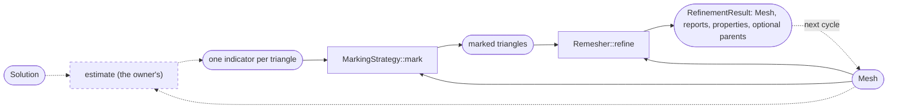

```cpp
Mesh mesh = Mesher(...).run(geometry, spec).mesh;
set_longest_edges_as_refinement_edges(mesh); // once, before the first cycle
const DorflerMarking marking({.theta = 0.5});
const Remesher refinement(std::make_shared<NewestVertexBisection>());
for (int cycle = 0; cycle < 10; ++cycle) {
  std::vector<double> eta = /* the owner's estimate on mesh */;
  RefinementResult r = refinement.refine(mesh, marking.mark(mesh, eta));
  // r.parents (if present): transfer the solution; else point location.
  mesh = std::move(r.mesh);
}
```

### Marking

`MarkingStrategy::mark(mesh, indicators)` takes one finite, non-negative
indicator per triangle (`std::span<const double>`, length
`mesh.triangles.size()`, else `std::invalid_argument`) and returns the
marked triangle indices in increasing order. It is not virtual: it checks
the input and applies the rules every strategy shares (a zero indicator
is never marked, so all zeros mark nothing; sorted, no repetitions), then
calls the strategy's private virtual `select`. Strategies, each with its
options struct validated in the constructor:

| Strategy | Options | Marks |
| --- | --- | --- |
| `MaximumMarking` | `theta` in [0, 1], default 0.5 | η_T ≥ θ · max η |
| `DorflerMarking` | `theta` in [0, 1], default 0.5 | the smallest set, largest first (ties by index), with Σ_M η² ≥ θ Σ η² (squares scaled by the largest indicator; both sums in the same order) |
| `FixedFractionMarking` | `fraction` in [0, 1], default 0.3 | the round(fraction · N) largest (nearest integer, halves up; ties by index) |
| `EquidistributionMarking` | `tolerance`, required, finite and > 0 | η_T ≥ tol / √N |

### Refinement edges

Every triangle's **refinement edge is the edge opposite its vertex 0**
(a convention of `Mesh` and `WorkingMesh`, documented in `mesh.hpp`).
The bisection refiners read it from the vertex order and write it into
the triangles they make (the newest vertex first, with
`WorkingMesh::set_refinement_edge`), so it persists across cycles without
a field in `Mesh`. The vertex order stays counterclockwise.
`set_longest_edges_as_refinement_edges(mesh)` (`mesh.hpp`) rotates every
triangle so that its longest edge is the refinement edge (ties: the
opposite vertex with the smaller node index); call it once on a mesh from
the Mesher, the Remesher or a file. Code that edits triangles (flips,
Ruppert, triangulators, Gmsh import) chooses vertex 0 freely: the mesh can
still be refined, but the shape guarantee needs the call again.

### Refiners refine marked triangles

Every `Refiner` has two calls: `run(mesh, spec, ...)` towards a
`MeshSpec`, and `refine(mesh, marked, ...)`, one refinement of marked
triangles. `Remesher::refine(mesh, marked)` calls the second with the same
plan, improvers and reports as `run`.

The three bisection refiners share one private core
(`src/mesh/edge_bisection.*`) and differ in one rule each
(`detail::BisectionRule`):

| Refiner | A marked triangle marks | A triangle not yet bisected in this step is bisected at |
| --- | --- | --- |
| `LongestEdgeBisection` | its longest edge | its longest edge (measured then) |
| `NewestVertexBisection` | its refinement edge (edge 0) | its refinement edge |
| `RedGreenBlueRefinement` | all three edges | its refinement edge; red where all three edges are split |

One step (`EdgeBisection::refine`):

1. mark the edges of the marked triangles by the rule;
2. split every marked edge, in the order they were marked. An edge is
   split only when it is the bisection edge of the triangles on both its
   sides; a side that must first be bisected at another edge pushes that
   edge on a stack, which is split first (the closure, so no node ever
   hangs: Rivara's longest-edge propagation path for longest edges, the
   recursive closure of newest vertex bisection otherwise). Interior
   edges are split at their midpoint (`split_interior_edge`), boundary
   edges by `split_boundary_edge` (the boundary split policy: the curve
   point of a linked edge, the chord midpoint otherwise). The new node
   becomes vertex 0 of every triangle the split makes, and a triangle a
   bisection made is bisected next at its edge 0, an edge of its parent;
3. `RedGreenBlueRefinement`: a triangle whose three edges were all split
   has the bisection pattern (bisected, both children bisected); one flip
   of the edge v0-m0 makes it red, and the four children are given the
   vertex order of the images of v0, v1, v2;
4. the local improvers run after every split (and every red division) on
   the triangles it made, as in every refiner; once an improver has
   changed the mesh, every triangle is bisected by the method's first rule
   (longest edges for `LongestEdgeBisection`, as in Rivara's propagation
   path), and an edge a flip removed before its split is not split.

Bisecting (v0, v1, v2) at the midpoint m of v1-v2 gives (m, v0, v1) and
(m, v2, v0). Red gives (v0, m2, m1), (m2, v1, m0), (m1, m0, v2),
(m0, m1, m2), m_i on the edge opposite v_i: each lists the images of
v0, v1, v2 under the similarity that maps the parent onto it, so its
refinement edge corresponds to the parent's. Green and blue are NVB
bisections and a red child is refined later like a copy of its parent,
so every triangle is similar to one that NVB alone makes from an initial
triangle: at most four similarity classes per initial triangle, and green
triangles need not be removed between cycles. Near curved boundaries this
does not hold (the curve points change the shapes); there red refinement
flattens triangles with two boundary edges on a smooth curve ("ears") by
half each cycle, NVB does not (see `red_green_blue_refinement.hpp`); the
mesh properties' warning shows it.

Special cases, each reported: triangles whose refinement edges wait for
each other in a cycle (possible only with refinement edges not set by
bisection or `set_longest_edges_as_refinement_edges`) have one edge split
out of order, so the mesh stays conforming but those triangles leave the
bisection pattern (`incompatible_splits`); an unsplittable boundary edge
leaves the triangles waiting for it unrefined (`unsplittable_edges`); a
red division that a curve point would invert keeps the bisection pattern
(`red_not_possible`).

`run` (until every edge is at most h) is a loop around the step: mark the
triangles with a longer edge, refine them, repeat until none is left or a
step splits nothing. `Ruppert` keeps its own quality loop for `run`; its
`refine` inserts the circumcenters of the marked triangles with its
encroachment rules (an encroaching circumcenter is replaced by splits of
the boundary edges it encroaches).

### Parents

`Parents{triangles, nodes}` (`report.hpp`): for each output triangle the
input triangle it lies in (a child of a curved boundary triangle may
stick out of it), for each output node `{v, v}` (input node v, which
keeps its index) or `{a, b}`, a < b (a node on input edge a-b: the
midpoint, or the curve point of a linked boundary edge). The bisection
core tracks them through its splits (a split reuses one index and appends
the other halves, which inherit the parent). They survive only if no
component made them untrue:

- the refiner declares `RefinerCapabilities::keeps_parents` (the three
  bisection refiners yes, `Ruppert` no) and its `refine` returned them
  (a bisection refiner returns none after a re-triangulating boundary
  split, with the reason in its report);
- every local improver and final pass of the plan declares
  `ImproverEffects::keeps_parents` (`DelaunayFlips` and
  `LaplacianSmoothing` do not).

Otherwise `RefinementResult::parents` is empty and the pipeline report
names each component that dropped them ("parents dropped: delaunay_flips
(local): it flips edges; ...").

### Remesher::refine

`Remesher::refine(mesh, marked)`: validates the mesh
(`std::invalid_argument`, "Remesher::refine: the input mesh is not
valid: ...") and the marked indices (out of range: `std::invalid_argument`);
needs a refiner; runs the refiner's `refine` with the planned local
improvers, compacts, runs the final passes (with a `MeshSpec` that has no
effective length bound, since refinement has no length target),
validates the result (a curve point bulging into another part of the mesh
is a `std::runtime_error`), measures it, and decides the parents.
Reports: pipeline, refiner, final passes. With nothing marked the refiner
changes nothing and the final passes do not run (the pipeline report says
so), so the mesh comes back unchanged. `refined_by_closure` counts every
unmarked input triangle that changed, including those a re-triangulating
boundary split replaced. Dörfler marking with θ = 1 marks every positive
indicator.

## Determinism

Results never depend on addresses or hash order (SymEngine's sets of
symbols are sorted by name before use): loops, curves, nodes,
triangles and boundary edges are processed in index order, queues are FIFO
or ordered by explicit keys with index tie-breaks, maps are ordered, and
`compact()` keeps the index order of what remains.
The same input gives the same mesh, bit for bit. Marking orders equal
indicators by triangle index; refinement marks edges in the order of the
marked triangles (sorted, repetitions removed) and splits them in that
order, each after the edges it waits for.
