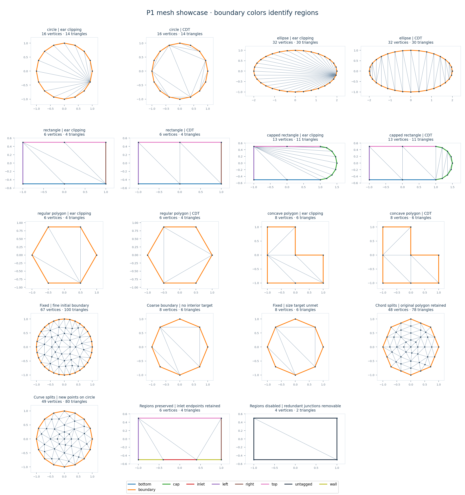

# Reproducible P1 mesh showcase

Open [the combined PNG gallery](gallery.png). Each panel also has a standalone
PNG and a `.pde2d` source file in this directory. All meshes have fewer than 500
vertices. The generator writes [manifest.tsv](manifest.tsv) with node/triangle
counts, size status, and report messages.



The first twelve panels compare ear clipping and CDT on the default circle,
ellipse, rectangle, capped rectangle, regular hexagon, and a custom concave
L-shaped polygon. These use default initial boundary settings and no interior
target. Further panels show:

- A fine fixed circle boundary with a `0.4` interior target.
- A coarse eight-edge circle outline with no interior target, then the explicit
  fixed-boundary conflict for the same `0.4` target.
- Straight-chord and analytical-curve refinement from that same coarse outline.
  Chord splitting retains the inscribed polygon; curve mode adds points on the
  circle. The initial curved deviation bound for this comparison is `0.15`.
- A rectangle with a split bottom inlet, with regions preserved or disabled.
  Length sampling is disabled for this straight outline to isolate region anchors.
  Colors identify regions; disabled regions have untagged edges and redundant
  smooth junctions may disappear. Geometric corners remain protected.

The panels illustrate geometry and topology, without a minimum-angle or FEM
accuracy claim. The fixed-conflict panel intentionally has an unmet size report.

## Reproduce

From the repository root, with a C++23 compiler and Python:

```sh
g++ -std=c++23 -Wall -Wextra -Werror -Icpp examples/meshing/showcase.cpp -o /tmp/pde2d-showcase
/tmp/pde2d-showcase docs/showcase
python3 -m venv .venv
.venv/bin/pip install -r tools/requirements-visualization.txt
.venv/bin/pip freeze > /tmp/pde2d-visualization-environment.txt
.venv/bin/python tools/plot_mesh.py --manifest docs/showcase/manifest.tsv --output-dir docs/showcase
```

Matplotlib is the only direct Python dependency. Its dependencies are installed
by pip inside the local venv; the requirements file pins the upstream Matplotlib
version. Rendering uses the noninteractive Agg backend and needs no browser,
display, or server. You may pass individual v1/v2/v3 mesh files instead:

```sh
.venv/bin/python tools/plot_mesh.py /tmp/rectangle.pde2d --output-dir /tmp/mesh-plots
```

The plotter reads nodes, triangles, exterior edges, and tags. It ignores the v3
metadata trailer and cannot restore curve context or replace the C++ validator.
Use `import_mesh_result` in C++ to resume curve refinement.

## Validation environment

Generated under WSL Ubuntu with C++23 and warnings as errors. This machine has
Matplotlib `3.10.7+dfsg1` preinstalled but lacks `ensurepip`; generation therefore
used `python3 -m venv --without-pip --system-site-packages .venv`, followed by the
explicit `.venv/bin/python` command above. No global packages were installed.
On a standard Python installation, use the isolated pip setup shown above;
Debian/Ubuntu may require the matching `python3-venv` system package first.

All 19 exported meshes were parsed and rendered. The learning and viewer
producer examples were also compiled and run, including export/import round
trips. Source: [showcase.cpp](../../examples/meshing/showcase.cpp),
[plot_mesh.py](../../tools/plot_mesh.py).
